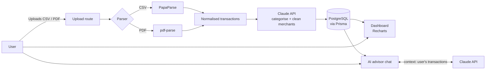

<div align="center">

# 💷 SpendSense

**An AI-powered personal finance assistant for people who can't afford a financial advisor.**

Upload your bank statements, see where your money goes, and get clear, personalised guidance from an AI advisor.

[](https://github.com/Elizabette01/spendsense/actions/workflows/ci.yml)


[Live demo](#) · [Report a bug](https://github.com/Elizabette01/spendsense/issues) · [Request a feature](https://github.com/Elizabette01/spendsense/issues)

</div>

---

## 📑 Table of contents

- [About the project](#-about-the-project)
- [Features](#-features)
- [Tech stack](#-tech-stack)
- [Architecture](#-architecture)
- [Project structure](#-project-structure)
- [Getting started](#-getting-started)
- [Environment variables](#-environment-variables)
- [Available scripts](#-available-scripts)
- [CI/CD pipeline](#-cicd-pipeline)
- [Development workflow](#-development-workflow)
- [Roadmap](#-roadmap)
- [Security and privacy](#-security-and-privacy)
- [Disclaimer](#-disclaimer)
- [License](#-license)
- [Author](#-author)

---

## 🧭 About the project

### The problem

Professional financial advice is expensive, so the people who would benefit most from it are often the least able to pay for it. Most people's financial picture is buried in bank statements they rarely read, and spending patterns only become obvious when something goes wrong.

### The solution

SpendSense turns raw bank statements into something you can understand and act on:

1. **Upload** a bank statement (CSV or PDF).
2. **Parse and categorise** every transaction automatically using AI.
3. **Visualise** spending through a clean dashboard.
4. **Ask questions** in plain English to an AI advisor that knows your actual spending.

### Why this project exists

SpendSense started life as a hackathon project. This repository is a **solo, from-scratch rebuild**, taking it all the way from ideation and UI design to deployment and a mobile app. It is built as a portfolio project, with a deliberate focus on **understanding every layer of the stack** over shipping as many features as possible.

---

## ✨ Features

### MVP

- 📤 **Statement upload:** import bank statements in CSV or PDF format
- 🧾 **Smart parsing:** extract dates, descriptions and amounts from messy, bank-specific formats
- 🏷️ **AI categorisation:** Claude classifies transactions (groceries, transport, bills, subscriptions, and so on) and normalises merchant names
- 📊 **Dashboard:** spending by category, trends over time and top merchants
- 💬 **AI advisor chat:** ask things like "Where can I cut back this month?" and get answers grounded in your own data
- 🔐 **Secure accounts:** authentication with NextAuth v5 (Auth.js)

### Phase 2

- 🔁 **Recurring payment detection:** spot subscriptions and direct debits automatically
- 🎯 **Budgets:** set monthly limits per category and track progress
- 🏪 **Merchant breakdown:** see exactly where your money goes, merchant by merchant
- 💡 **Proactive insights:** unprompted nudges such as "Your takeaway spending is up 40% this month"

### Future

- 🏦 Open Banking integration (no more manual uploads)
- 📈 Investment suggestions
- 🔔 Notifications
- 📱 Native mobile app (React Native / Expo)

---

## 🛠 Tech stack

| Layer | Technology | Why |
| --- | --- | --- |
| Framework | [Next.js 16](https://nextjs.org/) (App Router) | Full-stack React with server components and server actions |
| Language | [TypeScript](https://www.typescriptlang.org/) | Type safety across the frontend, backend and database |
| Styling | [Tailwind CSS v4](https://tailwindcss.com/) | Utility-first styling, configured in `globals.css` via `@theme` |
| Database | [PostgreSQL](https://www.postgresql.org/) | Reliable relational storage for financial data |
| ORM | [Prisma](https://www.prisma.io/) | Type-safe database queries and migrations |
| DB hosting | [Supabase](https://supabase.com/) | Managed Postgres |
| Auth | [NextAuth v5 (Auth.js)](https://authjs.dev/) | Open-source authentication for Next.js |
| CSV parsing | [PapaParse](https://www.papaparse.com/) | Fast, robust CSV parsing |
| PDF parsing | [pdf-parse](https://www.npmjs.com/package/pdf-parse) | Text extraction from PDF statements |
| AI | [Anthropic Claude API](https://docs.claude.com/) | Categorisation, normalisation and the advisor chat |
| Charts | [Recharts](https://recharts.org/) | Composable React charts |
| Deployment | [Vercel](https://vercel.com/) | Zero-config Next.js hosting with preview deploys |
| CI | [GitHub Actions](https://github.com/features/actions) | Lint, type-check and build on every push and PR |
| Mobile | [Expo](https://expo.dev/) (React Native) + EAS Build | Cross-platform mobile app |

---

## 🏗 Architecture



**How a statement flows through the app**

1. The user uploads a file through the upload page.
2. A server-side parser picks PapaParse or pdf-parse based on the file type.
3. Raw rows are converted into a common transaction shape (date, description, amount).
4. Claude assigns a category and a clean merchant name to each transaction.
5. Transactions are saved to PostgreSQL through Prisma, linked to the signed-in user.
6. The dashboard and the AI advisor both read from the same data.

---

## 📁 Project structure

> This structure grows as each step of the roadmap is built.

```
spendsense/
├── .github/
│   └── workflows/
│       └── ci.yml            # GitHub Actions: lint, type-check, build
├── prisma/
│   └── schema.prisma         # Database schema
├── public/                   # Static assets (icons, images)
├── src/
│   ├── app/                  # Next.js App Router
│   │   ├── (auth)/           # Sign-in / sign-up routes
│   │   ├── (dashboard)/      # Authenticated app routes
│   │   ├── api/              # Route handlers (upload, chat, auth)
│   │   ├── globals.css       # Tailwind v4 + design tokens (@theme)
│   │   ├── layout.tsx        # Root layout
│   │   └── page.tsx          # Landing page
│   ├── components/           # Reusable UI components
│   ├── lib/                  # Shared logic (db client, parsers, AI helpers)
│   └── types/                # Shared TypeScript types
├── .env.example              # Template for environment variables
├── eslint.config.mjs
├── next.config.ts
├── package.json
├── postcss.config.mjs
├── tsconfig.json
└── README.md
```

---

## 🚀 Getting started

### Prerequisites

- **Node.js** v20.9 or newer (`node -v` to check)
- **npm** (comes with Node)
- **Git**
- A **Supabase** project (free tier is fine) for PostgreSQL
- An **Anthropic API key** from the [Claude Console](https://console.anthropic.com/)

### Installation

1. **Clone the repository**

   ```bash
   gh repo clone Elizabette01/Spendsense_v2
   # or
   git clone https://github.com/Elizabette01/Spendsense_v2.git
   ```

2. **Move into the project folder**

   ```bash
   cd Spendsense_v2
   ```

3. **Install dependencies**

   ```bash
   npm install
   ```

4. **Set up environment variables**

   ```bash
   # macOS / Linux
   cp .env.example .env.local

   # Windows PowerShell
   Copy-Item .env.example .env.local
   ```

   Then fill in the values (see [Environment variables](#-environment-variables)).

5. **Set up the database**

   ```bash
   npx prisma generate      # generate the type-safe Prisma client
   npx prisma migrate dev   # apply migrations to your database
   ```

6. **Start the development server**

   ```bash
   npm run dev
   ```

7. Open **http://localhost:3000** in your browser.

---

## 🔑 Environment variables

Create a `.env.local` file in the project root. **Never commit this file.** It is already excluded by `.gitignore`.

| Variable | Required | Description |
| --- | --- | --- |
| `DATABASE_URL` | ✅ | Supabase Postgres connection string (pooled), used by the app at runtime |
| `DIRECT_URL` | ✅ | Supabase direct connection string, used by Prisma for migrations |
| `AUTH_SECRET` | ✅ | Random secret used by NextAuth to sign sessions. Generate with `npx auth secret` |
| `AUTH_URL` | ⚠️ Production only | The app's public URL (e.g. `https://spendsense.vercel.app`) |
| `AUTH_GOOGLE_ID` | Optional | Google OAuth client ID, if Google sign-in is enabled |
| `AUTH_GOOGLE_SECRET` | Optional | Google OAuth client secret |
| `ANTHROPIC_API_KEY` | ✅ | API key for Claude (categorisation and advisor chat) |

`.env.example` (committed to the repo) contains these keys with **empty values**, so anyone cloning the project knows what to set.

---

## 📜 Available scripts

| Command | What it does |
| --- | --- |
| `npm run dev` | Starts the local development server with hot reload |
| `npm run build` | Creates an optimised production build |
| `npm run start` | Runs the production build locally |
| `npm run lint` | Checks the code with ESLint |
| `npx tsc --noEmit` | Type-checks the whole project without producing output |
| `npx prisma studio` | Opens a visual browser for the database |
| `npx prisma migrate dev` | Creates and applies a new database migration |

---

## 🔄 CI/CD pipeline

### Continuous integration (GitHub Actions)

Every push and pull request triggers `.github/workflows/ci.yml`, which runs:

1. **Install:** `npm ci` (a clean, reproducible install from `package-lock.json`)
2. **Lint:** `npm run lint`
3. **Type-check:** `npx tsc --noEmit`
4. **Prisma client:** `npx prisma generate`
5. **Build:** `npm run build`

If any step fails, the check goes red and the pull request can't be merged.

### Continuous deployment (Vercel)

- **Push to `main`** → automatic production deploy
- **Open a pull request** → automatic **preview deployment** with its own URL, so changes can be tested before merging
- Environment variables are stored securely in the Vercel dashboard, never in the repo

### Branch protection

`main` is protected:

- Changes go through pull requests, not direct pushes
- CI must pass before merging

---

## 🌿 Development workflow

### Branching

```bash
git checkout main
git pull
git checkout -b feat/csv-upload
# ...make changes...
git push -u origin feat/csv-upload
# then open a pull request on GitHub
```

Branch names follow the commit types: `feat/…`, `fix/…`, `chore/…`, `docs/…`.

### Commit messages

This project uses [Conventional Commits](https://www.conventionalcommits.org/):

```
type(scope): short description in the imperative mood
```

| Type | Use for |
| --- | --- |
| `feat` | A new feature |
| `fix` | A bug fix |
| `chore` | Setup and maintenance |
| `docs` | Documentation only |
| `refactor` | Code changes that don't alter behaviour |
| `style` | Formatting only |
| `test` | Adding or updating tests |
| `ci` | Pipeline and workflow changes |
| `build` | Dependencies and build configuration |
| `perf` | Performance improvements |

**Examples**

```
feat(parser): add PDF statement support
fix(auth): redirect to dashboard after sign-in
ci: add type-check step to workflow
docs: add environment variable table to README
```

---

## 🗺 Roadmap

- [x] **0. Design:** web, responsive and mobile screens designed in Figma
- [ ] **1. Project setup:** repo, Next.js scaffold, CI, Vercel *(in progress)*
- [ ] **2. Database schema:** users, accounts, statements, transactions, categories (Prisma + Supabase)
- [ ] **3. Authentication:** NextAuth v5 sign-in, sessions and protected routes
- [ ] **4. File upload and parsing:** CSV (PapaParse) and PDF (pdf-parse) into normalised transactions
- [ ] **5. AI categorisation:** Claude assigns categories and cleans merchant names
- [ ] **6. Dashboard:** spending by category, trends and top merchants (Recharts)
- [ ] **7. AI advisor chat:** conversational advice grounded in the user's data
- [ ] **8. Phase 2 features:** recurring payments, budgets, merchant breakdown, proactive insights
- [ ] **9. CI/CD hardening:** tests in the pipeline, environment management, monitoring
- [ ] **10. Mobile app:** React Native with Expo and EAS Build

---

## 🔒 Security and privacy

Financial data is sensitive, so SpendSense is built with privacy in mind:

- **No secrets in code.** All keys live in environment variables, never in the repository.
- **User isolation.** Every transaction is tied to its owner, and queries are scoped to the signed-in user.
- **Minimal data sent to AI.** Only the transaction fields needed for categorisation or advice are sent to the Claude API. No account numbers or personal identifiers.
- **No real data in the repo.** Sample statements used for testing are fake.

Found a security issue? Please open a private report through GitHub's **Security → Report a vulnerability** rather than a public issue.

---

## ⚠️ Disclaimer

SpendSense provides **general information and educational insights only**. It is **not** regulated financial advice. For decisions with significant financial consequences, consult a qualified financial adviser.

---

## 📄 License

Distributed under the **MIT License**. See [`LICENSE`](LICENSE) for details.

---

## 👩🏾‍💻 Author

**Elizabeth Nduka**

Frontend developer and MSc Computing graduate (University of East London).

- GitHub: [@Elizabette01](https://github.com/Elizabette01)
- LinkedIn: [@LinkedIn](https://www.linkedin.com/in/nduka-elizabeth/)
- Portfolio: 

---

<div align="center">

Built with ☕ and curiosity: learning every layer, one commit at a time.

</div>
