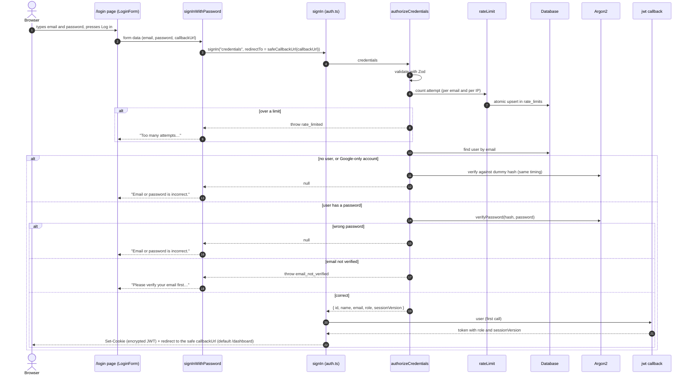
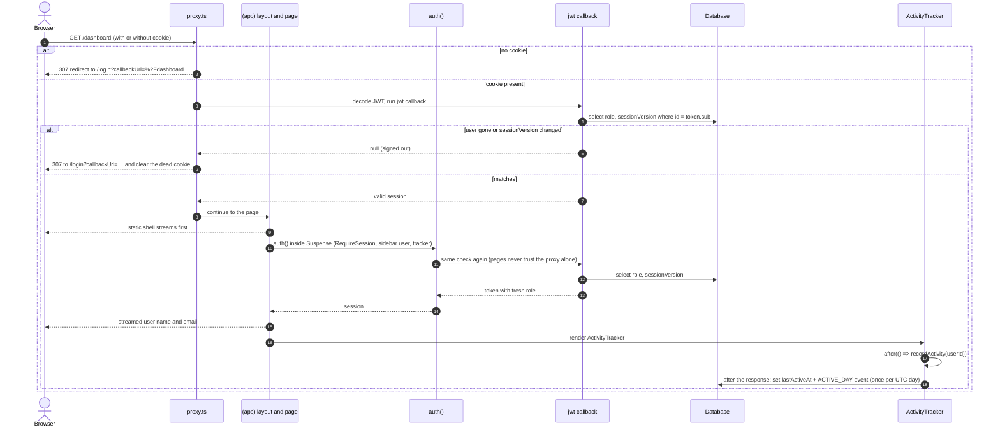
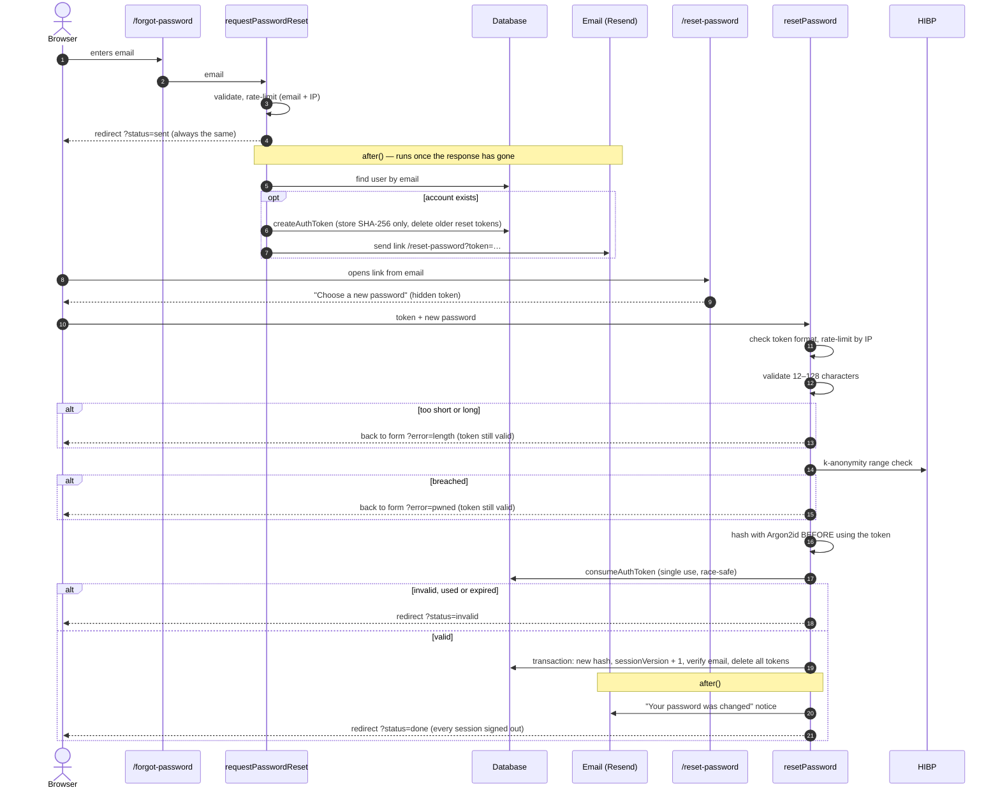

# SpendSense authentication: file guide

This guide is a map of every file that takes part in signing users up, signing them in, keeping them signed in and signing them out, plus the landing page that leads into it. Each file has one entry, written from reading the code as it is on the `feat/landing-and-auth-pages` branch. Entries are grouped from the bottom up: configuration first, then the shared library, the auth feature logic, the pages and components, and finally the database tables. "Used by" lists come from searching the codebase for imports, so they show real connections. If you want the big picture first, jump to [How it all connects](#how-it-all-connects) at the end, then come back to the files.

## Contents

**Config and entry points**
- [`src/auth.config.ts`](#srcauthconfigts)
- [`src/auth.ts`](#srcauthts)
- [`src/proxy.ts`](#srcproxyts)
- [`src/types/next-auth.d.ts`](#srctypesnext-authdts)
- [`src/app/api/auth/[...nextauth]/route.ts`](#srcappapiauthnextauthroutets)
- [`src/app/api/session/clear/route.ts`](#srcappapisessionclearroutets)
- [`src/app/api/cron/purge-deleted-accounts/route.ts`](#srcappapicronpurge-deleted-accountsroutets)
- [`next.config.ts` (auth-related parts)](#nextconfigts-auth-related-parts)

**Library (`src/lib/`)**
- [`src/lib/db.ts`](#srclibdbts)
- [`src/lib/password-rules.ts`](#srclibpassword-rulests)
- [`src/lib/password.ts`](#srclibpasswordts)
- [`src/lib/rate-limit.ts`](#srclibrate-limitts)
- [`src/lib/tokens.ts`](#srclibtokensts)
- [`src/lib/email.ts`](#srclibemailts)
- [`src/lib/request.ts`](#srclibrequestts)
- [`src/lib/activity.ts`](#srclibactivityts)
- [`src/lib/account-deletion.ts`](#srclibaccount-deletionts)
- [`src/lib/session.ts`](#srclibsessionts)
- [`src/lib/consent.ts`](#srclibconsentts)

**Feature logic (`src/features/auth/`)**
- [`src/features/auth/schemas.ts`](#srcfeaturesauthschemasts)
- [`src/features/auth/redirect.ts`](#srcfeaturesauthredirectts)
- [`src/features/auth/credentials.ts`](#srcfeaturesauthcredentialsts)
- [`src/features/auth/activity-tracker.tsx`](#srcfeaturesauthactivity-trackertsx)
- [`src/features/auth/queries.ts`](#srcfeaturesauthqueriests)
- [`src/features/auth/stale-session-guard.tsx`](#srcfeaturesauthstale-session-guardtsx)
- [Server actions (`src/features/auth/actions/`)](#server-actions-srcfeaturesauthactions)

**UI**
- [Shared UI primitives (`src/components/ui/`)](#shared-ui-primitives-srccomponentsui)
- [Shared layout (`src/components/layout/`)](#shared-layout-srccomponentslayout)
- [Auth components (`src/features/auth/components/`)](#auth-components-srcfeaturesauthcomponents)
- [Auth pages (`src/app/(auth)/`)](#auth-pages-srcappauth)
- [App area (`src/app/(app)/`)](#app-area-srcappapp)
- [Landing page (`src/app/(marketing)/` and `src/features/marketing/`)](#landing-page-srcappmarketing-and-srcfeaturesmarketing)
- [Images (`public/images/auth/`)](#images-publicimagesauth)

**Database**
- [Auth models in `prisma/schema.prisma`](#auth-models-in-prismaschemaprisma)

**Pictures**
- [How it all connects](#how-it-all-connects)

---

## Config and entry points

### `src/auth.config.ts`

**What it does:** The "light" half of the Auth.js configuration: the settings that don't need the database. It turns on Google sign-in, says sessions are JWTs that last 7 days, points Auth.js's own sign-in and error pages at `/login`, and copies the user's id and role from the token into the session object the app reads. It's kept as a separate file so a database-free Auth.js instance *could* be built from it (the proxy used to do that; see the `proxy.ts` entry for why it no longer does).

**Runs on:** server only (imported by `auth.ts`). Not marked `server-only`, but nothing in it would work in a browser.

**Exports:**
- `authConfig`: the shared settings object (`trustHost`, `pages`, `providers`, `session`, `callbacks.session`), spread into the full configuration in `auth.ts`.

**Depends on (imports):**
- Internal: none.
- Packages: `next-auth` (the `NextAuthConfig` type), `next-auth/providers/google` (Google sign-in).
- Environment variables read: `AUTH_TRUST_HOST` directly. Auth.js itself also reads `AUTH_SECRET`, `AUTH_GOOGLE_ID` and `AUTH_GOOGLE_SECRET` behind the scenes.

**Used by (imported by):**
- `src/auth.ts` (spreads it into the full configuration)

**Security notes:** `session.maxAge` caps a stolen cookie's lifetime at 7 days. `pages.error: "/login"` means OAuth errors land on the login page with an `?error=` code, which the page maps to fixed messages (never printing the raw value). `trustHost` is only set to `true` when the env var says so, and never to `false` (see the handoff gotcha about `UntrustedHost`).

**Notes:** The `session` callback copies `token.sub` into `session.user.id`. The `jwt` callback that decides whether a token is still valid lives in `auth.ts`, not here, because it needs the database.

### `src/auth.ts`

**What it does:** The full Auth.js setup, built on top of `authConfig`. It connects Auth.js to the database through the Prisma adapter, adds email-and-password sign-in (the Credentials provider, which hands the work to `authorizeCredentials`), and adds the callbacks that need the database. It produces the four functions the rest of the app uses: `auth`, `signIn`, `signOut` and the route `handlers`.

**Runs on:** server only. Not marked `server-only`, but it imports Prisma and Argon2 indirectly, so it can't be bundled for the browser.

**Exports:**
- `auth`: reads and validates the current session. Called in server components, actions and route handlers.
- `signIn`: starts a sign-in (`"credentials"` or `"google"`). Throws a redirect on success.
- `signOut`: clears the session cookie and redirects.
- `handlers`: the `GET`/`POST` functions behind `/api/auth/*` (OAuth callbacks, session endpoint).

**Depends on (imports):**
- Internal: `./auth.config` (shared settings), `@/lib/db` (the adapter and the `jwt`/`events` database calls), `@/features/auth/credentials` (`authorizeCredentials`, the password check).
- Packages: `next-auth`, `next-auth/providers/credentials`, `@auth/prisma-adapter`.
- Environment variables read: none directly (Auth.js reads `AUTH_SECRET` and the Google variables).

**Used by (imported by):**
- `src/app/api/auth/[...nextauth]/route.ts` (`handlers`)
- `src/features/auth/actions/sign-in.ts` (`signIn`), `sign-out.ts` (`signOut`), `change-password.ts` and `delete-account.ts` (`auth`, `signOut`)
- `src/proxy.ts` (`auth` as the proxy wrapper)
- `src/lib/session.ts` (`auth`, wrapped in `cache()` as `getSession`)
- `src/features/auth/components/header-auth-actions.tsx`, `sidebar-user.tsx`, `require-session.tsx` (`auth`)

**Security notes:**
- `callbacks.signIn`: a Google sign-in is refused unless Google says the email is verified (`email_verified === true`), so nobody can claim an address they don't own. It then looks up the linked account by its compound key `provider_providerAccountId`; if that user is scheduled for deletion, it sends them to `/login?error=AccountPendingDeletion` instead of signing them in. (Written as guard clauses: each check returns early.)
- `callbacks.jwt`: on sign-in it copies `role` and `sessionVersion` into the token. On every later `auth()` call it re-reads the user's `sessionVersion`, `role` and `deletionScheduledFor` from the database and returns `null` (signed out) if the user is gone, the version changed, or the account is scheduled for deletion. This is how a password reset, password change or deletion request kills every session.
- `events.createUser` (runs when the adapter creates a user, i.e. a first Google sign-in): sets `emailVerified` and records a `SIGN_UP` activity event in one transaction.
- No automatic account linking is configured, so a Google sign-in for an email that already has a password account fails with `OAuthAccountNotLinked` (shown as a banner on `/login`).

**Notes:**
- Because the `jwt` callback queries the database on every `auth()` call, each request that carries a session cookie costs a small query in the proxy, plus one for each `auth()` call while rendering. That's the price of instant session revocation.
- Credentials sign-ins don't go through `events.createUser`; `register` creates those users and their `SIGN_UP` event itself.
- During the deletion grace period there are three locks: the `jwt` callback (existing sessions), `authorizeCredentials` (password sign-in) and `callbacks.signIn` (Google). Only the emailed reactivation link clears `deletionScheduledFor`.
- The Google deletion check only finds users who have **already** linked Google. A first-time Google sign-in has no linked account yet, so it falls through to Auth.js's usual `OAuthAccountNotLinked` handling for an existing email. That's the correct outcome; it just isn't this check that stops it.
- Formatting is a little uneven (stray indentation before `adapter`, `providers` and `events`, trailing spaces). Cosmetic only.

### `src/proxy.ts`

**What it does:** Next.js 16's "proxy" (the file that used to be called middleware). It runs before every page request and does redirects only: admin URLs return a plain 404 unless the token's role is `ADMIN`; signed-out visitors to protected app URLs go to `/login?callbackUrl=<where they were going>`; signed-in visitors to `/login` or `/signup` go to `/dashboard`. It wraps the **full** Auth.js instance from `auth.ts`, so "signed in" here means exactly what it means everywhere else: the `jwt` callback has checked `sessionVersion` and `role` in the database.

**Runs on:** server, before routing, on the Node.js runtime (the Next 16 default for proxies, which is what lets it use Prisma). Next.js picks it up by file name; nothing imports it.

**Exports:**
- `proxy`: the request handler, wrapped in `auth()` from `@/auth`, so `req.auth` holds the validated session (or `null`).
- `config`: the `matcher`, which skips `/api`, `_next/static`, `_next/image`, the favicon and image files.

**Depends on (imports):**
- Internal: `@/auth` (`auth`).
- Packages: `next/server` (`NextResponse`).
- Environment variables read: none directly (Auth.js reads `AUTH_SECRET` to decode the cookie).

**Used by (imported by):** nobody imports it; Next.js runs it automatically.

**Security notes:**
- A revoked or deleted session (password changed elsewhere, user removed) is treated as signed out, and Auth.js clears the dead cookie in the same response.
- The admin check uses the role freshly read from the database, not the possibly stale copy in the cookie, and answers 404 rather than 403, so the admin area's existence isn't confirmed to outsiders.
- The `callbackUrl` it adds is only a suggestion: the sign-in actions run it through `safeCallbackUrl()` before redirecting.
- Pages and actions that touch user data must still call `auth()` themselves; the proxy only handles redirects. The `(app)` layout's `RequireSession` guard is the backup if a route is ever missing from `PROTECTED_PREFIXES`.

**Notes:**
- **Changed after B6 testing (bug fix).** The proxy used to build its own Auth.js instance from `authConfig` alone, with no database. A stale cookie (for example after a password change on another device, or for a deleted user) still decrypted, so the proxy said "signed in" while `auth()` on the pages said "signed out". As a result, `/login`, `/signup` and every "Get started" button bounced to `/dashboard`, the header still showed "Log in", and the dashboard rendered for a visitor who wasn't really signed in. Using the full instance removes the disagreement.
- Cost: one small database query for each request that carries a session cookie (signed-out visitors with no cookie cost nothing).
- `PROTECTED_PREFIXES` now lists all seven app sections plus `/onboarding`, matching the handoff (`/transactions`, `/budgets`, `/imports`, `/insights` and `/recurring` were missing before).
- `matches()` matches the exact path or `prefix/…`, so `/settingsx` isn't treated as `/settings`.

### `src/types/next-auth.d.ts`

**What it does:** A TypeScript "module augmentation" file: it adds SpendSense's own fields to Auth.js's built-in types. `Session.user` gains `id` and `role`; `User` gains optional `role` and `sessionVersion`; the `JWT` type (which lives in `@auth/core/jwt`, not `next-auth`) gains `role` and `sessionVersion`. It contains no runtime code at all.

**Runs on:** neither: types only, erased at build time.

**Exports:** nothing directly; it changes the types exported by `next-auth` and `@auth/core/jwt`.

**Depends on (imports):**
- Internal: `@/generated/prisma/client` (the `Role` enum type).
- Packages: `next-auth` (`DefaultSession`).
- Environment variables read: none.

**Used by (imported by):** nobody imports it; TypeScript loads it because it sits under `src/` (covered by `tsconfig.json`'s `include`). Its types are used in `src/auth.config.ts` (`token.role` → `session.user.role`), `src/auth.ts` (`user.role`, `user.sessionVersion`, `token.sessionVersion`) and `src/features/auth/credentials.ts` (returns `sessionVersion`).

**Security notes:** none at runtime, but it keeps `role` and `sessionVersion` type-checked, which makes it harder to forget the `sessionVersion` comparison or to misspell a role.

### `src/app/api/auth/[...nextauth]/route.ts`

**What it does:** The route handler that serves every URL under `/api/auth/` (the `[...nextauth]` folder name is a "catch-all" segment). It simply re-exports Auth.js's `GET` and `POST` handlers. Google redirects back here after sign-in (`/api/auth/callback/google`), and Auth.js's built-in endpoints such as `/api/auth/session` live here too.

**Runs on:** server only (a route handler).

**Exports:**
- `GET`, `POST`: Auth.js's request handlers.

**Depends on (imports):**
- Internal: `@/auth` (`handlers`).
- Packages: none directly.
- Environment variables read: none directly.

**Used by (imported by):** nobody imports it; Next.js routes `/api/auth/*` requests to it. The proxy's matcher skips `/api`, so these requests never go through `proxy.ts`.

**Security notes:** this is where the OAuth `state`/PKCE checks and CSRF checks built into Auth.js happen. The UI never links here directly (no links to `/api/auth/signin`); it uses the `signIn` server actions instead.

**Notes:** the folder name contains square brackets, so in PowerShell use `-LiteralPath` with it.

### `src/app/api/session/clear/route.ts`

**What it does:** A small `GET` route that wipes this browser's cookies and then redirects. It exists because **server actions can't set custom response headers**, and `Clear-Site-Data` is a header. The delete-account action and the stale-session guard send the browser here, and this route does the clean-up they can't.

**Runs on:** server only (a route handler, served at `/api/session/clear`).

**Exports:**
- `GET(request)`: reads `?reason=`, picks the destination from an allowlist, and returns a redirect carrying the clean-up headers.

**Depends on (imports):**
- Internal: none.
- Packages: `next/server` (`NextResponse`, `NextRequest`).
- Environment variables read: none.

**Used by (imported by):** nothing imports it; two places redirect to it:
- `src/features/auth/actions/delete-account.ts` (`signOut({ redirectTo: "/api/session/clear?reason=deletion-scheduled" })`)
- `src/features/auth/stale-session-guard.tsx` (`?reason=expired`)

**Security notes:**
- **Allowlisted destinations:** `deletion-scheduled` → `/login?status=deletion-scheduled`, `expired` → `/login`, anything else → `/login`. The `reason` value is never used as a URL, so this can't become an open redirect.
- `Clear-Site-Data: "cookies"` removes every cookie for the site in modern browsers. As a fallback, it also expires every cookie whose name contains `authjs.session-token` (which covers the `__Secure-` name on HTTPS, and chunked `.0`/`.1` cookies), setting `secure` to match the prefix so the browser accepts the deletion.

**Notes:**
- `Clear-Site-Data` also removes `ss_consent`, so after deleting an account the cookie banner appears again. That's expected.
- Browsers only honour `Clear-Site-Data` on secure origins (HTTPS, or `localhost` in development). That's why the by-name fallback matters.
- Because it's a plain `GET`, any site could link someone to it and sign them out. The harm is small (they just sign in again), and a `GET` is needed because it's reached by redirect.
- `src/proxy.ts`'s matcher skips `/api`, so the proxy doesn't run for this route.

### `src/app/api/cron/purge-deleted-accounts/route.ts`

**What it does:** The job that actually deletes accounts once their grace period is over. A scheduler calls it with a secret; it finds up to 100 users whose `deletionScheduledFor` has passed, deletes each one (the database cascades to their data), sends each a final "your account has been deleted" email, and replies with counts only.

**Runs on:** server only (a route handler, served at `/api/cron/purge-deleted-accounts`).

**Exports:**
- `GET(request)`: checks the secret, purges one batch, returns `{ deleted, failed, moreRemaining }`.

**Depends on (imports):**
- Internal: `@/lib/db` (find and delete users), `@/lib/email` (`sendAccountDeletedEmail`).
- Packages: `node:crypto` (`timingSafeEqual`), `next/server`.
- Environment variables read: `CRON_SECRET`.

**Used by (imported by):** nothing imports it. It's meant to be called by a daily Vercel cron, which isn't configured yet (no `vercel.json`; it's on the Step 9 checklist).

**Security notes:**
- **Fails closed:** if `CRON_SECRET` isn't set, every request gets `401`.
- The `Authorization: Bearer <secret>` header is compared with `timingSafeEqual`, so response timing doesn't leak how much of a guess was right. (The length check runs first; that only reveals the length, which is fixed at 64 hex characters anyway.)
- **Race with reactivation:** the delete is `deleteMany` with the deadline check repeated in its `where`. If the user reactivated after the `findMany`, `count` is 0 and they're skipped.
- The response contains counts only, never emails or ids, and logs contain error messages only.

**Notes:**
- Related data: `Account`, `AuthToken`, statements, transactions, categories and the subscription are deleted with the user (`onDelete: Cascade`). `ActivityEvent` and `AuditLog` rows are kept with the user reference set to `null` (`onDelete: SetNull`), so usage counts and the audit trail survive without pointing at a person.
- One batch per call: if more than 100 accounts are due, `moreRemaining` is `true` and the rest wait for the next run.
- The email goes out *after* the delete, using the address read beforehand. If the email fails, the deletion still stands.
- A comment marks where Stripe subscriptions must be cancelled before Stripe goes live.
- `.env.example` lists `CRON_SECRET` twice (lines 22 and 28). Harmless, but one can go.

### `next.config.ts` (auth-related parts)

**What it does:** Next.js's configuration. Two parts matter for auth: `cacheComponents: true`, which is why every component that reads the request (`searchParams`, `cookies()`, `auth()`) must sit inside `<Suspense>`; and `headers()`, which sends `Referrer-Policy: no-referrer` on `/verify-email`, `/reset-password` and `/reactivate-account`.

**Runs on:** build and server start-up (read once; changes need a server restart).

**Exports:**
- default `nextConfig`.

**Depends on (imports):**
- Internal: none.
- Packages: `next` (the `NextConfig` type).
- Environment variables read: none.

**Used by (imported by):** Next.js itself.

**Security notes:** the verify, reset and reactivation links carry a secret token in the URL (`?token=…`). `no-referrer` stops the browser from sending that full URL to any other site the page loads something from or links to.

**Notes:** `partialPrefetching: true` is also on; it doesn't affect auth behaviour. `devIndicators: false` hides the "N" badge that `npm run dev` shows in the corner (compile and runtime errors still appear).

---

## Library (`src/lib/`)

### `src/lib/db.ts`

**What it does:** Creates the single Prisma client the whole app uses to talk to PostgreSQL, using the `pg` driver adapter. In development it stores the client on `globalThis`, so hot reloads reuse one client instead of opening a new connection pool on every file save. During `next build` it tolerates a missing `DATABASE_URL`, so the build can run without a database.

**Runs on:** server only (`import "server-only"` makes a browser import fail the build).

**Exports:**
- `db`: the `PrismaClient` instance.

**Depends on (imports):**
- Internal: `@/generated/prisma/client` (the generated client).
- Packages: `server-only`, `@prisma/adapter-pg` (Postgres driver adapter), `next/constants` (`PHASE_PRODUCTION_BUILD`).
- Environment variables read: `DATABASE_URL`, `NEXT_PHASE`, `NODE_ENV`.

**Used by (imported by):**
- `src/auth.ts` (adapter, `jwt` check, `createUser` event)
- `src/features/auth/credentials.ts` (user lookup, rehash)
- `src/features/auth/actions/register.ts`, `verify-email.ts`, `password-reset.ts`, `change-password.ts`
- `src/lib/rate-limit.ts`, `src/lib/tokens.ts`, `src/lib/activity.ts`

**Security notes:** `server-only` guarantees database credentials and queries can never end up in browser JavaScript.

**Notes:** during a build with no `DATABASE_URL`, the client is created with `connectionString: undefined`; any query at build time would then fail. That's fine today because nothing queries during prerendering (all `auth()` calls sit behind `<Suspense>` and `connection()`).

### `src/lib/password-rules.ts`

**What it does:** The single source of truth for the password length rule (12 to 128 characters) and the helpers that apply it. Passwords are first normalised with Unicode NFKC (so visually identical characters typed different ways count the same), then counted in code points (`[...value].length`), not UTF-16 units, so an emoji counts as one character.

**Runs on:** both. It has no server-only imports, so client components can use the constants for helper text.

**Exports:**
- `PASSWORD_MIN_LENGTH` (12), `PASSWORD_MAX_LENGTH` (128): the limits.
- `normalizePassword(password)`: NFKC normalisation.
- `countCharacters(value)`: code-point count.
- `isValidPasswordLength(password)`: normalise, count, check both limits.

**Depends on (imports):**
- Internal: none. Packages: none. Environment variables read: none.

**Used by (imported by):**
- `src/features/auth/schemas.ts` (`newPasswordSchema`, `existingPasswordSchema`)
- `src/features/auth/credentials.ts` (rejects over-long passwords before hashing)
- `src/lib/password.ts` (normalises before hashing and verifying)
- UI helper text and error copy: `src/features/auth/components/signup-form.tsx`, `change-password-form.tsx`, `src/app/(auth)/reset-password/page.tsx`

**Security notes:** the 128 maximum stops very long inputs being used to make Argon2 do expensive work. Normalising before hashing means a password typed on a different keyboard or OS still verifies. There are deliberately no composition rules (following current NIST guidance).

**Notes:** this is why the UI never puts `minLength`/`maxLength` on password inputs: the browser counts UTF-16 units and doesn't normalise, so it could disagree with the server.

### `src/lib/password.ts`

**What it does:** Everything that touches a real password on the server. It hashes and verifies with Argon2id (19 MiB memory, 2 iterations, 1 thread: the OWASP minimum), tells you when an old hash should be upgraded to the current settings, runs a "dummy" verification so unknown emails take as long as real ones, and checks Have I Been Pwned to see whether a password has appeared in a data breach.

**Runs on:** server only (`import "server-only"`).

**Exports:**
- `hashPassword(password)`: normalise, then Argon2id hash.
- `verifyPassword(hash, password)`: normalise, then verify; returns `false` (never throws) on a malformed hash.
- `needsRehash(hash)`: `true` if the hash was made with different Argon2 settings.
- `verifyAgainstDummy(password)`: verifies against a fixed dummy hash (created once, then cached) and always returns `false`.
- `isPwnedPassword(password)`: HIBP range check.

**Depends on (imports):**
- Internal: `@/lib/password-rules` (`normalizePassword`).
- Packages: `server-only`, `argon2` (native hashing), `node:crypto` (SHA-1 for the HIBP lookup).
- Environment variables read: none.

**Used by (imported by):**
- `src/features/auth/credentials.ts` (verify, dummy verify, rehash)
- `src/features/auth/actions/register.ts`, `password-reset.ts`, `change-password.ts` (hash, HIBP check; change-password also verifies)

**Security notes:**
- **k-anonymity:** only the first 5 characters of the password's SHA-1 are sent to HIBP; the matching happens locally. `Add-Padding: true` makes every response a similar size, so network observers can't guess which prefix was asked about. Padding lines have a count of 0, which the `> 0` check ignores.
- **Fails open:** if HIBP is slow (3-second timeout) or down, the check returns `false` and the password is accepted, so an outside service can't block sign-ups. It logs a warning without the password.
- **Timing:** `verifyAgainstDummy` makes "no such user" cost the same Argon2 work as "wrong password", so response time doesn't reveal which emails have accounts.

**Notes:** the dummy hash is made lazily on first use, so the very first unknown-email sign-in after a server start is slower (two Argon2 operations).

### `src/lib/rate-limit.ts`

**What it does:** A database-backed rate limiter. Each limit is a row in the `rate_limits` table keyed by a string like `forgot:email:<hash>`. One SQL statement inserts the row, or adds 1 to it, or restarts the window if it has expired, and returns the new count. If the count is above the limit, the caller refuses the request. This is a "fixed window" limiter: the count resets when the window ends.

**Runs on:** server only (`import "server-only"`).

**Exports:**
- `LIMITS`: every limit in one place (sign-in 5 per email and 20 per IP per 15 min; register 5 per IP per hour; forgot password and resend verification 3 per email and 10 per IP per hour; reset password 10 per IP per hour; change password 5 per user per 15 min; delete account 5 per user per 15 min; resend reactivation link 3 per email and 10 per IP per hour).
- `hashIdentifier(value)`: SHA-256 of an email or IP, so the table never stores them in plain text.
- `rateLimit(key, { limit, windowSeconds })`: counts this attempt, returns `{ allowed, remaining, resetAt }`.
- `deleteExpiredRateLimits()`: removes finished windows.

**Depends on (imports):**
- Internal: `@/lib/db`.
- Packages: `server-only`, `node:crypto`.
- Environment variables read: none.

**Used by (imported by):**
- `src/features/auth/credentials.ts` (sign-in, per email and per IP)
- `src/features/auth/actions/register.ts`, `verify-email.ts` (resend), `password-reset.ts`, `change-password.ts`
- `src/features/auth/actions/delete-account.ts` (per user), `reactivate-account.ts` (resend, per email and per IP)

**Security notes:**
- The upsert is a single atomic statement, so two requests at the same moment can't both slip under the limit.
- Limiting per email stops guessing one person's password; limiting per IP stops one attacker trying many emails.
- Emails and IPs are hashed before they become keys.

**Notes:**
- `deleteExpiredRateLimits()` isn't called anywhere yet (as the handoff says, it still needs scheduling), so expired rows stay in the table until then. They're harmless, because an expired row is reset on its next use.
- The change-password and delete-account keys use the raw user id (`changepw:user:<id>`, `deleteacct:user:<id>`) rather than a hash. User ids aren't personal data, so that's fine, but it differs slightly from the handoff's "keys hashed". The reactivation keys (`reactivate:email:…`, `reactivate:ip:…`) are hashed.
- The delete-account limit mainly slows down password guessing: the delete dialog asks for the password, so without it someone at an unlocked laptop could try passwords there.
- Every attempt counts, including successful ones. For example, five successful sign-ins in 15 minutes block the sixth.

### `src/lib/tokens.ts`

**What it does:** Creates and redeems the one-time tokens inside email links (verify email: 24 hours; reset password: 1 hour; reactivate account: 48 hours, the deletion grace period). A token is 32 random bytes in URL-safe base64. Only its SHA-256 hash is stored in `auth_tokens`, and creating a new token deletes the user's older tokens of the same type. Redeeming looks the hash up, deletes the row, and only then checks expiry.

**Runs on:** server only (`import "server-only"`).

**Exports:**
- `createAuthToken(userId, type, { expiresAt? })`: returns the plain token (to put in the email link). `expiresAt` overrides the normal lifetime; the resend-reactivation action uses it to make a new link expire at the **original** deletion time, not 48 hours from now.
- `consumeAuthToken(token, type)`: returns the `userId` if the token was valid, otherwise `null`. Single use.

**Depends on (imports):**
- Internal: `@/lib/db`, `@/lib/account-deletion` (`DELETION_GRACE_MS`, the reactivation lifetime), `@/generated/prisma/client` (the `AuthTokenType` type).
- Packages: `server-only`, `node:crypto` (`randomBytes`, SHA-256).
- Environment variables read: none.

**Used by (imported by):**
- `src/features/auth/actions/register.ts` (creates verification tokens)
- `src/features/auth/actions/verify-email.ts` (consumes verification tokens; creates new ones on resend)
- `src/features/auth/actions/password-reset.ts` (creates and consumes reset tokens)
- `src/features/auth/actions/delete-account.ts` (creates the first reactivation token)
- `src/features/auth/actions/reactivate-account.ts` (consumes reactivation tokens; creates new ones on resend, capped at the deadline)

**Security notes:**
- Storing only the hash means a database leak doesn't give anyone working links.
- **Race-safe single use:** the token counts only if *this* request's `deleteMany` actually removed the row (`count === 1`), so two clicks at the same moment can't both succeed.
- The type is checked, so a verification token can't be used as a reset token.
- Old tokens of the same type are deleted when a new one is made, so only the newest email link works.

**Notes:**
- An expired token is deleted when someone tries it (it's consumed first and then rejected), which is fine because it was useless anyway.
- Because a new token deletes older ones of the same type, asking for a new reactivation link makes the link in the first deletion email stop working. Only the newest email works.
- There's an extra blank line after the imports (cosmetic only).

### `src/lib/email.ts`

**What it does:** Sends the six auth emails through Resend: verify your email, reset your password, "you already have an account", "your password was changed", "your account is scheduled for deletion" (with the reactivation link) and "your account has been deleted". Each has a plain-text and an HTML version. Links are built from `APP_URL`. The Resend client is created on first use, not when the file loads.

**Runs on:** server only (`import "server-only"`).

**Exports:**
- `sendVerificationEmail(to, token)`: link to `/verify-email?token=…` (24 hours).
- `sendPasswordResetEmail(to, token)`: link to `/reset-password?token=…` (1 hour).
- `sendAccountExistsEmail(to)`: links to `/login` and `/forgot-password`.
- `sendPasswordChangedEmail(to)`: notice with a link to `/forgot-password` in case it wasn't them.
- `sendDeletionScheduledEmail(to, token, deletionDate)`: the deletion time in UK time (`Europe/London`) and a link to `/reactivate-account?token=…`. Also tells someone who didn't ask for this to reactivate and change their password.
- `sendAccountDeletedEmail(to)`: the final "it's gone" notice, with a link to `/signup`.

**Depends on (imports):**
- Internal: none.
- Packages: `server-only`, `resend`.
- Environment variables read: `RESEND_API_KEY`, `EMAIL_FROM`, `APP_URL` (each read lazily, so a missing value only fails when an email is actually sent, not during `next build`).

**Used by (imported by):**
- `src/features/auth/actions/register.ts` (verification, account exists)
- `src/features/auth/actions/verify-email.ts` (verification resend)
- `src/features/auth/actions/password-reset.ts` (reset link, changed notice)
- `src/features/auth/actions/change-password.ts` (changed notice)
- `src/features/auth/actions/delete-account.ts` (scheduled notice with the first reactivation link)
- `src/features/auth/actions/reactivate-account.ts` (scheduled notice again, on resend)
- `src/app/api/cron/purge-deleted-accounts/route.ts` (deleted notice)

**Security notes:**
- `sendAccountExistsEmail` is the anti-enumeration piece of sign-up: the form says the same thing whether or not the email is taken, and only the inbox owner learns an account exists.
- Links are built from the server's `APP_URL`, never from the request's `Host` header, so an attacker can't make reset links point to their own domain.
- Failures are logged by error name and message only, never with the token or link.

**Notes:**
- With the Resend test sender, only the Resend account's own address actually receives mail. Sending to any other address makes `send()` throw. (For automated testing, Resend's `delivered@resend.dev` inbox, with a `+label`, works.)
- There's no development mode: running locally sends real emails through Resend. Keep that in mind when testing sign-up and account deletion.
- The deletion email is the account owner's safety net: if someone else deleted the account (for example on an unlocked laptop), the owner still has 48 hours to undo it from their inbox.

### `src/lib/request.ts`

**What it does:** Works out the visitor's IP address for per-IP rate limits. It takes the first address in the `x-forwarded-for` header, falls back to `x-real-ip`, and uses `"unknown"` if neither is present.

**Runs on:** server only (`import "server-only"`; reads request headers, so it only works during a request).

**Exports:**
- `getClientIp()`: the IP as a string.

**Depends on (imports):**
- Internal: none.
- Packages: `server-only`, `next/headers` (`headers()`).
- Environment variables read: none.

**Used by (imported by):**
- `src/features/auth/credentials.ts`, `src/features/auth/actions/register.ts`, `verify-email.ts`, `password-reset.ts` (all for per-IP rate-limit keys)

**Security notes:** the IP is hashed by the callers before it's stored.

**Notes:**
- `x-forwarded-for` can be set by the client unless a trusted proxy overwrites it. On Vercel the platform sets it, so it's reliable there. On a host that passes the client's header through, an attacker could change it on each request and dodge the per-IP limits (the per-email limits still apply). The handoff's Step 9 list already has "check `x-forwarded-for`".
- Every request without either header shares the single `"unknown"` bucket.

### `src/lib/activity.ts`

**What it does:** Records that a user was active today, at most once per UTC day. A conditional update sets `lastActiveAt` only if it's empty or from before today, and only when that update actually changed a row does it add an `ACTIVE_DAY` event. Both happen in one transaction.

**Runs on:** server only (`import "server-only"`).

**Exports:**
- `recordActivity(userId)`.

**Depends on (imports):**
- Internal: `@/lib/db`.
- Packages: `server-only`.
- Environment variables read: none.

**Used by (imported by):**
- `src/features/auth/activity-tracker.tsx` (called in `after()` on every signed-in app page view)

**Security notes:** none (analytics only), but it always takes the `userId` from the session, never from the request.

**Notes:** `lastActiveAt` holds the time of the *first* visit each day, not the latest. Two requests at the same moment can't both create an event, because only one `updateMany` gets `count === 1`.

### `src/lib/account-deletion.ts`

**What it does:** Holds one number: how long an account waits between "delete my account" and actually being deleted (48 hours). It's the single source for the grace period, so the scheduled deletion time, the reactivation link's lifetime and the "2 days" shown in the UI can't drift apart.

**Runs on:** both. A plain constant with no imports, so client components can use it too.

**Exports:**
- `DELETION_GRACE_MS`: 48 hours in milliseconds.

**Depends on (imports):**
- Internal: none.
- Packages: none.
- Environment variables read: none.

**Used by (imported by):**
- `src/features/auth/actions/delete-account.ts` (sets `deletionScheduledFor = now + DELETION_GRACE_MS`)
- `src/lib/tokens.ts` (the `ACCOUNT_REACTIVATION` token lifetime)
- `src/features/auth/components/deletion-grace.ts` (turns it into "2 days" for the delete dialog and the login banner)

**Security notes:** none directly. Keeping one source means a reactivation link can never outlive the deletion it's meant to cancel.

**Notes:** The purge job is planned to run once a day (the Vercel cron is a Step 9 task and isn't set up yet), so an account will actually be removed 48–72 hours after the request. The UI says "after 2 days", which is the earliest it can happen.

### `src/lib/session.ts`

**What it does:** Wraps `auth()` in React's `cache()`, so a session is looked up **once per request** however many server components ask for it. Each `auth()` call runs the `jwt` callback, which queries the database; without the cache, a layout and a page that both need the session would each pay for that query.

**Runs on:** server only (`import "server-only"`).

**Exports:**
- `getSession()`: the current session (or `null`), memoised for the rest of this request.

**Depends on (imports):**
- Internal: `@/auth` (`auth`).
- Packages: `server-only`, `react` (`cache`).
- Environment variables read: none.

**Used by (imported by):**
- `src/features/auth/queries.ts` (`getDeletionProof`)
- `src/features/auth/stale-session-guard.tsx` (is there a session?)
- `src/features/auth/activity-tracker.tsx` (who to record activity for)
- `src/features/auth/components/profile-section.tsx` (name and email on Settings)

**Security notes:** none of its own. It returns exactly what `auth()` returns, so the `sessionVersion` and deletion checks in the `jwt` callback still apply.

**Notes:**
- The rule is: **server components** use `getSession()`; **server actions** may keep calling `auth()`, because each action is its own request and the cache wouldn't help.
- React's `cache()` only lasts for one server request; it never shares a session between users.
- Not yet used everywhere: `sidebar-user.tsx`, `require-session.tsx` and `header-auth-actions.tsx` (built in B6) still call `auth()` directly, so an app page still does more than one session lookup. Switching them over is a small frontend change.

### `src/lib/consent.ts`

**What it does:** Everything about the cookie-consent choice, stored in a first-party cookie called `ss_consent`. It creates a choice (`{ version, analytics, decidedAt }`), turns it into cookie text and back, decides whether a saved choice is still valid, writes it to the browser and announces the change, and deletes Google Analytics cookies when someone withdraws. The banner, preferences dialog and analytics loader are all built on it.

**Runs on:** both. Deliberately browser-safe: no `server-only`, no Zod, no Node APIs. The "Browser only" functions touch `document`/`window`, so only client components call them (`readConsentFromDocument` returns `null` on the server instead of crashing).

**Exports:**
- `CONSENT_COOKIE` (`"ss_consent"`), `CONSENT_VERSION` (`1`), `CONSENT_MAX_AGE_SECONDS` (182 days, about 6 months), `CONSENT_CHANGED_EVENT` (`"ss:consent-changed"`).
- `ConsentCategory` (`"analytics"`) and `Consent` (the stored shape).
- `createConsent({ analytics })`: a new choice stamped with the current version and time.
- `serializeConsent` / `parseConsent`: to and from cookie text. `parseConsent` returns `null` for anything not JSON, the wrong shape, an old version, or older than 6 months.
- `hasConsent(consent, "analytics")`: `true` only if that category was explicitly allowed.
- `readConsentFromDocument()`: the valid saved choice, or `null` ("no decision").
- `writeConsentToDocument(consent)`: saves the cookie (`Path=/`, `Max-Age`, `SameSite=Lax`, `Secure` on HTTPS) and fires `CONSENT_CHANGED_EVENT`.
- `clearAnalyticsCookies()`: expires `_ga`, `_ga_*` and `_gid` on this host and each parent domain.

**Depends on (imports):**
- Internal: none.
- Packages: none.
- Environment variables read: none.

**Used by (imported by):**
- `src/features/privacy/components/cookie-consent.tsx` (show the banner when there's no decision; re-check on change)
- `src/features/privacy/components/cookie-banner.tsx` (Accept all / Reject all)
- `src/features/privacy/components/cookie-preferences-dialog.tsx` (save, and clear GA cookies on withdrawal)
- `src/features/privacy/components/analytics-loader.tsx` (load analytics only with consent)

**Security notes:**
- Fails closed: any doubt (missing, garbled, tampered, old version, expired) means "no decision", so the banner shows and nothing optional loads.
- Bumping `CONSENT_VERSION` re-asks everyone, which is what you do if the cookies used change.
- The cookie isn't `HttpOnly` on purpose: the browser code has to read it. It holds no personal data.

**Notes:**
- The server never reads this cookie. That's what keeps the landing page static (reading cookies on the server would make every page dynamic).
- `parseConsent` checks that a choice isn't *too old*, but not that `decidedAt` is in the past. A hand-edited future date would stay valid longer than 6 months. Only the visitor can edit their own cookie, so it isn't a security problem, just an edge case.
- `clearAnalyticsCookies()` on its own wasn't enough during testing: gtag, still running, rewrote `_ga_<ID>` as the page unloaded. The preferences dialog now sets Google's `ga-disable-<ID>` flag first (see that entry).

---

## Feature logic (`src/features/auth/`)

### `src/features/auth/schemas.ts`

**What it does:** The Zod schemas that check and clean auth input on the server. Emails are trimmed, lower-cased, NFKC-normalised, checked as an email and capped at 254 characters. New passwords must pass the 12–128 rule. Existing passwords (for sign-in and "current password") only check the maximum, because old accounts may have shorter passwords. The registration schema checks first name, last name, email and password together.

**Runs on:** server in practice (only server actions and `credentials.ts` import it). It has no server-only imports, so it could run in the browser too.

**Exports:**
- `tokenSchema`: 1–100 character string (a token from a link).
- `emailSchema`: the cleaned, validated email.
- `newPasswordSchema`: the 12–128 rule, with the message "Use between 12 and 128 characters".
- `registerSchema`: `{ firstName, lastName, email, password }`; names are trimmed, 1–50 characters each.
- `existingPasswordSchema`: required, at most 128 characters.

**Depends on (imports):**
- Internal: `@/lib/password-rules`.
- Packages: `zod` (v4 API: `z.email()`).
- Environment variables read: none.

**Used by (imported by):**
- `src/features/auth/credentials.ts` (`emailSchema`)
- `src/features/auth/actions/register.ts` (`registerSchema`)
- `src/features/auth/actions/verify-email.ts` (`emailSchema`, `tokenSchema`)
- `src/features/auth/actions/password-reset.ts` (`emailSchema`, `newPasswordSchema`, `tokenSchema`)
- `src/features/auth/actions/change-password.ts` (`existingPasswordSchema`, `newPasswordSchema`)

**Security notes:** this is the server-side validation every form relies on; the browser's `required` and `type="email"` are only conveniences. Normalising emails means `Me@X.com` and `me@x.com` are the same account.

**Notes:**
- `registerSchema` was changed in B6 from one `name` field to `firstName` and `lastName` (with Elizabette's approval). `register` joins them as `"First Last"` in the existing `name` column.
- `newPasswordSchema`'s message has no full stop, but the reset page's own `length` message does ("Use between 12 and 128 characters."). This is only cosmetic.

### `src/features/auth/redirect.ts`

**What it does:** Decides where to send someone after they sign in. It takes the untrusted `callbackUrl` from a form and returns a safe path on this site, or `/dashboard` if anything is off. The value must be a string that starts with `/`, is at most 2,048 characters, and still points at this site after the browser-standard URL parser has read it. A return to `/login` or `/signup` is replaced by `/dashboard`.

**Runs on:** server (called from server actions). It has no imports and no `server-only` marker.

**Exports:**
- `safeCallbackUrl(value)`: a `FormDataEntryValue | null` in, a safe relative path out.

**Depends on (imports):**
- Internal: none. Packages: none. Environment variables read: none.

**Used by (imported by):**
- `src/features/auth/actions/sign-in.ts` (both `signInWithPassword` and `signInWithGoogle`)

**Security notes:** this is the open-redirect guard. Rather than pattern-matching strings, it parses the value against a placeholder origin and checks the origin didn't change, so the tricky cases are caught by the same rules browsers use. Checked while writing this guide:
- `//evil.com` → rejected (parses as host `evil.com`)
- `/\evil.com` → rejected (the parser treats `\` like `/`)
- `/%2F%2Fevil.com` → allowed, but as a harmless path on this site
- `/settings/password?tab=a#b` → kept with its query and hash

The B6 test "`/login?callbackUrl=//evil.com` → sign in → lands on `/dashboard`" passed in the browser.

**Notes:** the UI never redirects using `callbackUrl` itself; it only passes it to the server in a hidden input.

### `src/features/auth/credentials.ts`

**What it does:** The `authorize` function behind email-and-password sign-in. Auth.js calls it with the submitted email and password, and it decides whether they're valid. Its steps run in a deliberate order: validate input → rate-limit by email and IP → look up the user → do the same password-hashing work whether or not the user exists → only after a correct password, say "this account is scheduled for deletion" or "verify your email first" if needed → upgrade an outdated hash → return just the fields the session needs.

**Runs on:** server only (`import "server-only"`).

**Exports:**
- `authorizeCredentials(credentials)`: returns a `User` (`id`, `name`, `email`, `image`, `role`, `sessionVersion`) or `null`, or throws `CredentialsSignin` subclasses with the codes `account_pending_deletion`, `email_not_verified` or `rate_limited`.

**Depends on (imports):**
- Internal: `@/lib/db`, `@/lib/rate-limit`, `@/lib/password`, `@/lib/password-rules`, `@/lib/request`, `./schemas` (`emailSchema`).
- Packages: `server-only`, `next-auth` (`CredentialsSignin`, `User` type), `zod`.
- Environment variables read: none.

**Used by (imported by):**
- `src/auth.ts` (the Credentials provider's `authorize`). It runs when `signInWithPassword` calls `signIn("credentials", …)`.

**Security notes:**
- **Enumeration:** unknown emails and Google-only accounts (no `passwordHash`) still run a full Argon2 verification against a dummy hash, then return `null`, so the response and its timing match "wrong password". The "scheduled for deletion" and "verify your email first" messages are only revealed *after* a correct password, so they leak nothing to someone guessing.
- **Deletion grace period:** a scheduled account can't sign in with its password, even the right one. The check comes before the email-verified check, so a scheduled account always gets the message that tells them how to undo it.
- **Rate limits** run before any lookup or hashing, so brute force is cheap to refuse.
- **Over-long passwords** (more than 128 characters) are rejected before hashing.
- **Rehash on sign-in:** if the Argon2 settings are ever raised, users are upgraded quietly the next time they sign in. A failed rehash is logged and doesn't block the sign-in.
- Returns only what the session needs; `passwordHash` never leaves this function.

**Notes:**
- `null` becomes a plain `CredentialsSignin` in `sign-in.ts`, which shows "Email or password is incorrect.". The three custom codes map to their own messages there.
- A scheduled account returns before step 7, so its hash isn't upgraded during the grace period. That's fine; it happens on the first sign-in after reactivation.
- The `@/lib/password-rules` import ends with a stray `, }` (cosmetic only).

### `src/features/auth/activity-tracker.tsx`

**What it does:** An invisible server component placed in the signed-in app layout. On each app page view it reads the session and, if there's a user, schedules `recordActivity(userId)` with `after()`, so the database write happens *after* the response has been sent and never slows the page down. It renders nothing.

**Runs on:** server only (an async server component; no `"use client"`).

**Exports:**
- `ActivityTracker`: the component.

**Depends on (imports):**
- Internal: `@/lib/session` (`getSession`, the cached `auth()`), `@/lib/activity` (`recordActivity`).
- Packages: `next/server` (`after`).
- Environment variables read: none.

**Used by (imported by):**
- `src/app/(app)/layout.tsx`, inside `<Suspense fallback={null}>` together with `StaleSessionGuard` (both read the request, so they must be inside a boundary).

**Security notes:** the user id comes from the validated session (`getSession()` runs `auth()`, which does the `sessionVersion` and deletion checks), not from anything the browser sends. Errors are caught and logged by message only.

**Notes:**
- The session is read *before* `after()` because cookies and headers aren't available inside `after()` in a server component.
- Since the privacy work it uses `getSession()` instead of calling `auth()` directly, so it shares one session lookup with `StaleSessionGuard` in the same request.
- In B6, the two new components that call `auth()` (`header-auth-actions.tsx`, `sidebar-user.tsx`) needed `await connection()` first: in development, Next flagged Auth.js's use of `crypto` while prerendering. `ActivityTracker` didn't trigger that warning in testing, so it was left as it is. If the warning ever appears on app pages, the same one-line fix applies here.

### `src/features/auth/queries.ts`

**What it does:** Database reads for the auth feature's pages. Right now there's one: `getDeletionProof()`, which tells the Settings page what the signed-in user must type to confirm deleting their account. Users with a password must enter it; Google-only users (no `passwordHash`) must type their account email instead.

**Runs on:** server only (`import "server-only"`).

**Exports:**
- `DeletionProof`: the type `"password" | "email"`.
- `getDeletionProof()`: `"password"`, `"email"`, or `null` if nobody is signed in (or the user no longer exists).

**Depends on (imports):**
- Internal: `@/lib/db` (reads `passwordHash`), `@/lib/session` (`getSession`, so it shares the page's one session lookup).
- Packages: `server-only`.
- Environment variables read: none.

**Used by (imported by):**
- `src/app/(app)/settings/page.tsx` (calls `getDeletionProof()` inside `<Suspense>` and passes the result down)
- `src/features/auth/components/danger-zone.tsx` and `delete-account-dialog.tsx` (`import type { DeletionProof }` only; type imports are removed when compiling, so no server code reaches the browser)

**Security notes:** the result only decides **which field the dialog shows**. `requestAccountDeletion` looks up the user again and decides the proof itself, so changing the prop in the browser gains nothing. Only a boolean-like answer leaves the server, never the hash.

**Notes:** it selects only `passwordHash` and immediately turns it into `"password"`/`"email"`, so the hash never travels further than this function.

### `src/features/auth/stale-session-guard.tsx`

**What it does:** Cleans up a "stale" session cookie. If the browser still sends an `authjs.session-token` cookie but the session is no longer valid (password changed elsewhere, account scheduled for deletion, cookie expired), it redirects to `/api/session/clear?reason=expired`, which deletes the cookie and lands on `/login`. Server components can read cookies but can't delete them, which is why it has to send the browser to a route handler. It renders nothing.

**Runs on:** server only (an async server component).

**Exports:**
- `StaleSessionGuard`: the component.

**Depends on (imports):**
- Internal: `@/lib/session` (`getSession`).
- Packages: `next/headers` (`cookies`), `next/navigation` (`redirect`).
- Environment variables read: none.

**Used by (imported by):**
- `src/app/(app)/layout.tsx`, in the same `<Suspense fallback={null}>` as `ActivityTracker` (it reads the request).

**Security notes:** without it, a dead cookie would keep being sent, and every request would pay for a `jwt` callback database lookup that always fails. The redirect target is a fixed path, never built from the request.

**Notes:**
- It only checks whether a cookie *exists* (by name), never its value.
- `RequireSession` in the same layout also redirects signed-out visitors (to `/login`). When the session is invalid, both want to redirect, and whichever renders first decides. If `RequireSession` wins, the visitor reaches `/login` with the stale cookie still there until it expires. That's harmless (the proxy treats it as signed out), but worth checking with a stale cookie if it matters.

### Server actions (`src/features/auth/actions/`)

All eight files start with `"use server"`, so every exported async function is a **server action**: a function the browser can call by submitting a form, which runs only on the server. Treat each one as a public API endpoint, because anyone can call it with any input. That's why each one validates, rate-limits and (where relevant) checks `auth()` itself.

There are two styles:
- **State-returning** (`register`, `signInWithPassword`, `changePassword`, `requestAccountDeletion`) return an object such as `{ status: "error", message, fieldErrors }` that a client component reads with `useActionState`.
- **Redirecting** (`verifyEmail`, `resendVerification`, `requestPasswordReset`, `resetPassword`, `signInWithGoogle`, `signOutAction`, `reactivateAccount`, `resendReactivation`) end with `redirect()` to a URL with `?status=` or `?error=`, and the page reads that. These work without JavaScript.

#### `actions/register.ts`

**What it does:** Creates a password account. Steps: rate-limit by IP → validate (`registerSchema`) → reject breached passwords → hash (always, so every path takes a similar time) → then one of three branches: a **new email** creates the user and a `SIGN_UP` event in one transaction, then emails a verification link; an **existing unverified** account is updated with the new name and password and sent a fresh link ("newest registration wins"); an **existing verified** account isn't changed, and its owner gets the "you already have an account" email. All three return `{ status: "success" }`.

**Runs on:** server only (`"use server"`).

**Exports:** `register(prevState, formData)`, type `RegisterState`.

**Depends on (imports):**
- Internal: `@/lib/db`, `@/lib/rate-limit`, `@/lib/password`, `@/lib/tokens`, `@/lib/email`, `@/lib/request`, `../schemas`, `@/generated/prisma/client` (the `Prisma` error class).
- Packages: `zod`.
- Environment variables read: none directly.

**Used by (imported by):** `src/features/auth/components/signup-form.tsx`.

**Form fields:** `firstName`, `lastName`, `email`, `password`. (`acceptTerms` is sent by the form but not read; see Notes.)

**Security notes:** the success response is identical on every path (anti-enumeration). A race where two people register the same email at once (a `P2002` unique-constraint error) also returns success. Breached passwords are refused before anything is stored.

**Notes:**
- Emails are sent *during* the request, not in `after()`. If sending fails, the user sees "Something went wrong…", even though the account row may already exist (unverified). They can recover with the resend form on `/verify-email`. The three branches also do different amounts of work (create + token + email vs. email only), so timing isn't perfectly uniform. Moving the email work into `after()`, as `requestPasswordReset` does, would fix both.
- The sign-up form's Terms checkbox (`acceptTerms`) is UI-only for now. The handoff lists the backend follow-up.
- Changed in B6 (approved): reads `firstName` and `lastName` and stores `"First Last"`.

#### `actions/sign-in.ts`

**What it does:** Two actions. `signInWithPassword` calls `signIn("credentials", …)` with the email, password and a `redirectTo` from `safeCallbackUrl(formData.get("callbackUrl"))`. On failure it turns Auth.js errors into fixed messages:
- `email_not_verified` → "Please verify your email first…"
- `rate_limited` → "Too many attempts…"
- `account_pending_deletion` → "This account is scheduled for deletion. Use the link in your email to reactivate it."
- any other credentials failure → "Email or password is incorrect."
- other Auth.js errors → "Something went wrong."

`signInWithGoogle` starts the Google OAuth flow with the same safe `redirectTo`.

**Runs on:** server only (`"use server"`).

**Exports:** `signInWithPassword(prevState, formData)`, `signInWithGoogle(formData)`, type `SignInState`.

**Depends on (imports):**
- Internal: `@/auth` (`signIn`), `../redirect` (`safeCallbackUrl`).
- Packages: `next-auth` (`AuthError`, `CredentialsSignin`).
- Environment variables read: none.

**Used by (imported by):** `src/features/auth/components/login-form.tsx` (`signInWithPassword`), `src/features/auth/components/google-button.tsx` (`signInWithGoogle`).

**Form fields:** `email`, `password`, hidden `callbackUrl`.

**Security notes:** non-Auth.js errors are re-thrown. That matters because a successful `signIn()` "fails" by throwing Next's redirect, and swallowing it would break sign-in. Messages come only from a fixed list.

**Notes:**
- The final `return { status: "idle" }` is never reached in practice, because success always throws the redirect.
- `login-form.tsx` shows a "Send a new link" link when the message is exactly the `account_pending_deletion` text. That's fragile (changing the wording here silently removes the link). Returning a `code` in `SignInState` alongside `message` would be sturdier.
- The `account_pending_deletion` line has one extra leading space (cosmetic only).

#### `actions/sign-out.ts`

**What it does:** `signOutAction()` calls `signOut({ redirectTo: "/" })`, which clears the session cookie and sends the user to the landing page.

**Runs on:** server only (`"use server"`).

**Exports:** `signOutAction()`.

**Depends on (imports):**
- Internal: `@/auth` (`signOut`).
- Packages: none directly. Environment variables read: none.

**Used by (imported by):** `src/features/auth/components/header-auth-actions.tsx` (navbar "Sign out"), `src/features/auth/components/sign-out-button.tsx` (sidebar "Log out").

**Security notes:** this signs out only *this* browser (it clears the cookie). Signing out everywhere happens by bumping `sessionVersion` (reset and change password).

#### `actions/verify-email.ts`

**What it does:**
- `verifyEmail` takes the hidden `token`, consumes it, sets `emailVerified` (only if it's still empty) and redirects to `?status=verified`. A bad or used token redirects to `?status=invalid`.
- `resendVerification` takes an `email` and rate-limits by email and IP. Then, **after the response**, it creates and sends a new link, but only if that email belongs to an unverified password account. It always redirects to `?status=sent` (or `invalid-email` / `limited`).

**Runs on:** server only (`"use server"`).

**Exports:** `verifyEmail(formData)`, `resendVerification(formData)`.

**Depends on (imports):**
- Internal: `@/lib/db`, `@/lib/tokens`, `@/lib/email`, `@/lib/rate-limit`, `@/lib/request`, `../schemas`.
- Packages: `next/server` (`after`), `next/navigation` (`redirect`).
- Environment variables read: none directly.

**Used by (imported by):** `src/app/(auth)/verify-email/page.tsx`.

**Security notes:** opening the link does nothing; only pressing **Confirm my email** (a POST) verifies. That stops email scanners that pre-open links from using up the token (tested in B6: the database was unchanged until the button was pressed). The resend response is identical whether or not the account exists, and the per-account work happens in `after()`, so timing doesn't differ either.

#### `actions/password-reset.ts`

**What it does:**
- `requestPasswordReset` validates the email and rate-limits by email and IP. Then, **after the response**, it creates a reset token and emails it if the account exists. It always redirects to `?status=sent`.
- `resetPassword` checks the token's format, rate-limits by IP, validates the new password and checks HIBP, and hashes it, all **before** consuming the token. Then, in one transaction, it saves the hash, increments `sessionVersion`, marks the email verified if it wasn't, and deletes all the user's tokens. It sends the "password changed" notice in `after()` and redirects to `?status=done`.

**Runs on:** server only (`"use server"`).

**Exports:** `requestPasswordReset(formData)`, `resetPassword(formData)`.

**Depends on (imports):**
- Internal: `@/lib/db`, `@/lib/tokens`, `@/lib/email`, `@/lib/password`, `@/lib/rate-limit`, `@/lib/request`, `../schemas`.
- Packages: `next/server` (`after`), `next/navigation` (`redirect`).
- Environment variables read: none directly.

**Used by (imported by):** `src/app/(auth)/forgot-password/page.tsx` (`requestPasswordReset`), `src/app/(auth)/reset-password/page.tsx` (`resetPassword`).

**Form fields:** `email`; then hidden `token` plus `password`.

**Security notes:**
- A weak or breached password sends the user back to the form with the **same token still valid** (`?token=…&error=length|pwned`). Tested in B6: both errors kept the form usable, and the token still worked afterwards.
- Incrementing `sessionVersion` signs out every existing session. Deleting all tokens kills any other outstanding links.
- A reused link is rejected (tested).
- A reset also verifies the email, which rescues accounts that never clicked the verification link: receiving the reset email proves they own the inbox.

**Notes:** a `limited` redirect drops the token from the URL, so the user has to reopen the email link, as the page's copy says.

#### `actions/change-password.ts`

**What it does:** For signed-in users. Steps: `auth()` (must be signed in) → rate-limit per user → validate current and new passwords → if the account is Google-only, explain that it has no password → verify the current password → refuse the same password → refuse a breached one → save the new hash and increment `sessionVersion` → send the notice in `after()` → `signOut({ redirectTo: "/login?status=password-changed" })`.

**Runs on:** server only (`"use server"`).

**Exports:** `changePassword(prevState, formData)`, type `ChangePasswordState`.

**Depends on (imports):**
- Internal: `@/auth` (`auth`, `signOut`), `@/lib/db`, `@/lib/email`, `@/lib/password`, `@/lib/rate-limit`, `../schemas`.
- Packages: `zod`, `next/server` (`after`).
- Environment variables read: none directly.

**Used by (imported by):** `src/features/auth/components/change-password-form.tsx`.

**Form fields:** `currentPassword`, `newPassword`.

**Security notes:** the user id comes from the session, never the form. Requiring the current password stops someone at an unlocked computer from taking over the account. Every device, including this one, is signed out (tested in B6: the old session was rejected afterwards).

#### `actions/delete-account.ts`

**What it does:** Schedules the signed-in user's account for deletion. Steps: `auth()` (must be signed in) → rate-limit per user → look up the user and decide the proof **from the database** → check the password (password accounts) or the typed email (Google-only accounts) → set `deletionScheduledFor = now + 48h` and increment `sessionVersion` in one update → create a reactivation token → send the "scheduled" email in `after()` → `signOut({ redirectTo: "/api/session/clear?reason=deletion-scheduled" })`, which clears cookies and lands on `/login?status=deletion-scheduled`.

**Runs on:** server only (`"use server"`).

**Exports:** `requestAccountDeletion(prevState, formData)`, type `DeleteAccountState` (`idle`, or `error` with `message` and optional `fieldErrors` for `password` / `confirmEmail`).

**Depends on (imports):**
- Internal: `@/auth` (`auth`, `signOut`), `@/lib/db`, `@/lib/account-deletion` (`DELETION_GRACE_MS`), `@/lib/email` (`sendDeletionScheduledEmail`), `@/lib/password` (`verifyPassword`), `@/lib/rate-limit`, `@/lib/tokens` (`createAuthToken`), `../schemas` (`emailSchema`, `existingPasswordSchema`).
- Packages: `next/server` (`after`).
- Environment variables read: none directly.

**Used by (imported by):** `src/features/auth/components/delete-account-dialog.tsx` (with `useActionState`).

**Form fields:** `password` (password accounts) or `confirmEmail` (Google-only accounts).

**Security notes:**
- The user id comes from the session, and the **database** decides which proof is needed. The `getDeletionProof()` prop only chooses which field the dialog shows, so tampering with it gains nothing.
- The typed email is normalised the same way as stored emails (lowercase, NFKC) before comparing.
- Incrementing `sessionVersion` and setting `deletionScheduledFor` signs out every device straight away; the `jwt` callback rejects both.
- Not deleting immediately means a mistake, or someone else at an unlocked laptop, can be undone from the owner's inbox.
- The rate limit runs before the password check, so the dialog can't be used to guess passwords quickly.

**Notes:**
- Scheduling and creating the token aren't in one transaction. If creating the token fails, the account is already scheduled (and signed out) but no email is sent; the user sees "Something went wrong" and can recover with "Send a new link" on `/reactivate-account`. Wrapping both in `db.$transaction` would close the gap.
- An email failure inside `after()` is only logged; the same "Send a new link" route recovers from it.
- The final `return { status: "idle" }` after `signOut()` is never reached, because `signOut` throws the redirect.

#### `actions/reactivate-account.ts`

**What it does:** Two redirecting actions for undoing a deletion during the grace period.
- `reactivateAccount` (the **Keep my account** button): validate the `token` → consume it (single use) → clear `deletionScheduledFor`, but only if the deadline is still in the future → `/login?status=reactivated`. Any failure → `/reactivate-account?status=invalid`.
- `resendReactivation` (the "Send a new link" form): validate the `email` (bad → `?status=invalid-email`) → rate-limit per email and per IP (over → `?status=limited`) → in `after()`, if that email belongs to an account still scheduled for deletion, create a new token that expires at the **original** deadline and email it → always `?status=sent`.

**Runs on:** server only (`"use server"`).

**Exports:** `reactivateAccount(formData)`, `resendReactivation(formData)`.

**Depends on (imports):**
- Internal: `@/lib/db`, `@/lib/email` (`sendDeletionScheduledEmail`), `@/lib/rate-limit` (`LIMITS`, `hashIdentifier`, `rateLimit`), `@/lib/request` (`getClientIp`), `@/lib/tokens` (`consumeAuthToken`, `createAuthToken`), `../schemas` (`emailSchema`, `tokenSchema`).
- Packages: `next/server` (`after`), `next/navigation` (`redirect`).
- Environment variables read: none directly.

**Used by (imported by):** `src/app/(auth)/reactivate-account/page.tsx` (both, straight into `<form action>`).

**Form fields:** hidden `token` (reactivate); `email` (resend).

**Security notes:**
- **Scanner-safe:** opening the email link only shows a page; nothing changes until the button is pressed, so email security scanners that "click" links can't reactivate (or use up) anything.
- **Race with the purge job:** the update is `updateMany` with `deletionScheduledFor > now` inside its `where`. If the deadline has passed, `count` is 0 and the user sees "invalid", even if the purge hasn't run yet.
- **Anti-enumeration:** `resendReactivation` always ends at `?status=sent`, and the lookup happens in `after()`, so neither the message nor the response time reveals whether the email has an account scheduled for deletion.
- A resent link can't extend the grace period: its expiry is capped at the original deadline.
- Only the emailed link reactivates. Signing in and resetting the password don't, so the deletion can only be undone by the inbox owner.

**Notes:**
- Reactivating doesn't sign the user in; they sign in again from `/login`. `sessionVersion` was incremented at deletion time, so any old cookies stay dead.
- `reactivateAccount` has no rate limit. That's fine: tokens are 32 random bytes, far too many to guess.
- A token is consumed even when the deadline has passed (the update then finds nothing). It wouldn't have worked anyway.

---

## UI

The UI files were built in B6 from the Figma file (`mgf2GJR0QdxCas9EqRDXaK`). They use only the Tailwind tokens from `src/app/globals.css`. Where a Figma colour failed WCAG AA, the entry says what was changed. None of them stores, logs or persists form values.

### Shared UI primitives (`src/components/ui/`)

These are small building blocks with no auth knowledge, so any feature can use them. Most are plain components (no `"use client"`), so they work in both server and client components. `dialog.tsx` and `toggle.tsx` are client components because they handle clicks and keyboard input.

#### `src/components/ui/button.tsx`

**What it does:** One visual style for buttons and button-looking links. `buttonStyles()` builds the class list from a variant (`primary`, `secondary`, `outline`, `ghost`, `inverse`, `destructive`, `destructive-outline`) and a size (`md` 44px, `lg` 48px), so a `<button>` and a `<Link>` can look identical.

**Runs on:** both.

**Exports:**
- `buttonStyles(options)`: the class string.
- `Button`: a `<button>` (defaults to `type="button"`, so it never submits a form by accident).
- `ButtonLink`: a Next.js `<Link>` styled as a button. Use it for navigation (e.g. "Log in now").

**Depends on (imports):** packages `next/link`. Env: none.

**Used by (imported by):** `src/features/auth/components/submit-button.tsx`, `header-auth-actions.tsx`, `signup-form.tsx`, `delete-account-dialog.tsx`, `profile-section.tsx`; `src/app/(auth)/reset-password/page.tsx`, `verify-email/page.tsx`; `src/app/(app)/settings/_components/placeholder-sections.tsx`; `src/features/marketing/components/hero.tsx`, `cta.tsx`, `pricing-plans.tsx`; `src/features/privacy/components/cookie-banner.tsx`, `cookie-preferences-dialog.tsx`, `cookie-settings-button.tsx`.

**Security notes:** none.

**Notes:** `destructive` (filled, for the final "Delete my account") and `destructive-outline` (for buttons that only *open* a dangerous flow) were added in B7. Light mode uses white text on `destructive` (5.4:1); dark mode's `destructive` is too light for white, so the text switches to the page background colour with `dark:text-background` (7.2:1). `primary` matches Figma "Button/Primary"; `secondary` is "Button/Secondary" (green outline); `inverse` is a white button for green backgrounds that stays white in dark mode (brand-800 text, about 10:1); `outline` uses `foreground-subtle` for its border so the edge meets the 3:1 contrast rule for UI components (the Figma grey border didn't). Every variant has a visible `focus-visible` outline.

#### `src/components/ui/input.tsx`

**What it does:** The text input from the Figma "Email address" field.

**Runs on:** both.

**Exports:**
- `inputStyles`: the class string, reused by `PasswordInput`.
- `Input`: an `<input>` with those styles.

**Depends on (imports):** none.

**Used by (imported by):** `src/features/auth/components/login-form.tsx`, `signup-form.tsx`, `password-input.tsx` (`inputStyles`), `delete-account-dialog.tsx`, `profile-section.tsx`; `src/app/(auth)/forgot-password/page.tsx`, `verify-email/page.tsx`, `reactivate-account/page.tsx`; `src/app/(app)/settings/_components/placeholder-sections.tsx`.

**Security notes:** none.

**Notes:** the border is `foreground-subtle` rather than the lighter Figma grey, for 3:1 contrast. Inputs with `aria-invalid` get a red border automatically (`aria-invalid:` variant). Since B7, `disabled` inputs get the page background and muted text, used by the "Coming soon" Settings sections. (WCAG doesn't require contrast for disabled controls.)

#### `src/components/ui/form-field.tsx`

**What it does:** A visible `<label>`, the input, optional helper text and an optional error, wired together for screen readers. It hands its child the `id`, `aria-describedby` (pointing at the hint and error) and `aria-invalid`, using a "render prop": `children` is a function that receives those props and returns the input.

**Runs on:** both.

**Exports:**
- `FormField`: the wrapper.
- `FieldError`: the red error line (with a ⚠ icon, so colour isn't the only signal).
- `FieldControlProps`: the type of the props passed to the input.

**Depends on (imports):** none.

**Used by (imported by):** `src/features/auth/components/login-form.tsx`, `signup-form.tsx`, `change-password-form.tsx`; `src/app/(auth)/forgot-password/page.tsx`, `reset-password/page.tsx`, `verify-email/page.tsx`.

**Security notes:** none.

**Notes:** `FieldError` is exported but only used inside this file so far.

#### `src/components/ui/form-alert.tsx`

**What it does:** A banner for form-level messages, in three tones: `error` (red border, `role="alert"`, announced immediately), `success` and `info` (`role="status"`). It accepts a `ref` and `tabIndex={-1}`, so a form can move keyboard focus onto it after a failed submit.

**Runs on:** both.

**Exports:** `FormAlert`.

**Depends on (imports):** none.

**Used by (imported by):** `src/app/(auth)/login/page.tsx` (URL banners); `src/features/auth/components/login-form.tsx`, `signup-form.tsx`, `change-password-form.tsx`.

**Security notes:** it only ever displays text the code passes in. Pages pass fixed messages, never raw URL values.

#### `src/components/ui/card.tsx`

**What it does:** A surface with the shared card radius, background and shadow.

**Runs on:** both.

**Exports:** `Card`.

**Depends on (imports):** none.

**Used by (imported by):** `src/app/(app)/settings/password/page.tsx`.

**Security notes:** none.

**Notes:** only one page uses it so far. It lives in `ui/` because the brief listed card as a shared primitive.

### Shared layout (`src/components/layout/`)

These are the page frames used by more than one area. They never import from `features/`: anything auth-specific (who's signed in, the sign-out button) is passed in as a prop or "slot" by the route's layout. That keeps the rule "features don't import each other, and shared code doesn't depend on features".

#### `src/components/layout/logo.tsx`

**What it does:** The green "S" tile plus the "SpendSense" wordmark from the Figma navbar. It links to `/` by default, and has an `inverse` tone (white text) for the green login panel.

**Runs on:** both.

**Exports:** `Logo` (`tone`, `asLink` props).

**Depends on (imports):** packages `next/link`.

**Used by (imported by):** `src/components/layout/site-header.tsx`, `app-shell.tsx`; `src/features/auth/components/auth-split-card.tsx`; `src/features/marketing/components/site-footer.tsx`.

**Security notes:** none.

**Notes:** the Figma login panel showed the green logo on a green background, which is unreadable. The `inverse` tone fixes that.

#### `src/components/layout/site-header.tsx`

**What it does:** The sticky top navbar for the landing and auth pages (in dark mode it gets a soft green shadow so it stands apart from the equally dark hero): logo on the left; on the right, the light/dark toggle (always visible, even on phones) and an `actions` slot.

**Runs on:** server (no `"use client"`). It renders the client `HeaderMenu` and `ThemeToggle`.

**Exports:** `SiteHeader({ actions })`.

**Depends on (imports):** `./logo`, `./header-menu`, `./theme-toggle`.

**Used by (imported by):** `src/app/(auth)/layout.tsx`, `src/app/(marketing)/layout.tsx` (both pass `<HeaderAuthActions />`).

**Security notes:** none.

#### `src/components/layout/header-menu.tsx`

**What it does:** The right side of the navbar. On `sm` screens and up, the actions sit inline. On phones, a hamburger button (Figma "Mobile Nav") toggles a dropdown. The actions are rendered **once**, and only their container's classes change with screen size, so the server-rendered, session-aware buttons aren't duplicated (which would mean two `auth()` calls).

**Runs on:** browser too (`"use client"`; it holds the open/closed state).

**Exports:** `HeaderMenu({ children })`.

**Depends on (imports):** packages `react` (`useState`, `useEffect`, `useId`).

**Used by (imported by):** `src/components/layout/site-header.tsx`.

**Security notes:** none.

**Notes:** the button has `aria-expanded` and `aria-controls`. Escape closes the menu, and clicking a link inside closes it too. It needs JavaScript to open on mobile. The links themselves are ordinary links.

#### `src/components/layout/app-shell.tsx`

**What it does:** The signed-in app layout from the Figma Settings and "Mobile — Hamburger Menu" frames. On desktop (`lg`+) it's a fixed 280px sidebar with the logo, a `user` slot, the MAIN nav links, then Settings, the "Dark mode" switch (Figma "◐ Theme") and a `signOut` slot at the bottom. On mobile there's a top bar with a hamburger, and the *same* sidebar element slides in as a drawer over a dimmed overlay. The current page's link is highlighted (`aria-current="page"`). It wraps the page in `<main>`.

**Runs on:** browser too (`"use client"`; it needs `usePathname()` and the drawer state).

**Exports:** `AppShell({ user, signOut, children })`.

**Depends on (imports):** `./logo`, `./theme-toggle`; packages `next/link`, `next/navigation` (`usePathname`), `react`.

**Used by (imported by):** `src/app/(app)/layout.tsx`.

**Security notes:** none. It shows links, and every page and action behind them checks access itself.

**Notes:**
- Opening the drawer moves focus to its close button. Escape or the close button returns focus to the hamburger (tested). When closed on mobile, the drawer is `invisible`, so it can't be tabbed into.
- "Settings" links to `/settings/password` for now, because there's no `/settings` page yet. It's highlighted on any `/settings/*` URL.
- Budgets is in the list because the mobile frame shows it (the desktop frame doesn't).
- Icons are the text glyphs from the design, with `\uFE0E` added to ask for text rather than emoji style. On Windows the "↑" may still render blue, which is only cosmetic.
- `/transactions`, `/recurring`, `/imports`, `/insights` and `/budgets` currently render `PagePlaceholder`. (They used to 404, which dropped the sidebar and so lost the current-page highlight.)

#### `src/components/layout/theme-script.ts`

**What it does:** Holds the tiny script that sets the colour theme before the page paints, and the `localStorage` key it uses. The script reads a saved choice (`"light"` or `"dark"`); if there's none, it follows the system setting (`prefers-color-scheme`). It then adds or removes the `dark` class on `<html>`, which switches every `dark:` style and the dark token values in `globals.css`.

**Runs on:** the script runs in the browser, inline in `<head>`. The file itself is a plain module (no `"use client"`), so the server-rendered root layout can import the string.

**Exports:** `THEME_SCRIPT` (the script as a string), `THEME_STORAGE_KEY` (`"theme"`).

**Depends on (imports):** none.

**Used by (imported by):** `src/app/layout.tsx` (renders it in `<head>`, with `suppressHydrationWarning` on `<html>` because the class changes before React hydrates), `./theme-toggle.tsx` (the key).

**Security notes:** the script is a fixed string written in the code, never built from user input. `try/catch` covers browsers that block `localStorage`.

**Notes:** this follows the Next.js guide "How to prevent flash before hydration". Without it, dark-mode visitors would see a white page for a moment on every load. Tested: the class is already set when HTML parsing finishes.

#### `src/components/layout/theme-toggle.tsx`

**What it does:** The light/dark switch, in two looks: a round sun/moon button for the navbar (`variant="icon"`), and the sidebar's "Dark mode" row with a switch (`variant="row"`). Toggling flips the `dark` class and saves the choice. If the new choice matches the system setting, it **removes** the saved choice instead, so the site goes back to following the system. While nothing is saved, it also follows live changes to the system setting.

**Runs on:** browser too (`"use client"`).

**Exports:** `ThemeToggle({ variant })`.

**Depends on (imports):** `./theme-script` (`THEME_STORAGE_KEY`); packages `react` (`useSyncExternalStore`, `useLayoutEffect`).

**Used by (imported by):** `src/components/layout/site-header.tsx`, `src/components/layout/app-shell.tsx`.

**Security notes:** none. It only stores `"light"` or `"dark"`.

**Notes:**
- The icon and the switch position come from CSS `dark:` classes, so they're right from the first paint. The accessible label ("Switch to dark mode" / "Switch to light mode") and the row's `aria-checked` come from `useSyncExternalStore`, which watches the `<html>` class. The server can't know the visitor's theme, so it assumes light, and React swaps in the real value right after hydration without a mismatch error.
- `useLayoutEffect` re-applies the theme on mount, because in development React re-mounts `<html>` and drops the class the inline script set (also from the Next.js guide). It's a no-op in production.

#### `src/components/layout/page-placeholder.tsx`

**What it does:** A "Coming soon" page body (title, subtitle, and a card) for app sections that aren't built yet. Because each section has a real page inside the `(app)` layout, the sidebar stays visible and highlights the current section, instead of the user dropping onto a plain 404.

**Runs on:** server. **Exports:** `PagePlaceholder({ title, description })`.

**Depends on (imports):** `@/components/ui/card`.

**Used by (imported by):** `src/app/(app)/transactions/page.tsx`, `recurring/page.tsx`, `imports/page.tsx`, `insights/page.tsx`, `budgets/page.tsx`. Titles come from the Figma page frames. The Insights frame is called "AI Advisor", so its subtitle says "AI money coach" instead (FCA copy rule).

**Security notes:** none. The pages read no user data, and the proxy and `RequireSession` keep signed-out visitors out.

**Notes:** replace each page's body when its feature is built; `PagePlaceholder` can be deleted once nothing uses it.

### Auth components (`src/features/auth/components/`)

UI used only by the auth feature. They import the server actions directly. Client components can do that, because importing a `"use server"` function gives the browser a reference to call, not the server code.

#### `auth-split-card.tsx`

**What it does:** The login and sign-up layout (Figma "Login-page" and "Signup-page"): a green panel on the left (logo, a **← Back to homepage** link, big line, supporting line, copyright) and the form on the right. Below the `lg` breakpoint the panel is hidden and the form sits at the top of the page, matching the mobile frames; the same back link then appears above the heading instead. Also exports `AuthHeading`, the "Welcome back" title plus subtitle.

**Runs on:** server (no `"use client"`).

**Exports:** `AuthSplitCard({ panelTitle, panelText, children })`, `AuthHeading({ title, children })`.

**Depends on (imports):** `@/components/layout/logo`; packages `next/link`.

**Used by (imported by):** `src/app/(auth)/login/page.tsx`, `signup/page.tsx`; `./signup-form.tsx` (`AuthHeading`).

**Security notes:** none.

**Notes:**
- **Contrast fixes:** the Figma gradient starts at `brand-400`, where white text is only about 2.9:1. It starts at `brand-600` here. The supporting text uses `white/90` instead of Figma's 80% white.
- The copyright year is fixed at 2026: reading the clock (`new Date()`) would stop the page shell being prerendered.

#### `auth-centered-card.tsx`

**What it does:** The single centred card with an icon on top (Figma "Forgot password - 1…4"). Used for every one-step screen: forgot password, reset password, verify email, and their success, limited and invalid states. It picks one of three Figma icons (`padlock`, `email`, `tick`).

**Runs on:** server.

**Exports:** `AuthCenteredCard({ icon, title, description, children })`, type `AuthIcon`.

**Depends on (imports):** packages `next/image`; images in `public/images/auth/`.

**Used by (imported by):** `src/app/(auth)/forgot-password/page.tsx`, `reset-password/page.tsx`, `verify-email/page.tsx`.

**Security notes:** none.

**Notes:** the Figma icons were exported with their drop shadow included, so each SVG is larger than the 65px circle you see. A negative `inset` lines the circle up with its slot, as in the design. The icons are decorative (`alt=""`); the heading carries the meaning.

#### `back-to-login.tsx`

**What it does:** The "← Back to log in" text link under one-step screens.

**Runs on:** server. **Exports:** `BackToLogin`. **Depends on (imports):** packages `next/link`.

**Used by (imported by):** `src/app/(auth)/forgot-password/page.tsx`, `reset-password/page.tsx`, `verify-email/page.tsx`.

**Security notes:** none.

#### `form-skeleton.tsx`

**What it does:** Grey pulsing bars shown as the `<Suspense>` fallback while a page waits for its URL values (`searchParams`).

**Runs on:** server. **Exports:** `FormSkeleton({ fields })`. **Depends on (imports):** none.

**Used by (imported by):** `src/app/(auth)/login/page.tsx`, `forgot-password/page.tsx`, `reset-password/page.tsx`, `verify-email/page.tsx`.

**Security notes:** none. Marked `aria-hidden` so screen readers skip it.

#### `submit-button.tsx`

**What it does:** A full-width submit button that disables itself and shows a spinner plus a pending label ("Logging in…") while its form is submitting. It reads the status with React's `useFormStatus()`, which works for any `<form action={…}>`, including the redirecting ones. Forms using `useActionState` can pass their own `pending` instead.

**Runs on:** browser too (`"use client"`).

**Exports:** `SubmitButton({ children, pendingLabel, variant, size, pending })`.

**Depends on (imports):** `@/components/ui/button`; packages `react-dom` (`useFormStatus`).

**Used by (imported by):** `./login-form.tsx`, `./signup-form.tsx`, `./change-password-form.tsx`, `./google-button.tsx`, `./header-auth-actions.tsx`; `src/app/(auth)/forgot-password/page.tsx`, `reset-password/page.tsx`, `verify-email/page.tsx`.

**Security notes:** disabling while pending prevents accidental double submits (which would also burn rate-limit attempts).

#### `password-input.tsx`

**What it does:** A password field with a "Show"/"Hide" toggle inside it (Figma "Show" text). The toggle is a real `<button type="button">` with `aria-pressed` and the label "Show password".

**Runs on:** browser too (`"use client"`; it holds the visible/hidden state).

**Exports:** `PasswordInput` (requires `id` and `autoComplete`: `current-password` or `new-password`).

**Depends on (imports):** `@/components/ui/input` (`inputStyles`).

**Used by (imported by):** `./login-form.tsx`, `./signup-form.tsx`, `./change-password-form.tsx`; `src/app/(auth)/reset-password/page.tsx`.

**Security notes:** no `minLength`/`maxLength` (the server's 12–128 rule counts differently from the browser), and pasting isn't blocked, so password managers work. The correct `autoComplete` value lets password managers save new passwords and fill existing ones.

**Notes:** this toggle is why the Figma "Confirm password" box was dropped from the reset form, with Elizabette's agreement: you can see what you typed instead of typing it twice.

#### `google-button.tsx`

**What it does:** "Continue with Google": its own `<form action={signInWithGoogle}>` with a hidden `callbackUrl` when there is one. Also exports `OrDivider`, the "or continue with" line between the two sign-in methods.

**Runs on:** server by default; it also works inside client components (it's rendered by `signup-form.tsx`).

**Exports:** `GoogleButton({ callbackUrl })`, `OrDivider({ label })`.

**Depends on (imports):** `../actions/sign-in` (`signInWithGoogle`), `./submit-button`; packages `next/image`; image `public/images/auth/google-g.svg`.

**Used by (imported by):** `src/app/(auth)/login/page.tsx`, `./signup-form.tsx`.

**Security notes:** `callbackUrl` travels only to the server, which validates it.

**Notes:** the Figma buttons said just "Google" and "Apple". Apple sign-in was dropped, and Google's branding rules require the "G" mark, so this is a full-width "Continue with Google" button with Google's official logo.

#### `login-form.tsx`

**What it does:** The email-and-password form (Figma "Login-page"). It uses `useActionState(signInWithPassword)`, shows the server's message in a `FormAlert` and moves focus onto it after a failed attempt. The email is kept in React state so it survives React's automatic form reset after each submit. The password isn't kept.

**Runs on:** browser too (`"use client"`).

**Exports:** `LoginForm({ callbackUrl })`.

**Depends on (imports):** `../actions/sign-in`, `@/components/ui/form-alert`, `form-field`, `input`, `./password-input`, `./submit-button`; packages `next/link`, `react`.

**Used by (imported by):** `src/app/(auth)/login/page.tsx`.

**Security notes:** shows the server's message unchanged, so "Email or password is incorrect." covers both unknown email and wrong password. Values live only in memory (no `localStorage`).

#### `signup-form.tsx`

**What it does:** The sign-up view (Figma "Signup-page"): heading, First and Last name side by side, email, password with the 12–128 helper text (built from the constants), the Terms checkbox, Create account, then Google. On `status: "success"` it swaps the whole view for "Check your email" (envelope icon, 24-hour expiry, spam tip, Back to log in) and moves focus to that heading. After an error, focus goes to the first field with an error, or else to the alert.

**Runs on:** browser too (`"use client"`).

**Exports:** `SignupForm`.

**Depends on (imports):** `../actions/register`, `@/lib/password-rules`, `@/components/ui/button`, `form-alert`, `form-field`, `input`, `./auth-split-card` (`AuthHeading`), `./google-button`, `./password-input`, `./submit-button`; packages `next/image`, `next/link`, `react`.

**Used by (imported by):** `src/app/(auth)/signup/page.tsx`.

**Security notes:** the success view says the same thing whatever happened on the server (anti-enumeration).

**Notes:**
- The Terms checkbox is `required` in the browser only; the server doesn't record consent yet (see the handoff's "Still open"). Its Terms and Privacy links point to `#` until those pages exist.
- The desktop Figma frame had no name fields and the mobile one used placeholders as labels. Both now have visible labels.

#### `change-password-form.tsx`

**What it does:** Current password + new password (with the 12–128 hint) and the warning "You'll be signed out on all devices, including this one…" before the button. It uses `useActionState(changePassword)`. On success the server redirects to `/login?status=password-changed`, so the form has no success state of its own.

**Runs on:** browser too (`"use client"`).

**Exports:** `ChangePasswordForm`.

**Depends on (imports):** `../actions/change-password`, `@/lib/password-rules`, `@/components/ui/form-alert`, `form-field`, `./password-input`, `./submit-button`; packages `react`.

**Used by (imported by):** `src/app/(app)/settings/password/page.tsx`.

**Security notes:** the Google-only account message comes from the server and is shown as-is.

#### `header-auth-actions.tsx`

**What it does:** The navbar buttons that depend on who's signed in. Signed out: "Log in" and "Get started". Signed in: "Dashboard" and a "Sign out" form. The session read sits inside its own `<Suspense>`, so the rest of the page stays prerendered. The fallback shows the signed-out buttons (most visitors are signed out).

**Runs on:** server (an async server component inside `<Suspense>`).

**Exports:** `HeaderAuthActions`.

**Depends on (imports):** `@/auth` (`auth`), `@/components/ui/button`, `../actions/sign-out`, `./submit-button`; packages `next/server` (`connection`), `react`.

**Used by (imported by):** `src/app/(auth)/layout.tsx`, `src/app/(marketing)/layout.tsx`.

**Security notes:** it only changes which buttons show; the proxy and pages enforce access.

**Notes:** `await connection()` comes before `auth()`. Without it, in development Next flagged Auth.js's use of `crypto` while prerendering the landing page ("blocking-prerender-crypto"). This is why `/` builds as ◐ (partial prerender) rather than fully static, which Elizabette approved.

#### `sidebar-user.tsx`

**What it does:** The avatar initials, name and email at the top of the app sidebar, read from the session inside `<Suspense>` (with a pulsing placeholder).

**Runs on:** server (an async server component).

**Exports:** `SidebarUser`.

**Depends on (imports):** `@/auth`; packages `next/server` (`connection`), `react`.

**Used by (imported by):** `src/app/(app)/layout.tsx` (passed into `AppShell`'s `user` slot).

**Security notes:** shows only the signed-in user's own name and email.

**Notes:** initials come from the first and last words of the name ("Test User A" → "TA").

#### `sign-out-button.tsx`

**What it does:** The "→ Log out" item at the bottom of the app sidebar: a real `<form action={signOutAction}>`, so it works without JavaScript, with a pending label.

**Runs on:** browser too (`"use client"`; it uses `useFormStatus`).

**Exports:** `SignOutButton`.

**Depends on (imports):** `../actions/sign-out`; packages `react-dom`.

**Used by (imported by):** `src/app/(app)/layout.tsx` (passed into `AppShell`'s `signOut` slot).

**Security notes:** sign-out is a POST (a form), not a link, so another site can't sign people out just by embedding a URL.

#### `require-session.tsx`

**What it does:** A guard that renders nothing. Inside its own `<Suspense>` it calls `auth()` and, if there's no valid session, `redirect("/login")`. Added after B6 testing as a backup to the proxy.

**Runs on:** server (an async server component inside `<Suspense>`).

**Exports:** `RequireSession`.

**Depends on (imports):** `@/auth`; packages `next/navigation` (`redirect`), `next/server` (`connection`), `react`.

**Used by (imported by):** `src/app/(app)/layout.tsx`.

**Security notes:** defence in depth. Normally the proxy has already redirected signed-out visitors, but if an app route is ever missing from `PROTECTED_PREFIXES`, this stops its pages rendering for a signed-out visitor.

**Notes:** it redirects to plain `/login` (without a `callbackUrl`); the proxy's redirect, which normally runs first, adds one.

### Auth pages (`src/app/(auth)/`)

`(auth)` is a **route group**: the brackets organise files without adding to the URL, so `src/app/(auth)/login/page.tsx` is `/login`. Pages stay thin: they read the URL, pick a state and compose components from `features/auth/components`. Nothing imports a page; Next.js routes to it.

**The Suspense pattern used by every page that reads the URL:** the page function itself isn't `async`. It passes the `searchParams` promise to an inner async component wrapped in `<Suspense>`. With Cache Components on, anything outside the boundary is prerendered into a static shell, and only the inner part waits for the request. Reading `searchParams` outside a boundary fails `next build`.

**Shared security rule:** pages only show messages from fixed lists keyed by known `status`/`error` values. Raw URL text is never printed (tested with `?error=<script>…`, which shows the generic message).

#### `src/app/(auth)/layout.tsx`

**What it does:** Wraps all five auth pages in the `SiteHeader` (with the session-aware `HeaderAuthActions`) and a `<main>` that centres the card. On phones the page background is the card colour, so the form sits directly on the page, as in the mobile frames.

**Runs on:** server. **Exports:** default `AuthLayout`.

**Depends on (imports):** `@/components/layout/site-header`, `@/features/auth/components/header-auth-actions`.

**Used by:** Next.js, for every route in `(auth)`.

**Security notes:** none.

#### `src/app/(auth)/login/page.tsx` → `/login`

**What it does:** The split card with "Welcome back" in the static shell. Inside `<Suspense>` it reads `callbackUrl`, `error` and `status`, then shows:
- `status=password-changed` → a success banner.
- `error=OAuthAccountNotLinked` / `AccessDenied` / anything else → the matching fixed error banner.
- Then `LoginForm` and the Google button, both given `callbackUrl` (only if it's a single string).

**Runs on:** server. **Exports:** default page, `metadata` (title).

**Depends on (imports):** `@/components/ui/form-alert`, `@/features/auth/components/auth-split-card`, `form-skeleton`, `google-button`, `login-form`; packages `next/link`, `react`.

**Security notes:** `callbackUrl` is passed on unchanged; only the server actions decide whether it's safe. Signed-in visitors never see this page (the proxy sends them to `/dashboard`; tested).

**Notes:** the panel's Figma copy "personalised financial advice" was changed to "personalised budgeting insights" (FCA wording).

#### `src/app/(auth)/signup/page.tsx` → `/signup`

**What it does:** The split card around `SignupForm`. It reads no request data, so the whole page is prerendered apart from the header buttons.

**Runs on:** server. **Exports:** default page, `metadata`.

**Depends on (imports):** `@/features/auth/components/auth-split-card`, `signup-form`.

**Security notes:** none beyond the form's.

**Notes:** the Figma panel line "Join thousands of users who've taken control…" was replaced with "Take control of your spending with clear insights and effortless tracking." There are no users yet, so the claim couldn't be supported.

#### `src/app/(auth)/forgot-password/page.tsx` → `/forgot-password`

**What it does:** Reads `status` inside `<Suspense>` and shows one of:
- Default (Figma "Forgot password - 1"): padlock, "Reset password", email form posting to `requestPasswordReset`.
- `invalid-email`: the same form with a field error, focus on the field.
- `sent` (Figma "Forgot password - 2"): "Check your email" with the "If that email has a SpendSense account…" wording.
- `limited` (no frame): "Too many requests".

**Runs on:** server. **Exports:** default page, `metadata`.

**Depends on (imports):** `@/features/auth/actions/password-reset`, `@/components/ui/form-field`, `input`, `@/features/auth/components/auth-centered-card`, `back-to-login`, `form-skeleton`, `submit-button`.

**Security notes:** the `sent` wording never confirms the account exists. The form is a plain server-action form, so it works without JavaScript.

**Notes:** the Figma "Open email app" button was replaced with "Back to log in", because a web page can't reliably open someone's email app.

#### `src/app/(auth)/reset-password/page.tsx` → `/reset-password`

**What it does:** Reads `token`, `status` and `error` inside `<Suspense>` and shows one of:
- Token present, no status (Figma "Forgot password - 3"): "Choose a new password" with a hidden `token` and one `password` field. `error=length` or `error=pwned` shows a field error.
- `done` (Figma "Forgot password - 4"): "Password changed… signed out on all devices" plus a **Log in now** link.
- `limited` (no frame): "Too many attempts".
- Anything else (no frame): "This link is invalid or has expired" plus **Request a new link**.

**Runs on:** server. **Exports:** default page, `metadata`.

**Depends on (imports):** `@/features/auth/actions/password-reset`, `@/lib/password-rules`, `@/components/ui/button`, `form-field`, `@/features/auth/components/auth-centered-card`, `back-to-login`, `form-skeleton`, `password-input`, `submit-button`.

**Security notes:** the token stays in a hidden field and the URL. `next.config.ts` sends `Referrer-Policy: no-referrer` here so it doesn't leak to other sites.

**Notes:**
- B6 replaced the temporary inline `signIn()` server action with a plain `<Link href="/login">`.
- Figma's "Confirm password" box and its "at least 8 characters" text were dropped (one box with a Show toggle, the 12–128 rule).
- Before B6 this file was accidentally named `page.tsc`, so the route was a 404. Elizabette renamed it.

#### `src/app/(auth)/verify-email/page.tsx` → `/verify-email`

**What it does:** Reads `token` and `status` inside `<Suspense>`. None of these states has a Figma frame; all use the centred card:
- Token present, no status: "Verify your email" plus **Confirm my email** (posts the hidden `token` to `verifyEmail`).
- `verified`: "Email verified" plus a **Log in** link.
- `sent`: "If that email has an account waiting to be verified, we've sent a new link…"
- `limited`: "Too many requests".
- Anything else: "This link is invalid or has expired" plus a resend form (`resendVerification`); `invalid-email` adds a field error.

**Runs on:** server. **Exports:** default page, `metadata`.

**Depends on (imports):** `@/features/auth/actions/verify-email`, `@/components/ui/button`, `form-field`, `input`, `@/features/auth/components/auth-centered-card`, `back-to-login`, `form-skeleton`, `submit-button`.

**Security notes:** opening the link changes nothing; only the button does (tested). Also gets `Referrer-Policy: no-referrer`.

**Notes:** B6 replaced the temporary `signIn()` form with a `<Link href="/login">`.

### App area (`src/app/(app)/`)

#### `src/app/(app)/layout.tsx`

**What it does:** The layout for every signed-in page. It renders `RequireSession` (the backup sign-in check), then `AppShell` with its slots filled by `SidebarUser` and `SignOutButton`, and keeps the pre-existing `<Suspense fallback={null}><ActivityTracker /></Suspense>` block unchanged after it.

**Runs on:** server. **Exports:** default `AppLayout`.

**Depends on (imports):** `@/components/layout/app-shell`, `@/features/auth/activity-tracker`, `@/features/auth/components/require-session`, `sidebar-user`, `sign-out-button`; packages `react`.

**Used by:** Next.js, for `/dashboard`, `/settings/password` and future app pages.

**Security notes:** the proxy redirects signed-out visitors first. `RequireSession` redirects to `/login` if a request ever gets this far without a valid session. Pages and actions that touch user data must still call `auth()` themselves.

#### `src/app/(app)/settings/password/page.tsx` → `/settings/password`

**What it does:** "Settings" page title, then a card titled "Change password" containing `ChangePasswordForm`. It follows the Settings frame's page header and "Profile" section card, because there's no change-password frame.

**Runs on:** server. **Exports:** default page, `metadata`.

**Depends on (imports):** `@/components/ui/card`, `@/features/auth/components/change-password-form`.

**Security notes:** the page reads no user data, so it doesn't call `auth()`. The `changePassword` action does. `/settings` is in the proxy's protected list, so signed-out visitors are redirected to log in first.

**Notes:** `src/app/(app)/dashboard/page.tsx` is still the placeholder heading, unchanged in B6.

### Landing page (`src/app/(marketing)/` and `src/features/marketing/`)

The landing page has no auth logic of its own, but it's the front door to sign-up and login, and its header is session-aware. It follows the Figma "Landing page" and "Mobile — Landing" frames. The pricing section had no frame and was designed from the page's own parts.

**Copy rules applied throughout:** SpendSense is never described as financial advice or a financial adviser ("budgeting insights", "AI money coach" instead). There are no invented user counts, testimonials or ratings, and the preview figures are labelled as example data.

#### `src/app/(marketing)/layout.tsx`

**What it does:** `SiteHeader` (with `HeaderAuthActions`), then `<main>`, then `SiteFooter`.

**Runs on:** server. **Exports:** default `MarketingLayout`.

**Depends on (imports):** `@/components/layout/site-header`, `@/features/auth/components/header-auth-actions`, `@/features/marketing/components/site-footer`.

**Used by:** Next.js, for `/`.

**Security notes:** none.

#### `src/app/(marketing)/page.tsx` → `/`

**What it does:** Page metadata (title and description), then the sections in order: Hero, Features, How it works, Pricing, CTA, plus the floating back-to-top button. It reads no request data itself.

**Runs on:** server. **Exports:** default `LandingPage`, `metadata`.

**Depends on (imports):** `@/features/marketing/components/hero`, `features`, `how-it-works`, `pricing`, `cta`, `scroll-to-top`.

**Security notes:** none.

**Notes:** the build shows `/` as ◐ (partial prerender): everything is prerendered except the header buttons, which stream in per request so signed-in visitors see "Dashboard / Sign out". The brief originally asked for fully static; Elizabette approved this trade-off. There's no `src/app/page.tsx` competing for `/`.

#### `src/features/marketing/pricing.ts`

**What it does:** The single place for plan prices and features. Pro is £4.99/month or £49.99/year with a 7-day trial (placeholders until Stripe). It also has helpers to format a price and work out the yearly saving (£9.89), so the copy stays correct if prices change.

**Runs on:** both. **Exports:** `CURRENCY_SYMBOL`, `PRO_PRICE`, `PRO_TRIAL_DAYS`, `FREE_FEATURES`, `PRO_FEATURES`, `formatPrice()`, `yearlySaving()`.

**Depends on (imports):** none.

**Used by (imported by):** `src/features/marketing/components/pricing-plans.tsx`.

**Security notes:** none.

#### `src/features/marketing/components/section-intro.tsx`

**What it does:** `Tag`, the small green pill (Figma "Tag" / "Badge"), and `SectionIntro`, a centred tag + `<h2>` + subtitle.

**Runs on:** both. **Exports:** `Tag`, `SectionIntro`.

**Used by (imported by):** `hero.tsx` (`Tag`), `features.tsx` (`Tag`), `how-it-works.tsx`, `pricing.tsx`.

**Security notes:** none.

#### `src/features/marketing/components/hero.tsx`

**What it does:** Badge, the page's only `<h1>` ("Smart insights for smarter spending"), a subtitle, **Get started free** (→ `/signup`) and **See how it works** (→ `#how-it-works`), then a browser-style preview of four example stat cards captioned "Example data".

**Runs on:** server. **Exports:** `Hero`.

**Depends on (imports):** `@/components/ui/button`, `./section-intro`.

**Used by (imported by):** `src/app/(marketing)/page.tsx`.

**Security notes:** none.

**Notes:** "receive personalised AI advice" became "personalised AI budgeting insights" (FCA). The mobile frame's line "Join thousands already in control of their finances" was left out as an unsupported claim.

#### `src/features/marketing/components/features.tsx`

**What it does:** "Everything you need to understand your finances", then three alternating rows (Import, Categorise, AI Insights), each with a tag, `<h3>`, description, ✓ points and an illustrated preview built in code (dropzone + uploaded file, a transactions list with category badges, two insight cards).

**Runs on:** server. **Exports:** `Features`.

**Depends on (imports):** `./section-intro` (`Tag`).

**Used by (imported by):** `src/app/(marketing)/page.tsx`.

**Security notes:** none.

**Notes:**
- The third row's Figma copy "Personalised advice… Your personal financial advisor" became "Personalised insights… like having an AI money coach" (FCA). Its desktop tag said "Import" (a copy-paste slip), so the mobile frame's "AI Insights" is used.
- The previews are `aria-hidden`: they're pictures of the product with example data, and the text beside each one says what it shows.

#### `src/features/marketing/components/how-it-works.tsx`

**What it does:** The `#how-it-works` section: three numbered steps (Upload, Categorise, Get insights) in a column on phones and three columns on wider screens.

**Runs on:** server. **Exports:** `HowItWorks`.

**Depends on (imports):** `./section-intro`.

**Used by (imported by):** `src/app/(marketing)/page.tsx`.

**Security notes:** none.

**Notes:** fixed the Figma typo "financial clarify" → "clarity". Step 3's "Receive personalised AI advice" became "Get personalised AI insights" (FCA). The desktop frame's three vector icons couldn't be exported (the Figma connector hit its plan limit during B6), so the mobile frame's glyphs (↑ ⊞ ✦) are used at both sizes.

#### `src/features/marketing/components/pricing.tsx` and `pricing-plans.tsx`

**What they do:** `pricing.tsx` is the `#pricing` section wrapper and heading. `pricing-plans.tsx` is the interactive part: a Monthly/Annual switch (two native radio buttons styled as a segmented control; defaults to monthly) and two plan cards. **Free** (£0.00, forever) lists the free features. **Pro** has a "7-day free trial" badge, a green border, the price for the chosen period and "Everything in Free + AI money coach chat". Both buttons go to `/signup` (there's no checkout yet).

**Runs on:** `pricing.tsx` on the server; `pricing-plans.tsx` in the browser too (`"use client"`, for the switch).

**Exports:** `Pricing`; `PricingPlans`.

**Depends on (imports):** `pricing.tsx` → `./pricing-plans`, `./section-intro`. `pricing-plans.tsx` → `@/components/ui/button`, `../pricing`; packages `react`.

**Used by (imported by):** `src/app/(marketing)/page.tsx` (`Pricing`); `pricing.tsx` (`PricingPlans`).

**Security notes:** none.

**Notes:** there was no Figma frame; this was designed in code from the landing page's components. The price uses `aria-live="polite"`, so screen readers hear the change when the switch flips. Tested: £4.99 per month ↔ £49.99 per year.

#### `src/features/marketing/components/scroll-to-top.tsx`

**What it does:** A round green "Back to top" button fixed to the bottom-right of the landing page. It only appears after the visitor has scrolled 600px. Clicking it scrolls back to the top and moves keyboard focus to the first link in the header (the logo), so keyboard users aren't left at the bottom of the page.

**Runs on:** browser too (`"use client"`; it listens to scrolling).

**Exports:** `ScrollToTop`.

**Depends on (imports):** packages `react`.

**Used by (imported by):** `src/app/(marketing)/page.tsx`.

**Security notes:** none.

**Notes:** the button isn't rendered at all until it's needed, so there's never an invisible button you can tab to. The scroll is smooth unless the visitor's system asks for reduced motion (`prefers-reduced-motion`), in which case it jumps. It has `aria-label="Back to top"` because the arrow icon is decorative.

#### `src/features/marketing/components/cta.tsx`

**What it does:** The green banner "Ready to take control of your finances?" with a white **Create your free account** button (→ `/signup`; label from the mobile frame; `inverse` variant, so it stays white in dark mode).

**Runs on:** server. **Exports:** `Cta`.

**Depends on (imports):** `@/components/ui/button`.

**Used by (imported by):** `src/app/(marketing)/page.tsx`.

**Security notes:** none.

#### `src/features/marketing/components/site-footer.tsx`

**What it does:** Logo, footer links (Privacy Policy, Terms, Contact) and the regulatory note: "SpendSense provides general information and budgeting insights, not regulated financial advice. For free, impartial guidance, visit MoneyHelper", linking to `https://www.moneyhelper.org.uk` in a new tab (with `rel="noopener noreferrer"` and a screen-reader note that it opens a new tab).

**Runs on:** server. **Exports:** `SiteFooter`.

**Depends on (imports):** `@/components/layout/logo`; packages `next/link`.

**Used by (imported by):** `src/app/(marketing)/layout.tsx`.

**Security notes:** `noopener` stops the opened site from controlling this tab.

**Notes:** Privacy, Terms and Contact link to `#` because those pages don't exist yet.

### Images (`public/images/auth/`)

**What they are:** `padlock.svg`, `email-open.svg` and `tick.svg` were exported from the Figma "Forgot password" frames (65px green circles with their drop shadow baked in). `google-g.svg` is Google's official "G" mark, required by Google's branding guidelines; it isn't in the Figma file.

**Used by:** `src/features/auth/components/auth-centered-card.tsx` (the three icons), `signup-form.tsx` (`email-open.svg` on the success view), `google-button.tsx` (`google-g.svg`).

**Security notes:** none. They're static files served as-is, and all are decorative (`alt=""`).

---

## Database

### Auth models in `prisma/schema.prisma`

**What it does:** Defines the PostgreSQL tables that auth reads and writes. Model names are PascalCase in code and mapped to snake_case table names with `@@map`.

| Model (table) | What it holds | Written by | Read by |
|---|---|---|---|
| `User` (`users`) | `email` (unique), `name`, `emailVerified`, `image`, `role` (`USER`/`ADMIN`), `passwordHash` (null for Google-only accounts), `sessionVersion` (starts at 0), `lastActiveAt` | `register`, `verifyEmail`, `resetPassword`, `changePassword`, `credentials.ts` (rehash), `auth.ts` (`createUser` event), the Prisma adapter, `recordActivity` | `credentials.ts`, `auth.ts` `jwt` callback, the actions |
| `Account` (`accounts`) | One row per linked OAuth login (`provider` + `providerAccountId`, unique together), plus the provider's tokens | the Prisma adapter, on Google sign-in | the Prisma adapter |
| `AuthToken` (`auth_tokens`) | `tokenHash` (unique), `type` (`EMAIL_VERIFICATION` / `PASSWORD_RESET`), `expiresAt`, `userId` | `src/lib/tokens.ts`, `resetPassword` (deletes all of a user's tokens) | `src/lib/tokens.ts` |
| `RateLimit` (`rate_limits`) | `key` (e.g. `signin:email:<sha256>`), `count`, `resetAt` (timestamptz) | `src/lib/rate-limit.ts` (raw SQL upsert) | the same |
| `ActivityEvent` (`activity_events`) | `type` (`SIGN_UP`, `ACTIVE_DAY`, `CHAT_MESSAGE`), `userId` (optional), `createdAt` | `register`, `auth.ts` `createUser` event, `recordActivity` | future admin analytics |

**Runs on:** the database; the generated client (`src/generated/prisma`) is used through `src/lib/db.ts` on the server only.

**Depends on:** the `DATABASE_URL` connection (see `prisma.config.ts`, which loads `.env.local`).

**Used by:** every server file that imports `@/lib/db`; the `Role` and `AuthTokenType` types are also imported from `@/generated/prisma/client` by `src/types/next-auth.d.ts` and `src/lib/tokens.ts`.

**Security notes:**
- Passwords and tokens are stored only as hashes (Argon2id and SHA-256). Rate-limit keys hash emails and IPs.
- `sessionVersion` is the "kill switch": incrementing it makes every existing JWT fail the `jwt` callback check.
- Deleting a user cascades to their `Account` and `AuthToken` rows (`onDelete: Cascade`). Their `ActivityEvent` rows are kept with `userId` set to null (`onDelete: SetNull`), so analytics totals survive account deletion.
- `@@unique([provider, providerAccountId])` stops one Google account being attached twice.

**Notes:**
- `Account` stores Google's `access_token`, `refresh_token` and `id_token` in plain text (the Prisma adapter's standard schema). SpendSense doesn't use them after sign-in. If they're ever needed, consider encrypting them, or don't keep them at all.
- `email` is optional (`String?`) because Auth.js's adapter schema allows providers without email. Every SpendSense sign-in method does supply one.
- There's no `Session` table: sessions are JWTs in a cookie (`strategy: "jwt"`).

---

## How it all connects

### 1. File dependency map

Each arrow points from a file to a file it imports. Packages (Auth.js, Zod, Argon2…) are left out to keep it readable.

```mermaid
flowchart LR
  subgraph Database
    schema[(schema.prisma)]
  end

  subgraph Config
    authconfig[auth.config.ts]
    authts[auth.ts]
    proxy[proxy.ts]
    types[next-auth.d.ts]
    route["api/auth/[...nextauth]"]
    nextconfig[next.config.ts]
  end

  subgraph Library
    db[db.ts]
    pwrules[password-rules.ts]
    password[password.ts]
    ratelimit[rate-limit.ts]
    tokens[tokens.ts]
    email[email.ts]
    request[request.ts]
    activity[activity.ts]
  end

  subgraph Feature["Feature logic"]
    schemas[schemas.ts]
    redirect[redirect.ts]
    credentials[credentials.ts]
    tracker[activity-tracker.tsx]
    aRegister[actions/register]
    aSignIn[actions/sign-in]
    aSignOut[actions/sign-out]
    aVerify[actions/verify-email]
    aReset[actions/password-reset]
    aChange[actions/change-password]
  end

  subgraph UI
    subgraph Shared["Shared UI and layout"]
      uiButton[ui/button]
      uiInput[ui/input]
      uiField[ui/form-field]
      uiAlert[ui/form-alert]
      uiCard[ui/card]
      logo[layout/logo]
      siteHeader[layout/site-header]
      headerMenu[layout/header-menu]
      appShell[layout/app-shell]
      themeToggle[layout/theme-toggle]
      themeScript[layout/theme-script]
      rootLayout[app/layout root]
    end
    subgraph AuthComponents["Auth components"]
      splitCard[auth-split-card]
      centeredCard[auth-centered-card]
      backToLogin[back-to-login]
      skeleton[form-skeleton]
      submit[submit-button]
      pwInput[password-input]
      google[google-button]
      loginForm[login-form]
      signupForm[signup-form]
      changeForm[change-password-form]
      headerActions[header-auth-actions]
      sidebarUser[sidebar-user]
      signOutBtn[sign-out-button]
      requireSession[require-session]
    end
    subgraph AuthPages["Auth pages"]
      authLayout["(auth)/layout"]
      pLogin[login/page]
      pSignup[signup/page]
      pForgot[forgot-password/page]
      pReset[reset-password/page]
      pVerify[verify-email/page]
    end
    subgraph App
      appLayout["(app)/layout"]
      pSettings[settings/password/page]
    end
    subgraph Landing
      mLayout["(marketing)/layout"]
      mPage["(marketing)/page"]
      pricingTs[pricing.ts]
      intro[section-intro]
      hero[hero]
      features[features]
      how[how-it-works]
      pricingSec[pricing]
      plans[pricing-plans]
      cta[cta]
      footer[site-footer]
      scrollTop[scroll-to-top]
    end
  end

  %% Config
  authts --> authconfig & db & credentials
  proxy --> authts
  types --> schema
  route --> authts

  %% Library
  db --> schema
  password --> pwrules
  ratelimit --> db
  tokens --> db
  activity --> db

  %% Feature logic
  schemas --> pwrules
  credentials --> db & ratelimit & password & pwrules & request & schemas
  tracker --> authts & activity
  aRegister --> db & ratelimit & password & tokens & email & request & schemas
  aSignIn --> authts & redirect
  aSignOut --> authts
  aVerify --> db & tokens & email & ratelimit & request & schemas
  aReset --> db & tokens & email & password & ratelimit & request & schemas
  aChange --> authts & db & email & password & ratelimit & schemas

  %% Shared UI and layout
  siteHeader --> logo & headerMenu & themeToggle
  appShell --> logo & themeToggle
  themeToggle --> themeScript
  rootLayout --> themeScript

  %% Auth components
  splitCard --> logo
  submit --> uiButton
  pwInput --> uiInput
  google --> aSignIn & submit
  loginForm --> aSignIn & uiAlert & uiField & uiInput & pwInput & submit
  signupForm --> aRegister & pwrules & uiButton & uiAlert & uiField & uiInput & splitCard & google & pwInput & submit
  changeForm --> aChange & pwrules & uiAlert & uiField & pwInput & submit
  headerActions --> authts & uiButton & aSignOut & submit
  sidebarUser --> authts
  signOutBtn --> aSignOut
  requireSession --> authts

  %% Auth pages
  authLayout --> siteHeader & headerActions
  pLogin --> uiAlert & splitCard & skeleton & google & loginForm
  pSignup --> splitCard & signupForm
  pForgot --> aReset & uiField & uiInput & centeredCard & backToLogin & skeleton & submit
  pReset --> aReset & pwrules & uiButton & uiField & centeredCard & backToLogin & skeleton & pwInput & submit
  pVerify --> aVerify & uiButton & uiField & uiInput & centeredCard & backToLogin & skeleton & submit

  %% App
  appLayout --> requireSession & appShell & tracker & sidebarUser & signOutBtn
  pSettings --> uiCard & changeForm

  %% Landing
  mLayout --> siteHeader & headerActions & footer
  mPage --> hero & features & how & pricingSec & cta & scrollTop
  hero --> uiButton & intro
  features --> intro
  how --> intro
  pricingSec --> plans & intro
  plans --> uiButton & pricingTs
  cta --> uiButton
  footer --> logo
```

### 2. User journey

```mermaid
flowchart LR
  landing["Landing page /"] -->|Get started| signup["/signup"]
  landing -->|Log in| login["/login"]
  signup -->|form submitted| check["Check your email<br/>(same page)"]
  check -->|link in email| confirm["/verify-email?token=…<br/>Confirm my email"]
  confirm -->|button pressed| verified["/verify-email?status=verified"]
  verified -->|Log in| login
  login -->|email + password| dashboard["/dashboard<br/>(or the callbackUrl page)"]

  signup -->|Continue with Google| google["Google sign-in"]
  login -->|Continue with Google| google
  google -->|verified Google email| dashboard
  google -.->|email already has a password| notLinked["/login?error=OAuthAccountNotLinked"]

  login -->|Forgot password?| forgot["/forgot-password"]
  forgot -->|email submitted| sent["?status=sent<br/>Check your email"]
  sent -->|link in email| reset["/reset-password?token=…"]
  reset -->|new password| done["?status=done<br/>Password changed"]
  done -->|Log in now| login

  dashboard -->|Settings| settings["/settings/password"]
  settings -->|password changed| changed["/login?status=password-changed"]
  dashboard -->|Log out| landing
```

### 3. Request flow: password sign-in

### 4. Request flow: visiting a protected page

### 5. Request flow: password reset

### Reading the diagrams

In the **dependency map**, an arrow means "imports". Follow arrows from a page down to see everything it relies on, or look for arrows *into* a box to see who would be affected if you changed it (for example, `db.ts` and `auth.ts` have the most arrows in). The boxes group files by layer: config at the edge of the framework, the library underneath, feature logic in the middle, UI on top, and the database at the bottom. Nothing in **Library** or **Shared UI** points into a feature, which is the "shared code doesn't depend on features" rule. In the **user journey**, solid arrows are the normal paths and the dotted arrow is an error path. In the **sequence diagrams**, time runs top to bottom: solid arrows are calls, dashed arrows are replies, `alt` boxes show the different outcomes, and `Note … after()` marks work that happens after the browser already has its response.
