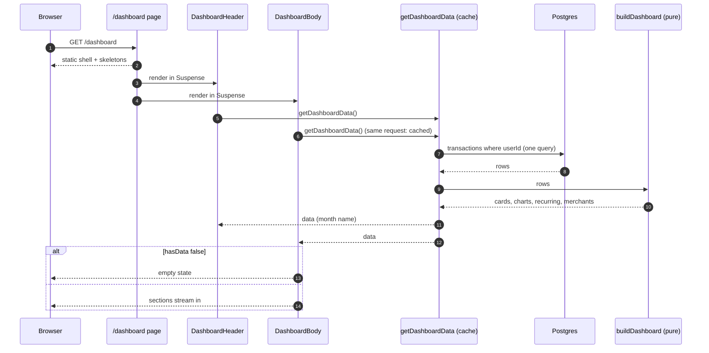

# SpendSense dashboard: file guide

This guide maps the dashboard built in B8 Phase 4 (on `feat/dashboard`): how the user's transactions become the four figures, two charts, recurring payments and top merchants on `/dashboard`. It's written from reading the code as it is, using the entry template from `docs/auth/file-guide.md`, plus a **Must never** line. "Used by" lists come from searching the codebase for imports. For the big picture first, jump to [How it all connects](#how-it-all-connects).

The design is simple on purpose: **one database read, then pure functions.** Every number is worked out by plain functions (rows in, numbers out) that have unit tests; the only database code is one small query.

## Contents

**Shared definitions (`src/lib/`)**
- [`src/lib/finance/months.ts`](#srclibfinancemonthsts)
- [`src/lib/recurring/detect.ts`](#srclibrecurringdetectts)

**Dashboard feature (`src/features/dashboard/`)**
- [`build.ts`](#buildts)
- [`queries.ts`](#queriests)
- [Components](#components)
- [`src/app/(app)/dashboard/page.tsx`](#srcappappdashboardpagetsx)

**Also in this branch**
- [Money out in red](#money-out-in-red)

**[How it all connects](#how-it-all-connects)** · **[Notes for Elizabette](#notes-for-elizabette)**

---

## Shared definitions (`src/lib/`)

### `src/lib/finance/months.ts`

**What it does:** The money definitions the dashboard (and onboarding, in Phase 5) share, plus month arithmetic. All months are calendar months in UTC, because transaction dates are calendar days stored at midnight UTC.

**Runs on:** both (pure; no imports).

**Exports:**
- `monthKey(date)` → `"2026-10"`; `shiftMonth(key, offset)` → another month, across year ends; `monthStart(key)` → its first day.
- `currentMonth(rows)` → **the most recent month that has transactions**, not today's month (statements are historical). `null` with no rows.
- `countsAsIncomeOrSpending(row)` → false for transactions whose category type is `TRANSFER` (own-account transfers and savings).
- `monthTotals(rows, key)` → `{ incomeMinor, expensesMinor, savingsMinor }`: money in, money out (positive), and income minus expenses, **excluding transfers**. Uncategorised rows count.
- `percentChange(current, previous)` → the change as a percentage of the *size* of `previous`, or `null` when there's no previous month of data or the base is 0 (so nothing is shown rather than a made-up number). From −£100 to −£50 is +50%.
- `netBalance(rows, throughKey?)` → all money in minus all money out, **transfers included**, optionally up to a month.
- `hasMonth(rows, key)`, types `MoneyRow`, `CategoryKind`, `MonthTotals`.

**Used by:** `src/lib/recurring/detect.ts`, `src/features/dashboard/build.ts`, `src/features/dashboard/components/*` (month names).

**Tests:** `months.test.ts` (14).

**Must never:** use local time for a month, or count transfers as income or spending.

### `src/lib/recurring/detect.ts`

**What it does:** Finds recurring payments from transactions, simply (Step 8 will refine it). Nothing is stored; it's worked out each time the dashboard loads.

**Runs on:** both (pure).

**Exports:**
- `detectRecurring(rows)` → `RecurringPayment[]`: `merchant`, `typicalAmountMinor`, `dayOfMonth`, `lastPaid`, `nextDue` (one month after the last payment, clamped: 31 Jan → 28 Feb), `monthlyCostMinor`.
- `nextDue(payments, n)` (soonest first) and `mostExpensive(payments, n)`; `oneMonthLater(date)`.

**The rule.** A merchant is recurring when its money-out payments (transfers left out):
1. fall in at least **two different months** with amounts **within 10%** of its typical (median) amount (the brief's rule), and
2. come about monthly: **at most 2 payments per active month** on average, and
3. are consistent: **at least 75%** of its payments are close to the typical amount, and
4. leave on about the **same day** each month (within 7 days).

Rules 2 to 4 were added because rule 1 alone marks frequent, varied spending as recurring: with 15 TfL fares a month, two are always within 10%; a supermarket's random totals match by chance. Each extra rule has a test.

**Used by:** `src/features/dashboard/build.ts`.

**Tests:** `detect.test.ts` (15).

**Must never:** treat money in or transfers as recurring payments.

---

## Dashboard feature (`src/features/dashboard/`)

### `build.ts`

**What it does:** `buildDashboard(rows)` turns the user's transactions into everything the page shows. Pure: no database, no session.

**Runs on:** both (pure; only called on the server).

**Exports:**
- `buildDashboard(rows)` → `DashboardData`: either `{ hasData: false }`, or:
  - `month`: the current month;
  - `cards`: `netBalance`, `income`, `expenses`, `savings`, each `{ valueMinor, changePercent }` against the previous month (`null` without one). The net balance change compares the balance through this month with the balance through last month;
  - `incomeVsExpenses`: the **six months ending at the current month**, oldest first, empty months as 0;
  - `spendingBreakdown`: this month's spending by category: **top four, then "Other", then "Needs review"** (uncategorised spending, its own entry), with the total;
  - `recurring`: `enoughData` (two months or more), the **next three due**, the **three most expensive**, the count and monthly total. Payments already overdue by the latest transaction are left out: they've probably stopped;
  - `topMerchants`: the top five merchants by spending this month.
- `buildBreakdown`, `buildTopMerchants` (exported for tests); types `DashboardRow`, `DashboardData`, `Card`, `MonthBars`, `BreakdownSlice`.

**Depends on:** `@/lib/finance/months`, `@/lib/recurring/detect`.

**Used by:** `queries.ts`.

**Tests:** `build.test.ts` (9).

**Must never:** read the database or the session.

### `queries.ts`

**What it does:** The one database read. Loads the signed-in user's transactions (date, amount, merchant or description, category id, name and type) and passes them to `buildDashboard`.

**Runs on:** server only (`server-only`).

**Exports:**
- `getDashboardData()`: wrapped in React's `cache()`, so the header and body share **one** database read per request.
- `getFirstName()`: the first word of the session user's name, for the greeting.

**Depends on:** `@/lib/db`, `@/lib/session`, `./build`.

**Used by:** `components/dashboard-body.tsx`.

**Security notes:** `userId` from the session only; the query is filtered by it; signed out returns `{ hasData: false }`.

**Must never:** accept a user id, or be called without `<Suspense>` around it.

### Components

All in `src/features/dashboard/components/`. Server components unless marked.

- **`dashboard-body.tsx`**: `DashboardHeader` ("Welcome back, {first name}!" and which month the figures are for) and `DashboardBody` (every section, or the empty state). Both call `await connection()` before reading the session.
- **`summary-cards.tsx`**: the four figures. The first card is **"Net balance"** (not "Total balance"). The change line has an arrow, the word "Up"/"Down" for screen readers, and colour: for Expenses, up is bad (red); for the others, up is good (green). Nothing shows when there's no previous month.
- **`chart-sections.tsx`**: the **Income vs expenses** section (chart, legend, table view) and the **Spending breakdown** (donut with the month's total in the middle, legend with amounts, "Needs review" linking to `/transactions?review=1`, table view with shares).
- **`income-expenses-chart.tsx`** (client): Recharts grouped bars. Round axis steps from `niceTicks`; a token-styled tooltip.
- **`spending-donut.tsx`** (client): Recharts donut, a 2px gap in the card colour between slices.
- **`chart-colors.ts`**: chart colour classes (on the `--chart-*` tokens in `globals.css`) and `niceTicks`. A plain module, so server components (legends) and client components (charts) can both import it. (Constants exported from a `"use client"` file arrive in a server component as client references, not text: that's why this file exists.)
- **`section-card.tsx`**: the card frame (`min-w-0` so charts can shrink at 320px) and `TableView`, the "View as table" disclosure every chart has.
- **`list-sections.tsx`**: **Recurring payments** (Next due / Most expensive, or "Not enough data yet" with one month of data) and **Top merchants** (amounts as text; the bars only repeat them and are hidden from screen readers).
- **`dashboard-extras.tsx`**: the **AI advisor bar** (shown, disabled, "Coming soon"), the **empty state** (faded placeholders behind "No data yet" and **Upload your first statement** → `/imports`), and the loading skeletons.

**Chart colours, and why.** Charts use their own tokens in `src/app/globals.css` (`--chart-income`, `--chart-expenses`, `--chart-rank-1` to `-4`, `--chart-other`, `--chart-review`), each with a light and a dark value, exposed to Tailwind as `text-chart-*` and applied with `currentColor`. Every value was checked with the dataviz palette validator, not by eye:
- Income vs expenses: light `#1a7a4c` + `#d4764e`; dark `#48a872` + `#a8502c`. Both pass; dark expenses is just under 3:1 against the card, so the visible table view is required.
- Spending breakdown: the top four are ranked largest first, so they're a one-hue ordered ramp (light, darkest = biggest: `#0d4a2e`, `#1a7a4c`, `#48a872`, `#66ba8a`; dark, lightest = biggest: `#b8e0c8`, `#7bc89a`, `#48a872`, `#2d8659`). Both pass. The light end is `#66ba8a` rather than `brand-300`, which was 1.99:1 against white (the floor is 2:1). "Other" is grey and "Needs review" coral; every slice is also named, valued and in the table.

### `src/app/(app)/dashboard/page.tsx`

Thin: the header and the body each in `<Suspense>` with a skeleton shaped like what will load.

## Money out in red

On your request, signed amounts now show money out in `text-destructive` (the red token: `#c0392b` light, `#f08a7e` dark; both meet AA on cards): the transactions table and phone cards (`transactions-list.tsx`) and the import preview sample (`map-step.tsx`). Money in stays green with a "+". Dashboard totals aren't signed, so they keep their colours.

---

## How it all connects

### Request flow: loading the dashboard

### Reading the diagram

Arrows are calls and answers, top to bottom in time order. The page sends its static shell straight away; the two `Suspense` parts stream in when the one database read finishes. `cache()` is why the header and body don't each read the database.

## Notes for Elizabette

- **Recharts 3.10 differs from older examples:** charts size themselves with the `responsive` prop (instead of `ResponsiveContainer`), and `Cell` is deprecated, so slice colours use the `shape` prop.
- **Recurring false positives in the demo data:** "Steam Purchase" still shows as recurring (two similar purchases on similar days). With only two data points, no simple rule can tell it from a subscription. Step 8 can refine this.
- **Chart tokens:** added to `globals.css` with your approval; the light donut now passes every check.
- **Stale dev CSS (16 Nov 2026): the charts went near-black.** The dev server kept serving an old compiled stylesheet without the new `--chart-*` tokens and `text-chart-*` classes, even after a restart, because Next 16's dev build cache (`.next/dev/cache`) survives restarts. The fix: stop `npm run dev`, delete `.next/dev/cache` (it's regenerated), start again. Likely trigger: running `npm run check` (which runs `next build`) while the dev server was running. From now on I'll warn before running `npm run check` with your dev server up.
- **Temporary dev page removed** (`src/app/dev/import-check/`), with your approval.
- **Not seen in the browser:** the empty state, because the test account has data. `buildDashboard([])` is tested.
