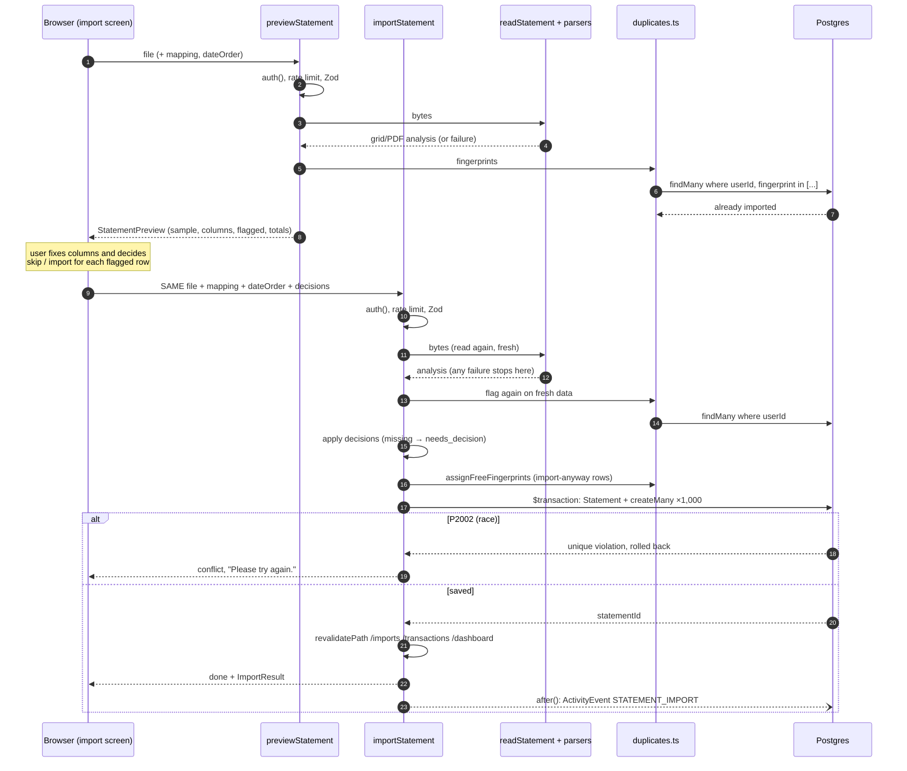
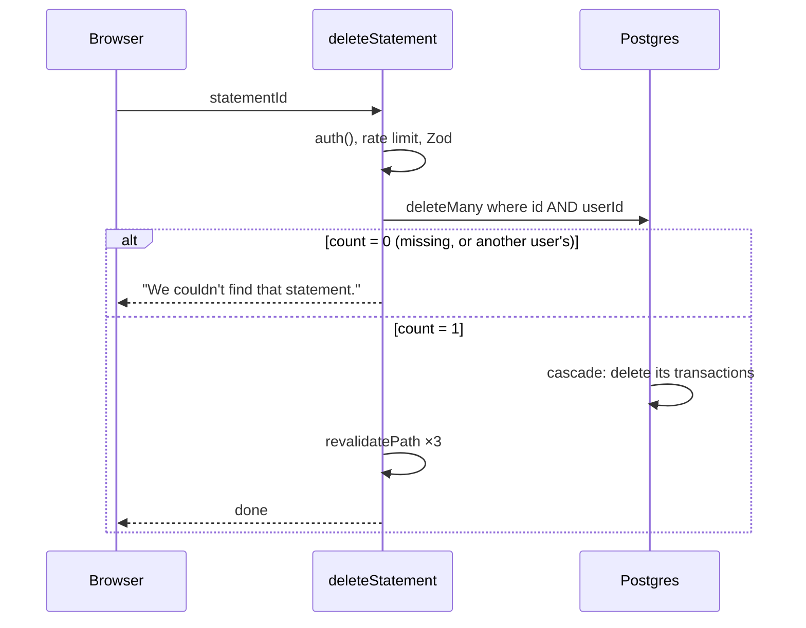
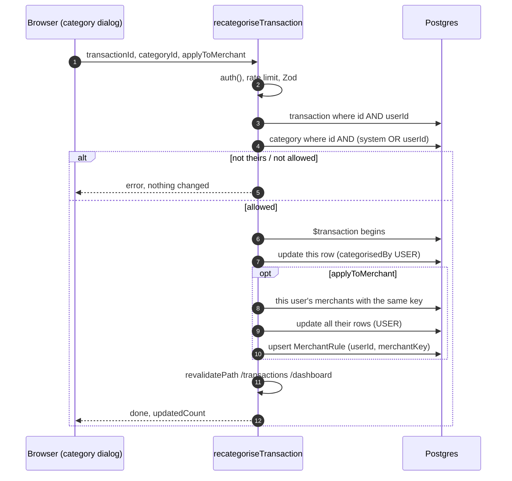
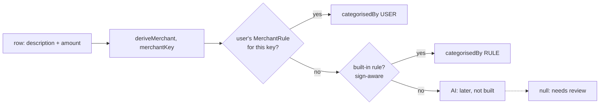
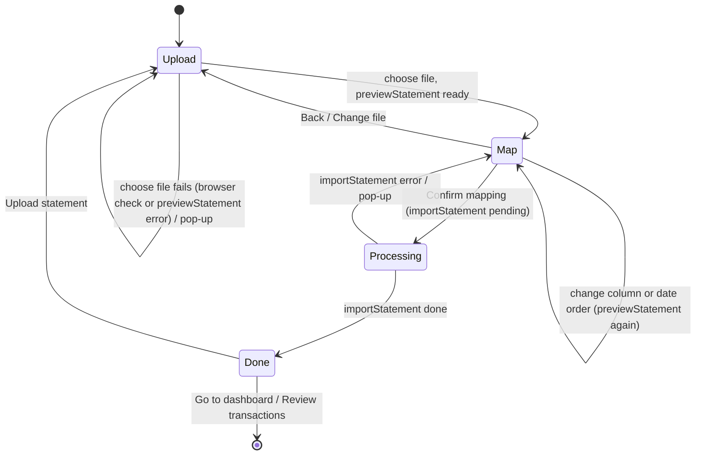

# SpendSense imports: file guide

This guide maps the statement import backend: how an uploaded file becomes saved transactions, how duplicates are handled, and how a statement is listed and deleted. It covers the files added or changed in B8 Phase 1 (on `feat/import-actions`) Phase 2 (built-in categorisation and recategorising, on `feat/categorisation`) and Phase 3 (the `/imports` and `/transactions` screens, on `feat/imports-ui`), written from reading the code as it is. The parsers in `src/features/imports/parsers/` were built earlier and aren't changed here; they're summarised in one short section so you know where they fit. "Used by" lists come from searching the codebase for imports. For the big picture first, jump to [How it all connects](#how-it-all-connects), then come back to the files.

Each entry uses the template from `docs/auth/file-guide.md`, plus a **Must never** line: the rules each file exists to protect.

## Contents

**Library (`src/lib/`)**
- [`src/lib/rate-limit.ts` (changed)](#srclibrate-limitts-changed)

**Server helpers (`src/features/imports/server/`)**
- [`server/form-fields.ts`](#serverform-fieldsts)
- [`server/build-preview.ts` (changed)](#serverbuild-previewts-changed)
- [What was already in place](#what-was-already-in-place)

**Queries and actions**
- [`src/features/imports/queries.ts`](#srcfeaturesimportsqueriests)
- [`actions/preview-statement.ts` (changed)](#actionspreview-statementts-changed)
- [`actions/import-statement.ts`](#actionsimport-statementts)
- [`actions/delete-statement.ts`](#actionsdelete-statementts)

**Phase 2: categorisation (`src/lib/categorisation/`) and transactions**
- [Database: `RULE` and `merchant_rules`](#database-rule-and-merchant_rules)
- [`src/lib/categorisation/merchant.ts`](#srclibcategorisationmerchantts)
- [`src/lib/categorisation/rules.ts`](#srclibcategorisationrulests)
- [`src/lib/categorisation/categorise.ts`](#srclibcategorisationcategorisets)
- [`src/features/transactions/queries.ts`](#srcfeaturestransactionsqueriests)
- [`src/features/transactions/actions/recategorise.ts`](#srcfeaturestransactionsactionsrecategorisets)

**Phase 3: imports UI and transactions page**
- [`src/lib/format.ts`](#srclibformatts)
- [`src/components/ui/badge.tsx`](#srccomponentsuibadgetsx)
- [`src/features/imports/file-rules.ts`](#srcfeaturesimportsfile-rulests)
- [The import flow](#the-import-flow-srcfeaturesimportscomponents)
- [`previous-imports.tsx` and `statement-actions.tsx`](#previous-importstsx-and-statement-actionstsx)
- [`src/app/(app)/imports/page.tsx`](#srcappappimportspagetsx)
- [Transactions components and page](#srcfeaturestransactionscomponents-and-srcappapptransactionspagetsx)
- [Landing page wording](#landing-page-wording)

**Tests**
- [The four new test files](#the-four-new-test-files)
- [Phase 2 tests](#phase-2-tests)

**Demo data and the dev page**
- [`docs/demo/synthetic-statement.csv`](#docsdemosynthetic-statementcsv)
- [`src/app/dev/import-check/` (temporary)](#srcappdevimport-check-temporary)

**[How it all connects](#how-it-all-connects)**

---

## Library (`src/lib/`)

### `src/lib/rate-limit.ts` (changed)

**What it does:** Counts attempts per key in the `rate_limits` table with one atomic `INSERT … ON CONFLICT` statement, and says whether this attempt is allowed. `LIMITS` holds every limit in the app in one place. Phase 1 added `deleteStatementUser` (20 per hour).

**Runs on:** server only (`server-only`).

**Exports:**
- `LIMITS`: named limits. The import ones are `previewStatementUser` (30/hour), `importStatementUser` (10/hour) and `deleteStatementUser` (20/hour, Phase 1). Phase 2 added `recategoriseUser` (120/hour), generous because people tidy many rows in one sitting.
- `rateLimit(key, limit)`: counts this attempt and returns `{ allowed, remaining, resetAt }`.
- `hashIdentifier`, `deleteExpiredRateLimits`: unchanged.

**Depends on (imports):**
- Internal: `@/lib/db` (the counter table).
- Packages: `node:crypto` (`hashIdentifier`).
- Environment variables read: none.

**Used by (imported by):**
- `src/features/imports/actions/preview-statement.ts`, `import-statement.ts`, `delete-statement.ts` (per-user limits), plus the auth actions (see the auth guide).

**Security notes:** Every action that writes, or does heavy work like parsing a 4 MB file, is capped per user, so one account can't overload the server or the database. Keys are `preview:user:<id>`, `import:user:<id>` and `deletestatement:user:<id>`.

**Must never:** be called with anything from the form as the key; the user id comes from the session.

---

## Server helpers (`src/features/imports/server/`)

### `server/form-fields.ts`

**What it does:** Two tiny helpers that turn raw `FormData` values into something Zod can check. `jsonField` parses a JSON text field; `textField` keeps a non-empty string. They don't validate anything themselves: the caller always runs a Zod schema afterwards. Moved here from `preview-statement.ts` so the preview and import actions read their fields the same way.

**Runs on:** server (plain module; no `server-only` marker, but only imported by server actions).

**Exports:**
- `jsonField(value)`: `undefined` when the field is missing or empty, `null` when it isn't valid JSON (so the schema rejects it), otherwise the parsed value.
- `textField(value)`: the string, or `undefined` when missing, empty or a file.

**Depends on (imports):** none.

**Used by (imported by):**
- `actions/preview-statement.ts` (`mapping`, `dateOrder`)
- `actions/import-statement.ts` (`mapping`, `dateOrder`, `decisions`)

**Security notes:** Returning `null` for bad JSON (instead of throwing) means a malformed field becomes a normal validation error, never a crash.

**Why `undefined` and `null` differ:** `.optional()` schemas accept `undefined` ("not sent"), but reject `null` ("sent, but broken"). That's how "no mapping" and "bad mapping" get different answers.

### `server/build-preview.ts` (changed)

**What it does:** Turns a successful `readStatement` result plus the flagged rows into `StatementPreview`: everything the import dialog shows (file, bank, columns with samples, a 20-row sample, flagged duplicates, row issues, totals) and nothing it doesn't need. Phase 1 only added `export` to `bankNameOf`, so the import action stores the same bank name the preview shows.

**Runs on:** server (pure functions; no database).

**Exports:**
- `buildPreview(read, rows)`: builds the preview. Totals are integer pence; money in and money out are added up separately.
- `bankNameOf(read)` (newly exported): the display name of the detected bank, or `null`.
- `isMappableFailure(failure)`: true for `no_date_column` and `no_amount_column`, the two failures a user can fix by choosing columns.
- Types: `StatementPreview`, `PreviewColumns`, `PreviewColumn`, `PreviewRow`, `FlaggedPreviewRow`, `MappableFailure`.

**Depends on (imports):** types from the parsers, `./duplicates` and `./read-statement` (types only).

**Used by (imported by):**
- `actions/preview-statement.ts` (`buildPreview`, `isMappableFailure`)
- `actions/import-statement.ts` (`bankNameOf`)

**Security notes:** Any column whose header looks like a sort code, account number or IBAN gets `sampleHidden: true` and `sample: null`, so those values never reach the browser.

**Must never:** send a sensitive column's sample to the browser.

### What was already in place

Built before Phase 1 and unchanged (tests pass):

- `parsers/**`: `csv.ts` and `excel.ts` read files into a grid of text cells; `pdf.ts` pulls text out of PDFs with `pdf-parse`; `columns.ts` and `profiles.ts` work out which column is which; `extract.ts`, `money.ts`, `dates.ts` and `normalise.ts` turn rows into `{ date, description, amountMinor }`; `balance.ts` checks running balances; `analyse.ts` and `pdfStatement.ts` decide whether the file reads as a statement; `fingerprint.ts` gives every row a SHA-256 fingerprint (`addFingerprints`, `hashFingerprint`).
- `schemas.ts`: `columnMappingSchema`, `dateOrderSchema`, `duplicateDecisionsSchema` (`{ defaultChoice?, overrides: { [fingerprint]: "skip" | "import" } }`).
- `server/read-statement.ts`: `readStatement` checks size, file name, and that the extension matches the real contents, then reads and analyses. `MAX_FILE_BYTES` is 4 MB.
- `server/duplicates.ts`: `findExistingFingerprints` (which fingerprints this user already has, in batches of 5,000), `flagDuplicates` (marks rows, removes nothing), `assignFreeFingerprints` (finds an unused fingerprint for an "import anyway" row).

---

## Queries and actions

### `src/features/imports/queries.ts`

**What it does:** Database reads for the imports feature. For now one function: the signed-in user's statements, newest first, with only the columns the "Previous imports" list needs.

**Runs on:** server only (`server-only`). Call it from server components inside `<Suspense>`, because it reads the session.

**Exports:**
- `getStatements()` → `Promise<StatementListItem[]>`: `id`, `fileName`, `fileType`, `bankName`, `createdAt`, `importedCount`, `status`, `periodStart`, `periodEnd`. Returns `[]` when signed out.
- `StatementListItem`: the row type.

**Depends on (imports):**
- Internal: `@/lib/session` (`getSession`, one session lookup per request), `@/lib/db`, `@/generated/prisma/client` (enum types).
- Environment variables read: none.

**Used by (imported by):**
- `src/app/dev/import-check/page.tsx` (temporary). The `/imports` page uses it from Phase 3.

**Security notes:** Filtered by `userId` from the session, never from the URL. Selects only the listed columns.

**Must never:** take a user id as an argument, or return another user's rows.

### `actions/preview-statement.ts` (changed)

**What it does:** The first half of an import. Reads the uploaded file, checks it's a bank statement, flags rows matching an earlier upload, and returns a `StatementPreview`. It saves nothing. Phase 1 only moved `jsonField` and `textField` out to `server/form-fields.ts`.

**Runs on:** server action file (`"use server"`). Used with `useActionState` in a client component.

**Exports:**
- `previewStatement(prevState, formData)` → `PreviewState`: `idle`, `error` (`reason`, `message`) or `ready` (`preview`). Fields: `file`, optional `mapping` (JSON), optional `dateOrder` (`dmy` / `mdy`).
- Types: `PreviewState`, `PreviewFailureReason`.

**Depends on (imports):** `@/auth`, `@/lib/rate-limit`, the parsers, `../schemas`, `../server/*`.

**Used by (imported by):**
- `actions/import-statement.ts` (type `PreviewFailureReason` only)
- `src/app/dev/import-check/_components/dev-import-form.tsx` (temporary)

**Security notes:** Auth, then the rate limit, then Zod on every field, then the size check before reading. A file that only needs a column chosen (`no_date_column`, `no_amount_column`) is still previewed, with `columns.needsMapping` set, so the user can fix it. Errors log `error.name` only.

### `actions/import-statement.ts`

**What it does:** The second half of an import. The browser sends the **same file again**, plus the final column choices and a decision for every flagged duplicate. The action re-reads and re-checks everything on fresh data, applies the decisions, and saves one `Statement` and its `Transaction` rows in a single database transaction: all or nothing.

**Runs on:** server action file (`"use server"`). Used with `useActionState` in a client component.

**Exports:**
- `importStatement(prevState, formData)` → `ImportState`: `idle`, `error` (`reason`, `message`) or `done` (`result`).
  - Fields: `file`, optional `mapping` (JSON), optional `dateOrder`, required `decisions` (JSON, `duplicateDecisionsSchema`).
- `ImportResult`: `statementId`, `importedCount`, `duplicateCount` (flagged rows skipped), `skippedCount` (zero-amount rows), `issueCount` (rows that couldn't be read), `categorisedCount` (rows given a category by the user's rules or the built-in rules), `needsReviewCount` (rows with no category), `periodStart` / `periodEnd` (ISO dates).
- `ImportFailureReason`: every preview reason, plus `needs_decision`, `nothing_to_import` and `conflict`.

**Depends on (imports):**
- Internal: `@/auth` (the user), `@/lib/db`, `@/lib/rate-limit`, `@/generated/prisma/client` (`Prisma` error class), the parsers (`addFingerprints`, `isoDateToUtcDate`), `../schemas`, `../server/duplicates`, `../server/form-fields`, `../server/read-statement`, `../server/build-preview` (`bankNameOf`).
- Packages / Next: `next/cache` (`revalidatePath`), `next/server` (`after`).
- Environment variables read: none.

**Used by (imported by):**
- `src/app/dev/import-check/_components/dev-import-form.tsx` (temporary). The `/imports` and onboarding screens use it from Phase 3.

**The steps, and why each is there:**
1. **Auth.** `userId` from `auth()`. Never from the form.
2. **Rate limit**, `import:user:<id>`, 10 an hour.
3. **Validate** `file`, `mapping`, `dateOrder`, `decisions` with Zod. A missing or malformed `decisions` is `invalid_input`.
4. **Read the file again.** The server holds nothing between preview and import, so it can't trust anything from the earlier preview.
5. **Any statement failure stops the import.** Unlike the preview, `no_date_column` / `no_amount_column` get no pass: by now the user's mapping should have cleared them.
6. **Fingerprint and flag** against the database *now*. If another tab imported the same rows since the preview, they're flagged here.
7. **Apply decisions.** For each flagged row: `overrides[fingerprint]`, else `defaultChoice`. No decision at all → `needs_decision`, and nothing is saved (the action never guesses). `skip` → counted in `duplicateCount`. `import` → `assignFreeFingerprints` gives the row a fingerprint nothing else uses (every fingerprint in the file is reserved), keeping file order. If no free fingerprint is found → `unexpected`.
8. **Nothing left** → `nothing_to_import`, nothing saved.
8b. **Categorise** (Phase 2): load the user's `MerchantRule`s once (one query, not one per row), run `categoriseRows` from `@/lib/categorisation/categorise`, and count how many rows got a category.
9. **Save in one `db.$transaction`** (timeout 60 s): create the `Statement` (`COMPLETED`, cleaned file name, file type, bank name, period, counts), then `createMany` transactions in chunks of 1,000, each with its `merchant`, `categoryId` and `categorisedBy`. If any step throws, Postgres rolls everything back.
10. **Errors.** Prisma `P2002` (the unique `[userId, fingerprint]` index was hit because two imports raced) → `conflict`, "Please try again." Anything else → log `error.name` only → `unexpected`.
11. **After the response,** `after()` records an `ActivityEvent` of type `STATEMENT_IMPORT`, inside its own `try/catch`, so a failure there never breaks the import.
12. **Refresh** `/imports`, `/transactions` and `/dashboard` with `revalidatePath`, and return `done`.

**Why it's built this way:**
- **Same file twice, not a server-side draft.** Storing the upload between steps would mean storing bank data we promised not to keep. Re-reading is cheap (4 MB cap) and always works on fresh data.
- **Fingerprints, not "delete duplicates".** A repeated row might be real (two identical coffees). Flagging and asking keeps the user in control; the unique index stops accidental double-saves.
- **`revalidatePath` rather than `refresh()`.** User data isn't cached with `"use cache"`, so there's no tag to invalidate. `refresh()` only re-renders the page the user is on. `revalidatePath` also marks the other visited pages (`/transactions`, `/dashboard`) stale, which is what "refresh the imports, transactions and dashboard views" needs.
- **Statement period.** `periodStart` / `periodEnd` cover every dated row in the file, including skipped duplicates: they describe the statement, not just what was newly saved.

**Security notes:** Session-only user id; rate limited; Zod on every field; size checked before reading; every database read and write is scoped to `userId`; only error names are logged.

**Must never:** drop a row with a cost (only zero-amount rows are skipped, and counted); remove a duplicate silently; save part of a statement; store the uploaded file; log descriptions, amounts or parser messages.

### `actions/delete-statement.ts`

**What it does:** Deletes one of the user's statements. Its transactions go with it through the database's cascade rule (`onDelete: Cascade` on `Transaction.statement`).

**Runs on:** server action file (`"use server"`). Used with `useActionState`.

**Exports:**
- `deleteStatement(prevState, formData)` → `DeleteStatementState`: `idle`, `error` (`message`) or `done`. Field: `statementId`.

**Depends on (imports):** `@/auth`, `@/lib/db`, `@/lib/rate-limit`, `zod`, `next/cache` (`revalidatePath`).

**Used by (imported by):**
- `src/app/dev/import-check/_components/dev-import-form.tsx` (temporary). The `/imports` "Previous imports" menu uses it from Phase 3.

**Security notes:**
- **The ownership check and the delete are one statement:** `deleteMany({ where: { id, userId } })`. Another user's statement matches nothing, so `count` is 0. There's no gap between "check" and "delete" for anything to slip through.
- "Not found" and "not yours" get the same message, so the action never reveals that someone else's statement id exists.
- Rate limited (`deletestatement:user:<id>`, 20 an hour). Errors log `error.name` only.

**Must never:** delete by id alone without `userId` in the same `where`.

---

## Phase 2: categorisation and transactions

### Database: `RULE` and `merchant_rules`

Two migrations, one each:

**`20261116173449_add_rule_categorised_by`**
```sql
ALTER TYPE "categorised_by" ADD VALUE 'RULE';
```
`Transaction.categorisedBy` records *who* chose a category: `USER`, `RULE` (the built-in keyword rules) or `AI` (later). `null` means nobody has, so the row needs review. Keeping "who" lets a later step know what it may and may not overwrite.

**`20261116173525_add_merchant_rules`**: the `MerchantRule` model (table `merchant_rules`): `id`, `userId`, `merchantKey`, `categoryId`, `createdAt`, `updatedAt`.
```sql
CREATE TABLE "merchant_rules" (
    "id" TEXT NOT NULL,
    "user_id" TEXT NOT NULL,
    "merchant_key" TEXT NOT NULL,
    "category_id" TEXT NOT NULL,
    "created_at" TIMESTAMP(3) NOT NULL DEFAULT CURRENT_TIMESTAMP,
    "updated_at" TIMESTAMP(3) NOT NULL,
    CONSTRAINT "merchant_rules_pkey" PRIMARY KEY ("id")
);
CREATE INDEX "merchant_rules_category_id_idx" ON "merchant_rules"("category_id");
CREATE UNIQUE INDEX "merchant_rules_user_id_merchant_key_key" ON "merchant_rules"("user_id", "merchant_key");
ALTER TABLE "merchant_rules" ADD CONSTRAINT "merchant_rules_user_id_fkey" FOREIGN KEY ("user_id") REFERENCES "users"("id") ON DELETE CASCADE ON UPDATE CASCADE;
ALTER TABLE "merchant_rules" ADD CONSTRAINT "merchant_rules_category_id_fkey" FOREIGN KEY ("category_id") REFERENCES "categories"("id") ON DELETE CASCADE ON UPDATE CASCADE;
```
- **One rule per merchant per user** (`@@unique([userId, merchantKey])`). That's what makes `upsert` possible.
- **Cascades:** deleting a user deletes their rules; deleting a category deletes rules that point to it, so no rule ever points at nothing.
- `@@index([categoryId])` keeps that cascade fast.

**Must never:** be read without `where: { userId }`.

### `src/lib/categorisation/merchant.ts`

**What it does:** Turns raw bank text into a clean merchant name, and a lowercase key for matching. `"TESCO STORES 4521 LONDON GB"` → `"Tesco Stores"` → key `"tesco stores"`.

**Runs on:** both (pure functions; no imports at all).

**Exports:**
- `deriveMerchant(description)` → `string`, never empty (falls back to the description, then `"Unknown"`), at most 100 characters. Steps: payment-type and processor prefixes (`CARD PAYMENT TO`, `DD`, `SQ *`, `PAYPAL *`), anything after a `*`, web domains, dates, times, references, masked card numbers, words containing digits (store numbers), then trailing cities, countries, legal suffixes (`LTD`, `PLC`) and payment words (`DD`, `REFUND`), then title case with a few acronyms kept (`TfL`, `HMRC`, `KFC`).
- `merchantKey(merchant)` → lowercase letters, digits and `&`, single spaces. Two spellings of one merchant ("Co-Op", "CO OP") share a key.

**Used by (imported by):** `categorise.ts` (deciding categories), `src/features/transactions/actions/recategorise.ts` (finding a row's merchant and its rule key).

**Why it's built this way:** Rules are remembered per merchant, so the same shop must always produce the same key, whichever branch or card number appears in the text. Being pure makes it easy to test with a table of real-looking examples.

**Must never:** return an empty string, or depend on the database.

### `src/lib/categorisation/rules.ts`

**What it does:** The built-in keyword rules: common UK merchants and payment words mapped to the 25 seeded system category ids in `prisma/seed.ts`. One ordered list; the **first matching rule wins**, so specific rules sit above broad ones ("TESCO MOBILE" is a bill before "TESCO" is groceries; "UBER EATS" is eating out before "UBER" is transport; shopping, with broad names like "NEXT" and "AMAZON", comes last).

**Runs on:** both (pure).

**Exports:**
- `matchBuiltInRule(description, amountMinor)` → a system category id, or `null`.
- `RULES`: the ordered list (exported for tests).
- `SystemCategoryId`: the 25 seeded ids as a type, so a typo in a rule is a type error.

**Sign-aware matching:**
- **Money out**: rules marked `out` or `any`. Income categories are never used.
- **Money in**: rules marked `in` or `any` (salary, benefits, refunds, interest, savings and transfers). If none matches but a spending rule does ("TESCO", "RYANAIR"), the money came back from a shop, so it's `sys_refunds`.
- **Savings and transfers** (`any`): Monzo pots, ISAs, own-account and credit-card payments. They're type `TRANSFER`, so the dashboard won't count them as income or spending.
- Words match **whole words only** (`SKYSCANNER` is not `SKY`; `CASHBACK` is not `CASH`; `PARENTAL` doesn't contain the word `RENT`).

**Why it's built this way:** Simple keyword rules are predictable, fast and testable, and they cover most everyday spending. Anything uncertain is left for the user (and later the AI) rather than guessed.

**Must never:** fall back to `sys_general` for an unknown row, or give an income category to money out.

### `src/lib/categorisation/categorise.ts`

**What it does:** The **single entry point** for categorising. For each row it returns `{ merchant, categoryId, categorisedBy }`.

**Runs on:** both (pure).

**Exports:**
- `categoriseRows(rows, userRules)` → one `CategoryDecision` per row, in order. `rows` are `{ description, amountMinor }`; `userRules` are `{ merchantKey, categoryId }`.
- Types: `CategorisableRow`, `UserMerchantRule`, `CategoryDecision`, `CategorisedBy`.

**Order:** 1. the user's merchant rule (`USER`), whatever the sign; 2. a built-in rule (`RULE`); 3. AI (not built; a marked comment shows exactly where it goes); 4. `null`: needs review.

**Depends on (imports):** `./merchant`, `./rules`.

**Used by (imported by):** `src/features/imports/actions/import-statement.ts`.

**Room for AI:** only rows still `null` after the rules will be sent to the AI categoriser, which will set `categorisedBy: "AI"`. AI never overrides `USER` or `RULE`. When that's added, the function becomes `async`, and its one caller awaits it.

**Must never:** override a user's rule with a built-in one, or guess.

### `src/features/transactions/queries.ts`

**What it does:** Database reads for the transactions page and the category picker.

**Runs on:** server only (`server-only`). They read the session, so call them from server components inside `<Suspense>`, after `await connection()`.

**Exports:**
- `getTransactions({ page, review })` → `{ transactions, page, pageCount, totalCount }`. 50 per page (`TRANSACTIONS_PER_PAGE`), newest first, with `merchant`, `amountMinor`, `categorisedBy` and the category's `id`, `name` and `type`. `review: true` returns only rows with no category. `page` can come straight from the URL: anything that isn't a whole number ≥ 1 becomes 1, and a page past the end shows the last page.
- `getCategories()` → system categories plus the user's own, each with `isOwn`, sorted by type then name.
- `getNeedsReviewCount()` → how many of the user's rows have no category.

**Depends on (imports):** `@/lib/session`, `@/lib/db`, `@/generated/prisma/client` (types).

**Used by (imported by):** nothing yet; the `/transactions` page in Phase 3.

**Security notes:** Every query is filtered by `userId` from the session. Signed out returns empty results. Sorting by date, then `createdAt`, then `id` keeps same-day rows from jumping between pages.

**Must never:** accept a user id, or return another user's categories.

### `src/features/transactions/actions/recategorise.ts`

**What it does:** Changes a transaction's category, and optionally every transaction from the same merchant, and remembers that choice for future imports.

**Runs on:** server action file (`"use server"`). Used with `useActionState`.

**Exports:**
- `recategoriseTransaction(prevState, formData)` → `RecategoriseState`: `idle`, `error` (`message`) or `done` (`updatedCount`). Fields: `transactionId`, `categoryId`, `applyToMerchant` (a checkbox: `"on"` when ticked, missing when not; `"true"`/`"false"` also accepted).

**Steps:**
1. Auth (`auth()`), rate limit `recategorise:user:<id>` (120/hour), Zod.
2. The transaction must be this user's (`findFirst where { id, userId }`).
3. The category must be a system one or this user's own (`where { id, OR: [{ userId: null }, { userId }] }`).
4. In one `db.$transaction`:
   - always: update that row to the category, `categorisedBy: "USER"` (and save its merchant if it had none: rows imported in Phase 1 have no merchant);
   - with `applyToMerchant`: find this user's merchant names whose `merchantKey` matches, update all their rows, and `upsert` the `MerchantRule` (create it, or change the existing one).
5. Refresh `/transactions` and `/dashboard` with `revalidatePath`; return the number of rows changed.

**Depends on (imports):** `@/auth`, `@/lib/db`, `@/lib/rate-limit`, `@/lib/categorisation/merchant`, `zod`, `next/cache`.

**Used by (imported by):** nothing yet; the category dialog on `/transactions` in Phase 3.

**Why match by key, not by name:** imports match rules by `merchantKey`, so the merchant-wide update uses the same test. "Tesco Stores" and "TESCO STORES" are one merchant.

**Security notes:** session-only user id; every read and write includes `userId`; a foreign category or transaction gets an error and changes nothing; errors log `error.name` only.

**Must never:** change another user's rows, or accept a category the user can't see.

## Phase 3: imports UI and transactions page

All UI. The pages stay thin server components; anything that reads the session sits inside `<Suspense>` after `await connection()`; interactive parts are client components.

### `src/lib/format.ts`

**What it does:** Display formatting, used only at the edge: money is stored as integer pence and dates as calendar days.

**Runs on:** both (pure, browser-safe).

**Exports:**
- `formatMoney(pence)` → `"£1,234.56"` / `"-£12.50"`; `formatMoneyAbs(pence)` → no sign (for "money in" / "money out" totals).
- `formatDay(date)` → `"11 Apr 2026"`; `formatMonthYear(date)` → `"April 2026"`; `formatPeriod(start, end)` → `"April 2026"`, `"May to October 2026"` or `"December 2025 to January 2026"`.
- `plural(count, word)` → `"1 transaction"`, `"1,420 transactions"`.

**Used by:** the imports components, the transactions list; the dashboard later. It's in `src/lib/` because more than one feature uses it.

**Why UTC:** a statement date is a calendar day. Read in local time, "2026-04-01" could show as 31 March for someone west of UTC. Every formatter reads dates as UTC.

**Must never:** be used to do maths on money; it only formats.

### `src/components/ui/badge.tsx`

**What it does:** The small status pill ("Complete", "Needs review", "Matched", "Please check").

**Runs on:** both (server component, no state).

**Exports:** `Badge({ tone, icon, children })`, with tones `success` (accent), `warning` (coral-light with coral-strong text), `error` (destructive outline) and `neutral`.

**Accessibility:** every pair meets WCAG AA for small text. The icon is decorative (`aria-hidden`); the word carries the meaning, so colour is never the only signal.

### `src/features/imports/file-rules.ts`

**What it does:** The upload checks the browser does before sending a file: extension (`.csv`, `.xlsx`, `.xls`, `.pdf`), empty, and the 4 MB limit.

**Runs on:** browser (plain module).

**Exports:** `MAX_UPLOAD_BYTES`, `ACCEPTED_EXTENSIONS`, `ACCEPT_ATTRIBUTE` (for `<input accept>`), `checkUpload(file)` → `"wrong_file_type" | "empty" | "too_large" | null`.

**Why it exists:** a request bigger than the Server Actions body limit (4.5 MB in `next.config.ts`) is rejected before the action runs, so the action can't explain it. The browser must. The server still checks everything again.

**Tests:** `file-rules.test.ts` checks the browser limit equals the server's `MAX_FILE_BYTES`, so they can't drift apart.

### The import flow (`src/features/imports/components/`)

**`import-flow.tsx`** (client) is the whole `/imports` screen: Upload → Map columns → Processing → Done.
- It holds the chosen `File` in memory. The server keeps nothing between preview and import, so the same file is sent again with the final choices.
- Its state is a small state machine run through `useActionState(runFlow, START)`. Each user action is an *intent* (`choose`, `remap`, `import`, `reset`); `runFlow` calls the right server action and returns the next state. There's no `useEffect` copying results into state, so a result can never be applied twice or late.
- "Processing" isn't stored: it's shown while the `import` intent is pending.
- `mapping` and `dateOrder` are only sent once the user changes them, so a bank's built-in profile (which can carry extra handling) is used until then.
- Focus moves to the page heading when the step changes, for screen reader and keyboard users.
- The failure pop-up uses the shared `Dialog`. Its wording comes from `failure-copy.ts`; a failure after a column change gets "That column choice didn't work" and **Keep editing**, because the previous choices are kept.

**`stepper.tsx`**: the four-step progress row. An ordered list; the current step has `aria-current="step"`; finished steps have a visually hidden "(completed)".

**`upload-step.tsx`**: drop zone plus **Browse files**. The real `<input type="file">` is visually hidden and out of the tab order; keyboard users use the button. Text reads "CSV, Excel or PDF · Max 4 MB".

**`map-step.tsx`**: step 2. The file bar ("Change file"), the summary (bank, transactions, dates, money in and out, zero rows skipped), the column table (`Read as` select with Date, Description, Amount, Money in, Money out, Balance, Transaction ID, Skip; "Hidden for privacy" for sensitive columns; uncertain roles highlighted in coral with "Please check"), the date-order choice when it's uncertain, the 20-row sample, rows that couldn't be read, and the duplicates section. **Confirm mapping** stays disabled, with the reason shown and linked by `aria-describedby`, until the missing column is chosen and every flagged row has a choice. Changing a select calls `previewStatement` again with the new mapping. PDFs have no column table.

**`duplicates-section.tsx`**: the flagged rows. Rows matched by the bank's transaction ID start as **Skip**; rows matched by date, amount and description start **undecided** (two identical coffees can both be real). **Skip all** / **Import all**, plus a Skip/Import radio pair per row (each in a `fieldset` with a visually hidden `legend` naming the row). Every choice is sent as an explicit per-row override.

**`processing-step.tsx`**: step 3. Four stages; "Reading rows" and "Normalising data" are ticked because they finished with the preview; the rest show as in progress with an indeterminate bar (`role="progressbar"` with no value). No invented percentages or counts. Animations only run when the user hasn't asked for reduced motion.

**`done-step.tsx`**: step 4. "Your {period} statement is ready", the three figures, a line for skipped duplicates, zero-amount rows and unreadable rows when any are above zero, the review banner only when `needsReviewCount > 0`, and **Go to dashboard** / **Review transactions** (`/transactions?review=1`).

**`failure-copy.ts`**: plain-English title and body for every failure `reason`, falling back to the server's message.

### `previous-imports.tsx` and `statement-actions.tsx`

- **`previous-imports.tsx`** (server component, inside `<Suspense>`, `await connection()` first): "Previous imports" from `getStatements()`: file name, import date, transaction count, status badge.
- **`statement-actions.tsx`** (client): the "…" menu (a disclosure button with `aria-expanded`; Escape and outside clicks close it; focus moves to **Delete**) and the confirm dialog: "This removes {file} and its N transactions. This can't be undone." Focus starts on **Cancel**. Uses `useActionState(deleteStatement)`. After a delete, focus moves to the "Previous imports" heading, because the row that opened the dialog is gone.

### `src/app/(app)/imports/page.tsx`

Thin: renders `ImportFlow`, passing the `PreviousImports` list (in `<Suspense>` with a skeleton) as a prop. The list is shown on the upload step.

### `src/features/transactions/components/` and `src/app/(app)/transactions/page.tsx`

- **`transactions-list.tsx`** (server component): the **All transactions** / **Needs review (N)** filter links (`aria-current="page"` on the active one), then the transactions, then pagination (**Previous** / **Next** links that keep the filter). On phones each transaction is a card (merchant and amount, description, date and category) so the category and amount stay in view; from the `sm` breakpoint up it's a table with a visually hidden caption. Money in is green with a "+", so colour isn't the only signal. Empty states for "no transactions yet" (with a link to `/imports`) and "nothing needs review".
- **`category-control.tsx`** (client): the category cell. Shows the category name, or a **Needs review** badge, as a button whose label says what it does ("Change category for Tesco Stores, currently Groceries"). It opens a dialog: a grouped category select (Spending, Income, Transfers and savings), and a checkbox, ticked by default, "Also apply to other transactions from {merchant} and remember for future imports". It submits `recategoriseTransaction` with `useActionState`. If the saved row leaves the list (the "Needs review" filter), focus moves to the page heading instead of being lost.
- **The page** reads `searchParams` inside `<Suspense>`; only `review=1` and a string `page` are used; everything else falls back to all rows on page 1.

### Landing page wording

`features.tsx` and `how-it-works.tsx` now say "CSV, Excel and PDF".

## Tests

### The four new test files

All use invented data. None touch a real database: `db`, `auth` and `rateLimit` are replaced with small fakes using `vi.hoisted` and `vi.mock`, the same way `server/duplicates.test.ts` does. `next/server` (`after`) and `next/cache` (`revalidatePath`) are faked too, so tests can check what ran after the response and which views were refreshed.

- **`server/build-preview.test.ts`** (9 tests): money in and out in pence, row and zero-row counts, date range whatever the file order, the 20-row sample cap, flagged rows (kept in the totals), sort-code and account-number samples hidden, detected column roles, a PDF has no columns.
- **`actions/preview-statement.test.ts`** (10 tests): signed out, rate limited, missing file, three kinds of bad input, wrong file type, not a statement (a PDF shopping list), a file that only needs a column chosen still previews, and the happy path flags only *this user's* earlier rows.
- **`actions/import-statement.test.ts`** (23 tests): every check before reading (signed out, rate limited, missing file, five kinds of bad input, wrong file type, not GBP, mappable failure blocked); saving (exact statement and transaction rows, the 60 s timeout, 2,500 rows → 3 inserts, activity only after the response, views refreshed); duplicates (skip, all skipped saves nothing, missing decision, override beats default, import anyway gets a new fingerprint in file order, other users' rows ignored); database errors (`P2002` → `conflict` with nothing saved, any other error logs only its name, never the message).
- **`actions/delete-statement.test.ts`** (8 tests): own statement deleted and views refreshed, another user's statement can't be deleted, missing id gets the same answer, signed out, rate limited, three bad ids.

The fake `$transaction` keeps rows only if the callback finishes without throwing, the same promise Postgres makes, so "nothing saved" checks are meaningful.

### Phase 2 tests

- **`src/lib/categorisation/merchant.test.ts`** (31): a table of descriptions → merchant names (store numbers, cities, prefixes, processors, domains, dates, references, card numbers, acronyms), fallbacks, never empty, length cap, and `merchantKey`.
- **`src/lib/categorisation/rules.test.ts`** (74): a table of description → category for money out and money in, refunds from shops, income never used for money out, savings both ways, rows that must stay `null`, whole-word matching, and checks that every rule uses a seeded id and every seeded category is covered.
- **`src/lib/categorisation/categorise.test.ts`** (7): user rule → built-in rule → needs review; user rule beats built-in; user rules work whatever the sign; matched by key; never General; order kept.
- **`import-statement.test.ts`** (now 25): saved rows carry merchant, category and `categorisedBy`; this user's rules are used and another user's aren't; rules are loaded once; categories stay lined up with rows across insert chunks.
- **`src/features/transactions/actions/recategorise.test.ts`** (14): signed out, rate limited, bad input, another user's transaction, another user's category, a missing category, one row only (no rule saved), the user's own category, merchant-wide update (by key, this user only), rule created, rule updated not duplicated, merchant worked out for an older row.

---

## Demo data and the dev page

### `docs/demo/synthetic-statement.csv`

**What it is:** The demo and test statement from here on. 297 invented transactions from May to October 2026: salary, rent, council tax, utilities, subscriptions, groceries, TfL, eating out, shopping, a savings pot transfer, and a few one-offs (a flight, a refund, a cash withdrawal, a tax refund, a donation). Columns `Date,Description,Amount,Balance`, day-first dates, signed amounts, a running balance that checks out.

**Notes:** Merchant names are real UK brands so the Phase 2 rules have something to match; every transaction, amount, the employer and the landlord are invented. It reads with no issues and a consistent balance check. Never replace it with a real statement.

### `src/app/dev/import-check/` (temporary)

**What it does:** A bare dev-only page at `/dev/import-check` for the Phase 1 manual check: upload a file, call `previewStatement` or `importStatement`, and print the raw result; list `getStatements()` with a delete button per statement.

**Files:** `page.tsx` (server component; the statement list sits inside `<Suspense>` because it reads the session) and `_components/dev-import-form.tsx` (client component; two `useActionState` hooks with `formAction` on each button).

**Security notes:** Calls `notFound()` in production builds, so it can't ship by accident. Not linked from anywhere. The actions do their own auth, so a signed-out visitor gets `signed_out`.

**Notes:** Remove in Phase 3, with Elizabette's approval.

---

## How it all connects

### Request flow: upload → preview → import



### Request flow: deleting a statement



### Request flow: recategorising a transaction



### How a row gets its category on import



### The import screen as a state machine (Phase 3)



Every arrow is one *intent* passed to `runFlow` through `useActionState`. "Processing" is not a stored state: it is the Map state while the import intent is pending.

### Reading the diagrams

Solid arrows are calls and their answers, top to bottom in time order; the dashed arrow at the end is work that runs after the response has already gone back. `alt` boxes show the two possible outcomes of one step. The key idea in the first diagram is that the browser crosses the network twice with the same file: the server keeps nothing in between, so every check runs again on the second trip.

## Notes for Elizabette

- **Branch name.** The B8 brief names `feat/step4-u7-import-actions`, which doesn't exist; Phase 1 continued on `feat/import-actions`, which already held the earlier import commits.
- **New failure reason `conflict`.** The brief says `P2002` → "Please try again." without naming a `reason`; `conflict` lets the Phase 3 pop-up word it.
- **`assignFreeFingerprints` failing** (no free fingerprint after 50 rounds) returns `unexpected`. It needs more than 50 identical earlier imports of the same row, so it should never happen in practice.
- **Two message constants are duplicated** (`FILE_MESSAGE`, `STATEMENT_MESSAGE`) in `preview-statement.ts` and `import-statement.ts`. A `"use server"` file can only export async functions, so they can't be shared from the preview action. Moving them to a shared module would mean changing the preview file, which the brief didn't ask for.
- **No `/dev` protection in `proxy.ts`.** The dev page relies on `notFound()` in production and on each action's own `auth()`.
- **`getStatements()` callers need `await connection()` first.** Without it, Cache Components tries to prerender the session read and fails with "unstable value `crypto.getRandomValues()` while prerendering". This matches the existing pattern in `settings/page.tsx` and `profile-section.tsx`. The `/imports` page in Phase 3 must do the same.
- **React 19 resets a form after a form action finishes,** which empties a file input. The dev page needs the file chosen again before each button press. The Phase 3 import flow must hold the chosen `File` in state, not rely on the input keeping it.

## Manual check (16 Nov 2026, `next dev` with Turbopack on Windows)

| Check | Result |
|---|---|
| Preview `synthetic-statement.csv` | `ready`: 297 rows, 1 May to 31 Oct 2026, balance consistent, 0 flagged, 0 issues |
| Import it | `done`: 297 imported; statement `COMPLETED`; list refreshed without reload |
| Same file again, preview | all 297 flagged (`matchedBy: "content"`) |
| Import with no decision | `needs_decision`, nothing saved |
| Import with "skip all" | `nothing_to_import`, nothing saved |
| Import with "import all" | `done`: second copy of 297, each with a distinct fingerprint, 0 clashes in the database |
| Database totals | each copy nets 19,248 pence, matching the preview's money in minus money out |
| Activity | one `STATEMENT_IMPORT` event per successful import |
| Delete the second copy | statement and its 297 transactions gone (cascade); first copy untouched |
| Small synthetic Barclays PDF | **`pdf-parse` loaded fine under Turbopack.** Preview `ready` (Barclays, 4 rows, no columns); import `done` |
| Server log | no descriptions, amounts or file contents logged |

## Manual check, Phase 2 (16 Nov 2026, real Postgres through `/dev/import-check`)

| Check | Result |
|---|---|
| Import `synthetic-statement.csv` | `done`: 297 imported, **296 categorised, 1 needs review** ("TRANSFER FROM J DOE"); every row has a merchant (40 distinct); every category marked `RULE` |
| Recategorise one Costa Coffee row to Expenses, "apply to merchant" ticked | `done`, `updatedCount: 6`: all 6 Costa rows `sys_expenses` / `USER`; rule `costa coffee → sys_expenses` saved |
| Import the file again ("import all") | the new copy's Costa rows used the rule (`sys_expenses` / `USER`), not the built-in Eating Out |
| Recategorise back to Eating Out | the same rule updated (`upsert`), no second rule |
| Server log | no errors, nothing about rows logged |

**Gotcha found:** after a schema change and `prisma generate`, a dev server that was already running keeps its old Prisma client (`src/lib/db.ts` stores it on `globalThis` so hot reloads reuse it). New models such as `db.merchantRule` are missing until the dev server is restarted; the action fails with `TypeError`. Restart `npm run dev` after every migration.

## Manual check, Phase 3 (16 Nov 2026, `/imports` and `/transactions` in the browser)

| Check | Result |
|---|---|
| Upload the demo CSV (already imported) | step 2 with summary, column table, sample; all 297 rows flagged, undecided; **Confirm mapping** disabled with the reason shown |
| **Skip all** → Confirm | "Nothing new to import" pop-up; focus starts on its main button; Escape closes it |
| **Import all** → Confirm | Done: 297 / 296 categorised / 1 needs review, review banner, both buttons; Previous imports refreshed by itself |
| "…" → Delete | menu focuses Delete; dialog focuses **Cancel**; deleting removes the row and moves focus to the list heading |
| `.txt`, 5 MB CSV, empty CSV | pop-ups from the browser check ("That file type isn't supported", "That file is too large", "That file is empty"); the 5 MB file never reached the server |
| USD statement | "Only pounds sterling for now" |
| CSV with no amount column | still previews, with the "We couldn't find the amount" alert and the date-order choice |
| Choosing a column that makes no transactions | "That column choice didn't work", **Keep editing**; previous choices kept |
| Synthetic Barclays PDF | step 2 with no column table, the PDF note, 4 sample rows |
| `/transactions?review=1` → recategorise | dialog focuses the select, checkbox ticked by default; after saving the list shows "Nothing needs review" and focus moves to the page heading |
| `/transactions?page=2` | 50 rows, "Page 2 of 6", Previous and Next keep the filter |
| 320 px, light and dark | no sideways page scroll; transactions as cards; previous imports readable |

Not seen: the Processing step, because a 12 KB file imports faster than a screenshot.

## Transactions page redesign (after Phase 4, `.UI/transactions.png`)

The `/transactions` page now follows the Transactions design.

- **`src/features/transactions/filters.ts`** (pure, browser-safe; tests in `filters.test.ts`): `parseTransactionFilters(searchParams)` reads `q` (search, trimmed, max 100 characters), `category` (an id, or `review`), `month` (`YYYY-MM`), `type` (`in` / `out`) and `page` from the URL. URL values are untrusted: anything unknown or malformed is dropped, never passed to the database. `?review=1` (used by the import Done screen) still works and means `category=review`. Also `filtersHref(filters)` (builds a URL, leaving empty filters and page 1 out) and `pageList(current, count)` (the page numbers to show, with gaps).
- **`queries.ts`** (changed): `getTransactions(filters)` also filters by search (merchant or description, case-insensitive), category or "review", calendar month and money in or out. Everything is still scoped to the user's id. New: `getTransactionMonths()` (the months that have transactions, newest first, for **Date range**) and `getTransactionCount()` (for the header pill).
- **`transactions-toolbar.tsx`** (client): search plus **Category**, **Date range** and **Type** selects in one GET form (`next/form`). Filters live in the URL, so the back button and shared links work, and it works without JavaScript (a `noscript` Apply button). With JavaScript, changing a select applies it at once; search applies on Enter. Each control has a label (visually hidden, as in the design).
- **`transactions-list.tsx`** (rewritten): header pills ("297 transactions"; "N need review" linking to the review filter), the toolbar, then rows as cards: a decorative category icon, merchant and bank description, the category pill, date, amount (money out red, money in green with "+") and "…". Uncategorised rows are tinted coral with an **Assign ▾** pill. On wide screens it's a real `<table>` (rows styled as cards, a hidden caption); on phones, a card list. Numbered pagination: "Showing 101–150 of 297", ← 1 2 **3** 4 … 6 →, with `aria-current="page"`. Empty states for "no transactions yet" and "no transactions match these filters" (with **Clear filters**).
- **`category-control.tsx`** (changed): the trigger is now the design's pill. The row's "…" (with `menu`) opens the same dialog by clicking that row's visible pill; it's hidden from screen readers and the tab order because the pill already does the job.
- **`src/app/(app)/transactions/page.tsx`**: parses the filters inside `<Suspense>` and passes them down; no subtitle (design).

**Departures from the image:** money out is red (requested earlier); the second line of an uncategorised row is its bank description, because there's no "confidence" in the data; 50 rows per page (the image shows 5 as an example); **Date range** lists months with data, because statements are historical.

## Moved to shared components (Phase 5)

Onboarding step 3 uses the same column check, duplicate choices and failure wording, and features can't import each other. So in Phase 5 these moved with `git mv` to `src/components/statement-import/`. Their code is unchanged except import paths:

- `components/map-step.tsx` → `src/components/statement-import/map-step.tsx`
- `components/duplicates-section.tsx` → `src/components/statement-import/duplicates-section.tsx`
- `components/failure-copy.ts` → `src/components/statement-import/failure-copy.ts`
- `file-rules.ts` → `src/components/statement-import/file-rules.ts` (its test stays here, because it compares against the server's `MAX_FILE_BYTES`)

The entries above still describe what each file does; only the location changed. `import-flow.tsx` and `upload-step.tsx` now import them from `@/components/statement-import/…`. See `docs/onboarding/file-guide.md` for how onboarding uses them.
