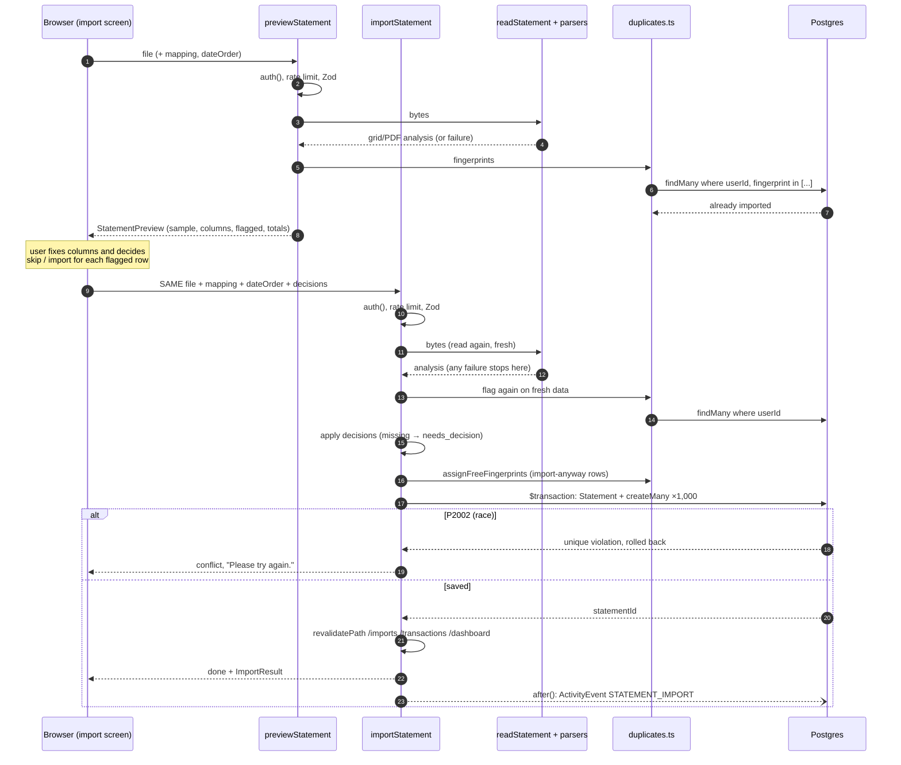
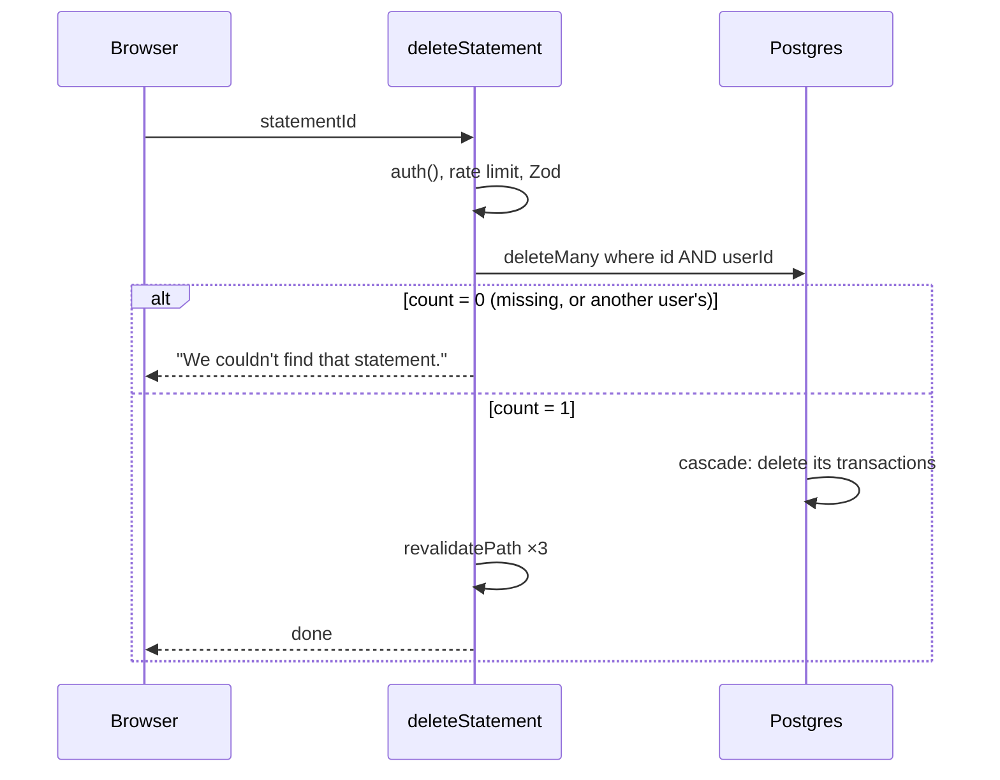

# SpendSense imports: file guide

This guide maps the statement import backend: how an uploaded file becomes saved transactions, how duplicates are handled, and how a statement is listed and deleted. It covers the files added or changed in B8 Phase 1 (on `feat/import-actions`), written from reading the code as it is. The parsers in `src/features/imports/parsers/` were built earlier and aren't changed here; they're summarised in one short section so you know where they fit. "Used by" lists come from searching the codebase for imports. For the big picture first, jump to [How it all connects](#how-it-all-connects), then come back to the files.

Each entry uses the template from `docs/auth/file-guide.md`, plus a **Must never** line: the rules each file exists to protect.

## Contents

**Library (`src/lib/`)**
- [`src/lib/rate-limit.ts` (changed)](#srclibrate-limitts-changed)

**Server helpers (`src/features/imports/server/`)**
- [`server/form-fields.ts`](#serverform-fieldsts)
- [`server/build-preview.ts` (changed)](#serverbuild-previewts-changed)
- [What was already in place](#what-was-already-in-place)

**Queries and actions**
- [`src/features/imports/queries.ts`](#srcfeaturesimportsqueriests)
- [`actions/preview-statement.ts` (changed)](#actionspreview-statementts-changed)
- [`actions/import-statement.ts`](#actionsimport-statementts)
- [`actions/delete-statement.ts`](#actionsdelete-statementts)

**Tests**
- [The four new test files](#the-four-new-test-files)

**Demo data and the dev page**
- [`docs/demo/synthetic-statement.csv`](#docsdemosynthetic-statementcsv)
- [`src/app/dev/import-check/` (temporary)](#srcappdevimport-check-temporary)

**[How it all connects](#how-it-all-connects)**

---

## Library (`src/lib/`)

### `src/lib/rate-limit.ts` (changed)

**What it does:** Counts attempts per key in the `rate_limits` table with one atomic `INSERT … ON CONFLICT` statement, and says whether this attempt is allowed. `LIMITS` holds every limit in the app in one place. Phase 1 added `deleteStatementUser` (20 per hour).

**Runs on:** server only (`server-only`).

**Exports:**
- `LIMITS`: named limits. The import ones are `previewStatementUser` (30/hour), `importStatementUser` (10/hour) and the new `deleteStatementUser` (20/hour).
- `rateLimit(key, limit)`: counts this attempt and returns `{ allowed, remaining, resetAt }`.
- `hashIdentifier`, `deleteExpiredRateLimits`: unchanged.

**Depends on (imports):**
- Internal: `@/lib/db` (the counter table).
- Packages: `node:crypto` (`hashIdentifier`).
- Environment variables read: none.

**Used by (imported by):**
- `src/features/imports/actions/preview-statement.ts`, `import-statement.ts`, `delete-statement.ts` (per-user limits), plus the auth actions (see the auth guide).

**Security notes:** Every action that writes, or does heavy work like parsing a 4 MB file, is capped per user, so one account can't overload the server or the database. Keys are `preview:user:<id>`, `import:user:<id>` and `deletestatement:user:<id>`.

**Must never:** be called with anything from the form as the key; the user id comes from the session.

---

## Server helpers (`src/features/imports/server/`)

### `server/form-fields.ts`

**What it does:** Two tiny helpers that turn raw `FormData` values into something Zod can check. `jsonField` parses a JSON text field; `textField` keeps a non-empty string. They don't validate anything themselves: the caller always runs a Zod schema afterwards. Moved here from `preview-statement.ts` so the preview and import actions read their fields the same way.

**Runs on:** server (plain module; no `server-only` marker, but only imported by server actions).

**Exports:**
- `jsonField(value)`: `undefined` when the field is missing or empty, `null` when it isn't valid JSON (so the schema rejects it), otherwise the parsed value.
- `textField(value)`: the string, or `undefined` when missing, empty or a file.

**Depends on (imports):** none.

**Used by (imported by):**
- `actions/preview-statement.ts` (`mapping`, `dateOrder`)
- `actions/import-statement.ts` (`mapping`, `dateOrder`, `decisions`)

**Security notes:** Returning `null` for bad JSON (instead of throwing) means a malformed field becomes a normal validation error, never a crash.

**Why `undefined` and `null` differ:** `.optional()` schemas accept `undefined` ("not sent"), but reject `null` ("sent, but broken"). That's how "no mapping" and "bad mapping" get different answers.

### `server/build-preview.ts` (changed)

**What it does:** Turns a successful `readStatement` result plus the flagged rows into `StatementPreview`: everything the import dialog shows (file, bank, columns with samples, a 20-row sample, flagged duplicates, row issues, totals) and nothing it doesn't need. Phase 1 only added `export` to `bankNameOf`, so the import action stores the same bank name the preview shows.

**Runs on:** server (pure functions; no database).

**Exports:**
- `buildPreview(read, rows)`: builds the preview. Totals are integer pence; money in and money out are added up separately.
- `bankNameOf(read)` (newly exported): the display name of the detected bank, or `null`.
- `isMappableFailure(failure)`: true for `no_date_column` and `no_amount_column`, the two failures a user can fix by choosing columns.
- Types: `StatementPreview`, `PreviewColumns`, `PreviewColumn`, `PreviewRow`, `FlaggedPreviewRow`, `MappableFailure`.

**Depends on (imports):** types from the parsers, `./duplicates` and `./read-statement` (types only).

**Used by (imported by):**
- `actions/preview-statement.ts` (`buildPreview`, `isMappableFailure`)
- `actions/import-statement.ts` (`bankNameOf`)

**Security notes:** Any column whose header looks like a sort code, account number or IBAN gets `sampleHidden: true` and `sample: null`, so those values never reach the browser.

**Must never:** send a sensitive column's sample to the browser.

### What was already in place

Built before Phase 1 and unchanged (tests pass):

- `parsers/**`: `csv.ts` and `excel.ts` read files into a grid of text cells; `pdf.ts` pulls text out of PDFs with `pdf-parse`; `columns.ts` and `profiles.ts` work out which column is which; `extract.ts`, `money.ts`, `dates.ts` and `normalise.ts` turn rows into `{ date, description, amountMinor }`; `balance.ts` checks running balances; `analyse.ts` and `pdfStatement.ts` decide whether the file reads as a statement; `fingerprint.ts` gives every row a SHA-256 fingerprint (`addFingerprints`, `hashFingerprint`).
- `schemas.ts`: `columnMappingSchema`, `dateOrderSchema`, `duplicateDecisionsSchema` (`{ defaultChoice?, overrides: { [fingerprint]: "skip" | "import" } }`).
- `server/read-statement.ts`: `readStatement` checks size, file name, and that the extension matches the real contents, then reads and analyses. `MAX_FILE_BYTES` is 4 MB.
- `server/duplicates.ts`: `findExistingFingerprints` (which fingerprints this user already has, in batches of 5,000), `flagDuplicates` (marks rows, removes nothing), `assignFreeFingerprints` (finds an unused fingerprint for an "import anyway" row).

---

## Queries and actions

### `src/features/imports/queries.ts`

**What it does:** Database reads for the imports feature. For now one function: the signed-in user's statements, newest first, with only the columns the "Previous imports" list needs.

**Runs on:** server only (`server-only`). Call it from server components inside `<Suspense>`, because it reads the session.

**Exports:**
- `getStatements()` → `Promise<StatementListItem[]>`: `id`, `fileName`, `fileType`, `bankName`, `createdAt`, `importedCount`, `status`, `periodStart`, `periodEnd`. Returns `[]` when signed out.
- `StatementListItem`: the row type.

**Depends on (imports):**
- Internal: `@/lib/session` (`getSession`, one session lookup per request), `@/lib/db`, `@/generated/prisma/client` (enum types).
- Environment variables read: none.

**Used by (imported by):**
- `src/app/dev/import-check/page.tsx` (temporary). The `/imports` page uses it from Phase 3.

**Security notes:** Filtered by `userId` from the session, never from the URL. Selects only the listed columns.

**Must never:** take a user id as an argument, or return another user's rows.

### `actions/preview-statement.ts` (changed)

**What it does:** The first half of an import. Reads the uploaded file, checks it's a bank statement, flags rows matching an earlier upload, and returns a `StatementPreview`. It saves nothing. Phase 1 only moved `jsonField` and `textField` out to `server/form-fields.ts`.

**Runs on:** server action file (`"use server"`). Used with `useActionState` in a client component.

**Exports:**
- `previewStatement(prevState, formData)` → `PreviewState`: `idle`, `error` (`reason`, `message`) or `ready` (`preview`). Fields: `file`, optional `mapping` (JSON), optional `dateOrder` (`dmy` / `mdy`).
- Types: `PreviewState`, `PreviewFailureReason`.

**Depends on (imports):** `@/auth`, `@/lib/rate-limit`, the parsers, `../schemas`, `../server/*`.

**Used by (imported by):**
- `actions/import-statement.ts` (type `PreviewFailureReason` only)
- `src/app/dev/import-check/_components/dev-import-form.tsx` (temporary)

**Security notes:** Auth, then the rate limit, then Zod on every field, then the size check before reading. A file that only needs a column chosen (`no_date_column`, `no_amount_column`) is still previewed, with `columns.needsMapping` set, so the user can fix it. Errors log `error.name` only.

### `actions/import-statement.ts`

**What it does:** The second half of an import. The browser sends the **same file again**, plus the final column choices and a decision for every flagged duplicate. The action re-reads and re-checks everything on fresh data, applies the decisions, and saves one `Statement` and its `Transaction` rows in a single database transaction: all or nothing.

**Runs on:** server action file (`"use server"`). Used with `useActionState` in a client component.

**Exports:**
- `importStatement(prevState, formData)` → `ImportState`: `idle`, `error` (`reason`, `message`) or `done` (`result`).
  - Fields: `file`, optional `mapping` (JSON), optional `dateOrder`, required `decisions` (JSON, `duplicateDecisionsSchema`).
- `ImportResult`: `statementId`, `importedCount`, `duplicateCount` (flagged rows skipped), `skippedCount` (zero-amount rows), `issueCount` (rows that couldn't be read), `categorisedCount` (0 until Phase 2), `needsReviewCount` (= `importedCount` until Phase 2), `periodStart` / `periodEnd` (ISO dates).
- `ImportFailureReason`: every preview reason, plus `needs_decision`, `nothing_to_import` and `conflict`.

**Depends on (imports):**
- Internal: `@/auth` (the user), `@/lib/db`, `@/lib/rate-limit`, `@/generated/prisma/client` (`Prisma` error class), the parsers (`addFingerprints`, `isoDateToUtcDate`), `../schemas`, `../server/duplicates`, `../server/form-fields`, `../server/read-statement`, `../server/build-preview` (`bankNameOf`).
- Packages / Next: `next/cache` (`revalidatePath`), `next/server` (`after`).
- Environment variables read: none.

**Used by (imported by):**
- `src/app/dev/import-check/_components/dev-import-form.tsx` (temporary). The `/imports` and onboarding screens use it from Phase 3.

**The steps, and why each is there:**
1. **Auth.** `userId` from `auth()`. Never from the form.
2. **Rate limit**, `import:user:<id>`, 10 an hour.
3. **Validate** `file`, `mapping`, `dateOrder`, `decisions` with Zod. A missing or malformed `decisions` is `invalid_input`.
4. **Read the file again.** The server holds nothing between preview and import, so it can't trust anything from the earlier preview.
5. **Any statement failure stops the import.** Unlike the preview, `no_date_column` / `no_amount_column` get no pass: by now the user's mapping should have cleared them.
6. **Fingerprint and flag** against the database *now*. If another tab imported the same rows since the preview, they're flagged here.
7. **Apply decisions.** For each flagged row: `overrides[fingerprint]`, else `defaultChoice`. No decision at all → `needs_decision`, and nothing is saved (the action never guesses). `skip` → counted in `duplicateCount`. `import` → `assignFreeFingerprints` gives the row a fingerprint nothing else uses (every fingerprint in the file is reserved), keeping file order. If no free fingerprint is found → `unexpected`.
8. **Nothing left** → `nothing_to_import`, nothing saved.
9. **Save in one `db.$transaction`** (timeout 60 s): create the `Statement` (`COMPLETED`, cleaned file name, file type, bank name, period, counts), then `createMany` transactions in chunks of 1,000. If any step throws, Postgres rolls everything back.
10. **Errors.** Prisma `P2002` (the unique `[userId, fingerprint]` index was hit because two imports raced) → `conflict`, "Please try again." Anything else → log `error.name` only → `unexpected`.
11. **After the response,** `after()` records an `ActivityEvent` of type `STATEMENT_IMPORT`, inside its own `try/catch`, so a failure there never breaks the import.
12. **Refresh** `/imports`, `/transactions` and `/dashboard` with `revalidatePath`, and return `done`.

**Why it's built this way:**
- **Same file twice, not a server-side draft.** Storing the upload between steps would mean storing bank data we promised not to keep. Re-reading is cheap (4 MB cap) and always works on fresh data.
- **Fingerprints, not "delete duplicates".** A repeated row might be real (two identical coffees). Flagging and asking keeps the user in control; the unique index stops accidental double-saves.
- **`revalidatePath` rather than `refresh()`.** User data isn't cached with `"use cache"`, so there's no tag to invalidate. `refresh()` only re-renders the page the user is on. `revalidatePath` also marks the other visited pages (`/transactions`, `/dashboard`) stale, which is what "refresh the imports, transactions and dashboard views" needs.
- **Statement period.** `periodStart` / `periodEnd` cover every dated row in the file, including skipped duplicates: they describe the statement, not just what was newly saved.

**Security notes:** Session-only user id; rate limited; Zod on every field; size checked before reading; every database read and write is scoped to `userId`; only error names are logged.

**Must never:** drop a row with a cost (only zero-amount rows are skipped, and counted); remove a duplicate silently; save part of a statement; store the uploaded file; log descriptions, amounts or parser messages.

### `actions/delete-statement.ts`

**What it does:** Deletes one of the user's statements. Its transactions go with it through the database's cascade rule (`onDelete: Cascade` on `Transaction.statement`).

**Runs on:** server action file (`"use server"`). Used with `useActionState`.

**Exports:**
- `deleteStatement(prevState, formData)` → `DeleteStatementState`: `idle`, `error` (`message`) or `done`. Field: `statementId`.

**Depends on (imports):** `@/auth`, `@/lib/db`, `@/lib/rate-limit`, `zod`, `next/cache` (`revalidatePath`).

**Used by (imported by):**
- `src/app/dev/import-check/_components/dev-import-form.tsx` (temporary). The `/imports` "Previous imports" menu uses it from Phase 3.

**Security notes:**
- **The ownership check and the delete are one statement:** `deleteMany({ where: { id, userId } })`. Another user's statement matches nothing, so `count` is 0. There's no gap between "check" and "delete" for anything to slip through.
- "Not found" and "not yours" get the same message, so the action never reveals that someone else's statement id exists.
- Rate limited (`deletestatement:user:<id>`, 20 an hour). Errors log `error.name` only.

**Must never:** delete by id alone without `userId` in the same `where`.

---

## Tests

### The four new test files

All use invented data. None touch a real database: `db`, `auth` and `rateLimit` are replaced with small fakes using `vi.hoisted` and `vi.mock`, the same way `server/duplicates.test.ts` does. `next/server` (`after`) and `next/cache` (`revalidatePath`) are faked too, so tests can check what ran after the response and which views were refreshed.

- **`server/build-preview.test.ts`** (9 tests): money in and out in pence, row and zero-row counts, date range whatever the file order, the 20-row sample cap, flagged rows (kept in the totals), sort-code and account-number samples hidden, detected column roles, a PDF has no columns.
- **`actions/preview-statement.test.ts`** (10 tests): signed out, rate limited, missing file, three kinds of bad input, wrong file type, not a statement (a PDF shopping list), a file that only needs a column chosen still previews, and the happy path flags only *this user's* earlier rows.
- **`actions/import-statement.test.ts`** (23 tests): every check before reading (signed out, rate limited, missing file, five kinds of bad input, wrong file type, not GBP, mappable failure blocked); saving (exact statement and transaction rows, the 60 s timeout, 2,500 rows → 3 inserts, activity only after the response, views refreshed); duplicates (skip, all skipped saves nothing, missing decision, override beats default, import anyway gets a new fingerprint in file order, other users' rows ignored); database errors (`P2002` → `conflict` with nothing saved, any other error logs only its name, never the message).
- **`actions/delete-statement.test.ts`** (8 tests): own statement deleted and views refreshed, another user's statement can't be deleted, missing id gets the same answer, signed out, rate limited, three bad ids.

The fake `$transaction` keeps rows only if the callback finishes without throwing, the same promise Postgres makes, so "nothing saved" checks are meaningful.

---

## Demo data and the dev page

### `docs/demo/synthetic-statement.csv`

**What it is:** The demo and test statement from here on. 297 invented transactions from May to October 2026: salary, rent, council tax, utilities, subscriptions, groceries, TfL, eating out, shopping, a savings pot transfer, and a few one-offs (a flight, a refund, a cash withdrawal, a tax refund, a donation). Columns `Date,Description,Amount,Balance`, day-first dates, signed amounts, a running balance that checks out.

**Notes:** Merchant names are real UK brands so the Phase 2 rules have something to match; every transaction, amount, the employer and the landlord are invented. It reads with no issues and a consistent balance check. Never replace it with a real statement.

### `src/app/dev/import-check/` (temporary)

**What it does:** A bare dev-only page at `/dev/import-check` for the Phase 1 manual check: upload a file, call `previewStatement` or `importStatement`, and print the raw result; list `getStatements()` with a delete button per statement.

**Files:** `page.tsx` (server component; the statement list sits inside `<Suspense>` because it reads the session) and `_components/dev-import-form.tsx` (client component; two `useActionState` hooks with `formAction` on each button).

**Security notes:** Calls `notFound()` in production builds, so it can't ship by accident. Not linked from anywhere. The actions do their own auth, so a signed-out visitor gets `signed_out`.

**Notes:** Remove in Phase 3, with Elizabette's approval.

---

## How it all connects

### Request flow: upload → preview → import

### Request flow: deleting a statement

### Reading the diagrams

Solid arrows are calls and their answers, top to bottom in time order; the dashed arrow at the end is work that runs after the response has already gone back. `alt` boxes show the two possible outcomes of one step. The key idea in the first diagram is that the browser crosses the network twice with the same file: the server keeps nothing in between, so every check runs again on the second trip.

## Notes for Elizabette

- **Branch name.** The B8 brief names `feat/step4-u7-import-actions`, which doesn't exist; Phase 1 continued on `feat/import-actions`, which already held the earlier import commits.
- **New failure reason `conflict`.** The brief says `P2002` → "Please try again." without naming a `reason`; `conflict` lets the Phase 3 pop-up word it.
- **`assignFreeFingerprints` failing** (no free fingerprint after 50 rounds) returns `unexpected`. It needs more than 50 identical earlier imports of the same row, so it should never happen in practice.
- **Two message constants are duplicated** (`FILE_MESSAGE`, `STATEMENT_MESSAGE`) in `preview-statement.ts` and `import-statement.ts`. A `"use server"` file can only export async functions, so they can't be shared from the preview action. Moving them to a shared module would mean changing the preview file, which the brief didn't ask for.
- **No `/dev` protection in `proxy.ts`.** The dev page relies on `notFound()` in production and on each action's own `auth()`.
- **`getStatements()` callers need `await connection()` first.** Without it, Cache Components tries to prerender the session read and fails with "unstable value `crypto.getRandomValues()` while prerendering". This matches the existing pattern in `settings/page.tsx` and `profile-section.tsx`. The `/imports` page in Phase 3 must do the same.
- **React 19 resets a form after a form action finishes,** which empties a file input. The dev page needs the file chosen again before each button press. The Phase 3 import flow must hold the chosen `File` in state, not rely on the input keeping it.

## Manual check (16 Nov 2026, `next dev` with Turbopack on Windows)

| Check | Result |
|---|---|
| Preview `synthetic-statement.csv` | `ready`: 297 rows, 1 May to 31 Oct 2026, balance consistent, 0 flagged, 0 issues |
| Import it | `done`: 297 imported; statement `COMPLETED`; list refreshed without reload |
| Same file again, preview | all 297 flagged (`matchedBy: "content"`) |
| Import with no decision | `needs_decision`, nothing saved |
| Import with "skip all" | `nothing_to_import`, nothing saved |
| Import with "import all" | `done`: second copy of 297, each with a distinct fingerprint, 0 clashes in the database |
| Database totals | each copy nets 19,248 pence, matching the preview's money in minus money out |
| Activity | one `STATEMENT_IMPORT` event per successful import |
| Delete the second copy | statement and its 297 transactions gone (cascade); first copy untouched |
| Small synthetic Barclays PDF | **`pdf-parse` loaded fine under Turbopack.** Preview `ready` (Barclays, 4 rows, no columns); import `done` |
| Server log | no descriptions, amounts or file contents logged |
