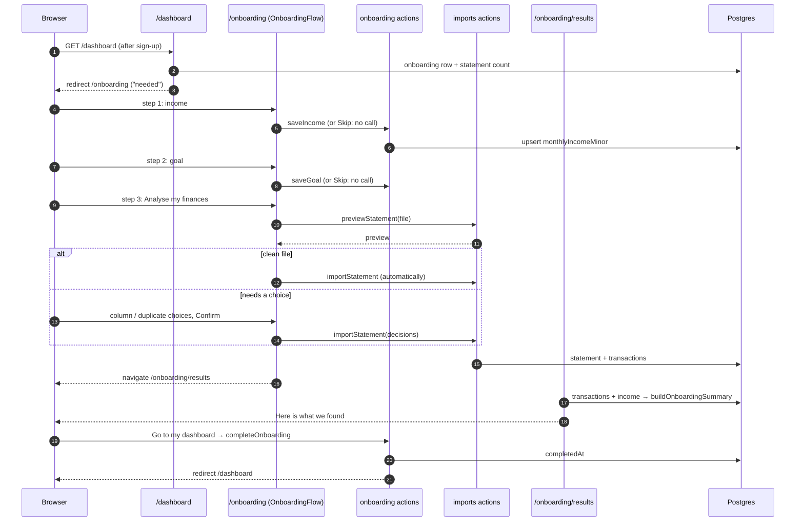

# SpendSense onboarding: file guide

This guide maps every file that takes part in onboarding (B8 Phase 5, branch `feat/onboarding`): the first-run screens a new user sees before the dashboard. Each file has one entry, written from the code as it is. Entries go from the bottom up: database, backend logic, shared pieces, screens, routes. For the big picture first, jump to [How it all connects](#how-it-all-connects).

## Contents

**Database**
- [Migration `add_onboarding`](#migration-add_onboarding)

**Backend (`src/features/onboarding/`)**
- [`goals.ts`](#goalsts)
- [`schemas.ts`](#schemasts)
- [`actions/onboarding.ts`](#actionsonboardingts)
- [`summary.ts`](#summaryts)
- [`queries.ts`](#queriests)
- [`src/lib/rate-limit.ts` (one new limit)](#srclibrate-limitts-one-new-limit)

**Shared statement pieces (`src/components/statement-import/`)**
- [Moved from `features/imports`](#moved-from-featuresimports)
- [`types.ts`](#typests)

**Screens (`src/features/onboarding/components/`)**
- [`onboarding-flow.tsx`](#onboarding-flowtsx)
- [The step screens](#the-step-screens)
- [`results.tsx` and `finish-buttons.tsx`](#resultstsx-and-finish-buttonstsx)
- [`gates.tsx`](#gatestsx)

**Routes**
- [`src/app/onboarding/`](#srcapponboarding)
- [`src/app/(app)/dashboard/page.tsx` (one addition)](#srcappappdashboardpagetsx-one-addition)

**Pictures**
- [How it all connects](#how-it-all-connects)

---

## Database

### Migration `add_onboarding`

**What it does:** Adds the `financial_goal` enum and the `onboarding` table: one row per user holding the answers from steps 1 and 2 and when onboarding was finished.

```sql
-- CreateEnum
CREATE TYPE "financial_goal" AS ENUM ('SAVE_MORE', 'GET_OUT_OF_DEBT', 'UNDERSTAND_SPENDING', 'BUILD_WEALTH');

-- CreateTable
CREATE TABLE "onboarding" (
    "id" TEXT NOT NULL,
    "user_id" TEXT NOT NULL,
    "monthly_income_minor" INTEGER,
    "goal" "financial_goal",
    "completed_at" TIMESTAMP(3),
    "skipped_at" TIMESTAMP(3),
    "created_at" TIMESTAMP(3) NOT NULL DEFAULT CURRENT_TIMESTAMP,
    "updated_at" TIMESTAMP(3) NOT NULL,
    CONSTRAINT "onboarding_pkey" PRIMARY KEY ("id")
);

-- CreateIndex
CREATE UNIQUE INDEX "onboarding_user_id_key" ON "onboarding"("user_id");

-- AddForeignKey
ALTER TABLE "onboarding" ADD CONSTRAINT "onboarding_user_id_fkey" FOREIGN KEY ("user_id") REFERENCES "users"("id") ON DELETE CASCADE ON UPDATE CASCADE;
```

**Why it's built this way:**
- **`user_id` is unique**, so a user can never have two onboarding rows. The actions rely on it to "update if it exists, otherwise create" (`upsert`).
- **Every answer is optional (`NULL`)**, because steps 1 and 2 can be skipped.
- **Money in pence (`monthly_income_minor`)**, like every other amount in the app, so there are no rounding errors.
- **`ON DELETE CASCADE`**: deleting a user deletes their onboarding row too (account deletion keeps working).
- **No earlier draft was used.** The handoff doc lists an `OnboardingProfile` under "drafted, migrate later", but only as a name; with your OK, Phase 5 follows the brief's `Onboarding` model exactly.

---

## Backend (`src/features/onboarding/`)

### `goals.ts`

**What it does:** The four step-2 goals in the design's order: value (matching the enum), title and description.

**Runs on:** both (browser-safe: no imports).

**Exports:** `GOALS`, `GoalValue`, `GOAL_VALUES`.

**Used by:** `schemas.ts` (to check answers), `components/goal-step.tsx` (to show them).

**Must never:** drift from the `FinancialGoal` enum. If you add a goal, add it to the schema and migrate.

### `schemas.ts`

**What it does:** Zod rules for the two answers.

**Exports:**
- `monthlyIncomeSchema`: text in, **pence out**. Removes "£", commas and spaces, then requires whole pounds (digits only) from 0 to `MAX_MONTHLY_INCOME_POUNDS` (£1,000,000; anything higher is almost certainly a typo). "3,200" becomes `320000`. Decimals, negatives and letters are rejected with a message the screen shows.
- `goalSchema`: one of `GOAL_VALUES`.

**Used by:** `actions/onboarding.ts`.

**Tests:** through `actions/onboarding.test.ts`.

### `actions/onboarding.ts`

**What it does:** The four server actions behind the screens. Each one follows the same numbered steps as the other actions in the app: **(1)** who is asking, from the session only; **(2)** rate limit; **(3)** validate with Zod; **(4)** write; **(5)** log only an error's *name* if something fails.

**Runs on:** server (`"use server"`).

**Exports:**
- `saveIncome(prevState, formData)` → `OnboardingActionState`. Reads `monthlyIncome`, saves `monthlyIncomeMinor`.
- `saveGoal(prevState, formData)` → reads `goal`, saves it.
- `skipOnboarding()` sets `skippedAt`, then **redirects to `/dashboard`**.
- `completeOnboarding()` sets `completedAt`, then **redirects to `/dashboard`**.
- `OnboardingActionState`: `idle` | `error` (with a message to show) | `saved`.

**Why it's built this way:**
- **`upsert` on `userId`**: the first save creates the row, later saves update it, so steps can be answered in any order or skipped.
- **Skipping steps 1 and 2 doesn't call the server.** The brief says skipping moves on "without saving", so those are plain buttons.
- **`redirect()` is outside the `try/catch`.** Next's `redirect()` works by throwing a special error. Catching it would stop the redirect.
- **`revalidatePath("/dashboard")`** before redirecting, so the dashboard isn't served from a stale client cache.
- **One rate limit for all four:** `onboarding:user:<id>`, 30 per hour.

**Tests:** `actions/onboarding.test.ts` (28). They cover the accepted and rejected incomes, updating the same row, ignoring a `userId` sent in the form, no session, the rate limit, a failing database (only `TypeError` is logged), and skip and complete setting their date and redirecting (or staying put if the save fails).

**Must never:** take the user id from the form, log the income, or redirect inside the `try`.

### `summary.ts`

**What it does:** `buildOnboardingSummary(rows, answeredIncomeMinor)` works out the numbers on the last screen. Pure: rows in, numbers out, no database.

**Exports:** `buildOnboardingSummary`, types `SummaryRow`, `OnboardingSummary`:
- `month`: the latest month with transactions (the same "current month" as the dashboard).
- `topCategory`: the biggest **categorised** spending category that month, with its amount. Uncategorised spending ("Needs review") never wins.
- `recurring`: `enoughData` (two months or more), `count`, `monthlyTotalMinor`. Uses `detectRecurring` and drops payments already overdue, **exactly as the dashboard does**, so the two screens agree.
- `saving`: saved = income − spending that month; rate = saved ÷ income, as a whole percent (it can be negative). **Income comes from the statement**; only if the statement has no income that month is the step-1 answer used (`incomeFrom: "answer"`, and the screen says so). Null when there's no income at all.
- `noticed`: the top category against the **month before**, as a whole-percent change. Only when both months have data, the category had spending last month, and the change isn't 0%. Otherwise null and the line isn't shown (brief: "only when it can be computed from two months of data").

**Why pure, and why not reuse `features/dashboard/build.ts`:** features can't import each other. The shared definitions (what counts as income or spending, the current month, recurring detection) already live in `src/lib/finance` and `src/lib/recurring`, so both features use them.

**Tests:** `summary.test.ts` (15, together with `onboardingStateFor`).

**Must never:** read the database or the session.

### `queries.ts`

**What it does:** The database reads for onboarding, all for the signed-in user only.

**Runs on:** server only (`server-only`).

**Exports:**
- `onboardingStateFor(record, statementCount)`: the pure rule. **"needed"** means no `completedAt`, no `skippedAt`, **and** no statements. Anything else is "done". Someone who uploaded through `/imports` is never sent back to onboarding.
- `getOnboardingState()` → `"needed" | "done"` (signed out counts as "done": nothing to redirect).
- `hasFinishedOnboarding()`: completed or skipped. Statements don't count here; see `gates.tsx` for why this is separate.
- `getOnboardingSummary()` → `OnboardingSummary | null`: loads the user's transactions and step-1 income, then calls `buildOnboardingSummary`. Null when there are no transactions.

**Security notes:** the `userId` comes from `getSession()`; every query is filtered by it.

**Must never:** accept a user id, or be called outside `<Suspense>`.

### `src/lib/rate-limit.ts` (one new limit)

`onboardingUser: { limit: 30, windowSeconds: 3600 }`, shared by the four onboarding actions.

---

## Shared statement pieces (`src/components/statement-import/`)

### Moved from `features/imports`

Step 3 needs the same column check, duplicate choices and failure pop-up as `/imports` (brief 5.4: "share the components through `src/components/`"). These moved with `git mv`, so their history is kept and nothing was deleted or changed except import paths:

| Now | Was |
| --- | --- |
| `map-step.tsx` | `src/features/imports/components/map-step.tsx` |
| `duplicates-section.tsx` | `src/features/imports/components/duplicates-section.tsx` |
| `failure-copy.ts` | `src/features/imports/components/failure-copy.ts` |
| `file-rules.ts` | `src/features/imports/file-rules.ts` |

`file-rules.test.ts` stays in `features/imports`, because it checks the browser limit against the server's `MAX_FILE_BYTES`. `map-step.tsx` and `duplicates-section.tsx` use `import type` from `@/features/imports/...`. Type imports disappear when the code is compiled, so no imports code is bundled through them.

### `types.ts`

**What it does:** The types a screen outside `/imports` needs to upload a statement: `PreviewAction`, `ImportAction`, `PreviewState`, `ImportState`, `StatementPreview`, `ColumnMappingInput`, `DuplicateDecisions`. Type-only, for the same reason.

**Used by:** `features/onboarding/components/onboarding-flow.tsx`. This keeps onboarding from importing from `features/imports` directly.

---

## Screens (`src/features/onboarding/components/`)

### `onboarding-flow.tsx`

**What it does:** The whole first-run flow on the client: step 1 → step 2 → step 3 → (check) → analysing → `/onboarding/results`.

**Runs on:** browser (`"use client"`).

**Props:** `previewAction`, `importAction`, the imports feature's `previewStatement` and `importStatement`, **passed in by the route** (`src/app/onboarding/page.tsx`). Routes may import from any feature; features may not import each other. Server actions can be passed as props from a server component to a client component.

**How step 3 works:**
1. **Analyse my finances** checks the file in the browser first (type, size, empty), then calls `previewAction`. The "Analysing" screen shows while it runs.
2. **Clean file** (no flagged duplicates, no unreadable rows, no missing column, **and no guessed column or date order**): the state becomes `ready` and an effect calls `importAction` straight away. "Analysing" stays on screen, now with "297 transactions found across 1 statement".
3. **Anything to decide:** the shared `MapStep` (columns, date order, duplicates) inside a wide card, then import on **Confirm**.
4. **Saved:** `router.push("/onboarding/results")`.
5. **Errors:** the same wording (`failureCopy`) and `Dialog` as `/imports`, with the same buttons: Choose another file, Keep editing (after a column change) and Check the file again.

**Accessibility:** focus moves to each new screen's heading. The analysing count is a `role="status"` message. Each stage has hidden "(done)" / "(in progress)" / "(waiting)" text, so colour and icons aren't the only signal.

### The step screens

- **`onboarding-card.tsx`**: the white card (onboarding 1–5 designs): "Step n of 3", **Skip for now →**, the progress bar, the round icon, the heading and the subtitle. `wide` is used for the column check.
- **`income-step.tsx`**: step 1. A labelled field with a "£" prefix, a "Stored securely and never shared" hint and the server's error linked with `aria-describedby`. **The typed value is kept in state**, because React resets a form after submitting, which would wipe it when the server says it's invalid.
- **`goal-step.tsx`**: step 2. A real radio group (`fieldset` + hidden `legend`) styled as cards. Arrow keys move between goals, the focus ring shows on the card, and borders use `foreground-subtle` for 3:1 contrast.
- **`upload-card.tsx`**: step 3. Drop zone, "or click to browse", "CSV, Excel or PDF · Max 4 MB", the chosen file's name, and **Analyse my finances**. Without a file, the button opens the file picker. **Skip for now** is a form that calls `skipOnboarding`.
- **`analysing-step.tsx`**: onboarding 4. The server reads and saves the statement in one request and can't report progress, so the four stages move on with time. **The last stage stays "in progress" until the import really finishes.** Spinners stop for people who turn on "reduce motion".
- **`icons.tsx`**, **`onboarding-skeleton.tsx`**: decorative icons; the loading card.

### `results.tsx` and `finish-buttons.tsx`

**What it does:** onboarding 5, "Here is what we found", built from `OnboardingSummary`:
- **Top category** (brief: not the image's "Parsing transactions"): the name and "£950.00 in October 2026", or "Not sorted yet".
- **Recurring payments**: "11 detected" and "£1,353.50/month committed", or "Not enough data yet" with one month of data.
- **Saving rate**: "17%" and "£420.16 saved" (or "… more out than in"), or "Not available".
- **SpendSense noticed**: factual only, for example "your Groceries spending in October 2026 was 23% higher than in September 2026". No suggestion is added, because the app doesn't give advice.
- **Ask the AI advisor**: disabled, with a "Coming soon" label inside the button.
- **Go to my dashboard** calls `completeOnboarding`.

### `gates.tsx`

**What it does:** The three server-side checks that send people to the right place. Each calls `connection()` first and sits inside `<Suspense>`.
- `SendToOnboardingIfNeeded` (on `/dashboard`): "needed" → `/onboarding`.
- `OnboardingOnlyIfNeeded` (on `/onboarding`): "done" and finished → `/dashboard`. "Done" only because there's now a statement → **`/onboarding/results`**.
- `OnboardingResultsPage` (on `/onboarding/results`): finished → `/dashboard`; no transactions → `/onboarding`; otherwise the results.

**Why the results have their own route, and why the second rule exists:** the moment the step-3 import saves, the user has a statement, so by the brief's rule they're "done". The import action calls `revalidatePath`, and the Next docs (`revalidatePath`, "Server Functions") note this also refreshes pages. In testing, that re-rendered `/onboarding`, which sent the user to `/dashboard` and **skipped their results**. Now that re-render lands them on `/onboarding/results`, and a page reload there still shows the results. Only **Go to my dashboard** or **Skip** marks onboarding finished.

---

## Routes

### `src/app/onboarding/`

- **`layout.tsx`**: outside the app shell (no sidebar). It uses the landing page's `SiteHeader` with **Sign out**, not "Log in / Get started" (brief 5.4), plus `RequireSession` and `StaleSessionGuard`, like the app area. `/onboarding` was already in the proxy's protected list.
- **`page.tsx`**: `/onboarding`. `OnboardingOnlyIfNeeded` around `OnboardingFlow`, which receives the two imports actions.
- **`results/page.tsx`**: `/onboarding/results`.

### `src/app/(app)/dashboard/page.tsx` (one addition)

A `<Suspense fallback={null}>` with `SendToOnboardingIfNeeded`. It's done in the page, not in `src/proxy.ts`, as the brief says: the proxy has no database access.

---

## How it all connects

### Request flow: a new user's onboarding



### Reading the diagram

Arrows are calls and answers, top to bottom in time order. The statement never goes to the onboarding actions: onboarding only ever stores the two answers and the finish dates. Reading and saving the file is the same imports code `/imports` uses. Skipping step 3 replaces steps 9–20 with `skipOnboarding` → `skippedAt` → `/dashboard` (empty state).

## Notes for Elizabette

- **Checked in the browser** with a throwaway local account (`…@example.test`; its email was marked verified directly in the local database, because a fake address can't receive the verification email):
  - sign-up → dashboard → onboarding;
  - income rejected then kept, then saved as pence;
  - goal by mouse and keyboard;
  - both skips;
  - demo CSV → Analysing ("297 transactions found across 1 statement") → results;
  - Go to my dashboard;
  - Skip on step 3 → empty dashboard;
  - your own account is never sent to onboarding;
  - steps 1–3 at 320px with no sideways scroll, and in dark mode;
  - `/imports` still reaches the column step with the moved components.
- **Copy changed from the images:**
  - Step 1 and 2 subtitles no longer promise "advice" or a personalised "AI advisor": the app doesn't give advice, and the advisor isn't built yet.
  - Step 3 says "CSV, Excel or PDF · Max 4 MB" (brief), not "CSV, PDF · Max 10MB".
  - The results subtitle names the month ("first insights for October 2026") instead of "Your June statement", because one file can cover several months.
  - The noticed line drops "Want to know how to bring it down?".
- **Stricter than the brief's "clean":** a column or date order the reader only *guessed* also shows the check, because importing a wrong guess could put every date in the wrong month.
- **The analysing stages move on a timer.** The server can't report real progress during one request, so only the last stage waits for the real result.
